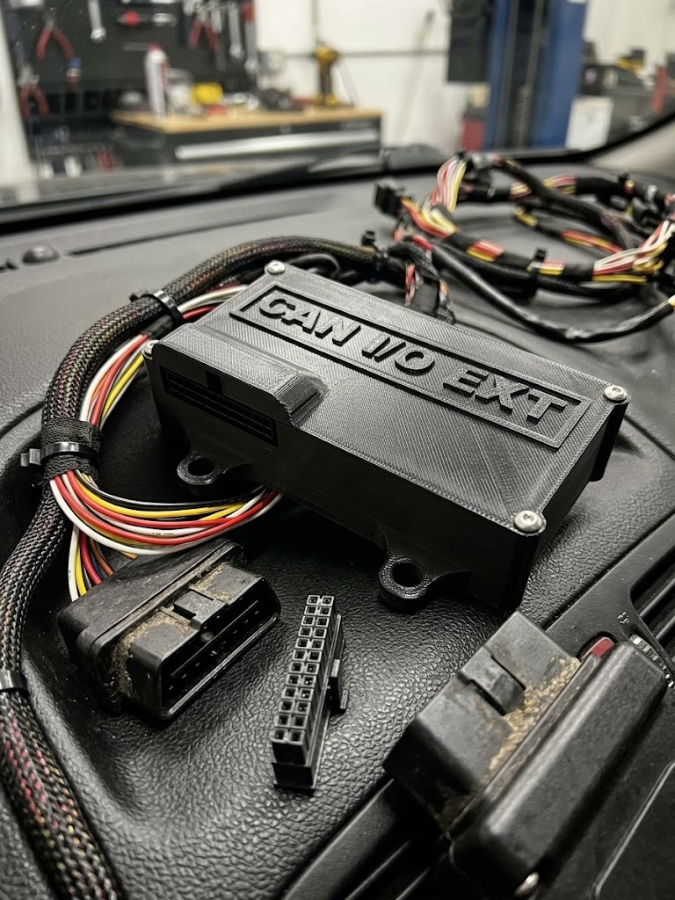
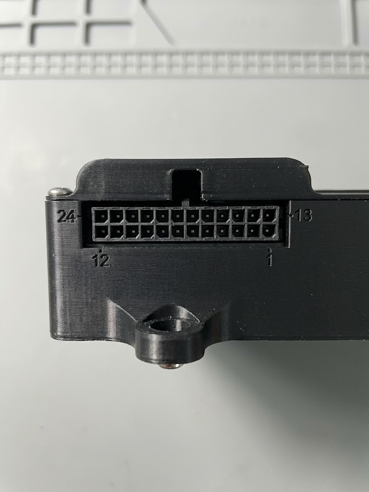
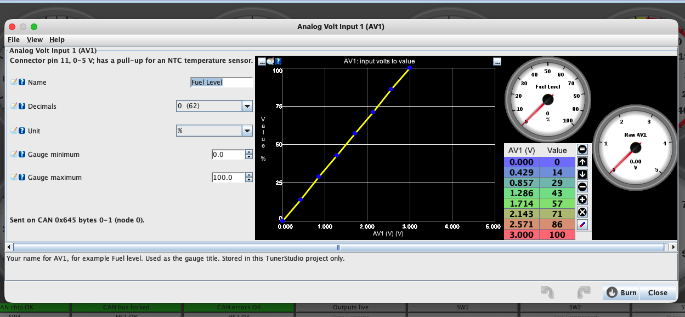
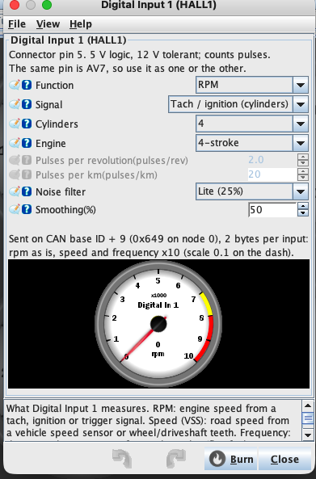

# CAN IO Extender

## Overview



The CAN IO Extender adds **inputs and outputs** to the Racedash over the same CAN
bus as the ECU. The module reads sensors and switches the ECU does not know about,
such as turn signals, handbrake, high beam, an extra oil pressure sensor, a clutch
switch or a wheel speed sensor, and broadcasts them as CAN frames the dash can
read. In the other direction, the dash can switch the module's outputs on to drive
relays, pumps, fans or solenoids.

There are two ways to use it:

- **Vehicles with a CAN-equipped ECU**: the module adds inputs and outputs the
  ECU does not have. ECU data is still read as usual.
- **Vehicles without a CAN bus**: for example a carbureted engine or an older ECU
  without CAN. The module becomes the dash's only data source through the
  [M-Link](#vehicles-without-a-can-bus-m-link-protocol) protocol: it reads
  analog, digital and RPM signals directly from the vehicle and sends them to the
  dash over CAN.

The bus bitrate is detected automatically. The function of each pin is chosen at
installation to suit the vehicle, and sensor calibration is set in
[TunerStudio](#sensor-calibration-in-tunerstudio).

| Capability | Count | Description |
| :--- | :---: | :--- |
| Analog input | 11 | One is used for battery voltage; five of them (AV1–AV5) have a 2.7 kΩ pull-up for NTC sensors |
| Switch input 12 V | 4 | For turn signals and OEM indicator lamps; share pins with some of the analog inputs |
| Digital input (HALL) | 4 | RPM, VSS, frequency, or active-ground switch (clutch, launch control); share pins with some of the analog inputs |
| Low-side output | 5 + 2 | Five low-current for relays, two high-current for solenoids (PWM) |
| High-side output | 2 | Support PWM and report faults |
| Logic output | 2 | 5 V or 12 V signal output |

Seven outputs are available at the same time on the main connector; two more share
pins with the logic outputs.

## Main Connector (J2)

All vehicle wiring enters through a single **Molex Micro-Fit 3.0, 24-pin
(2 rows × 12)** connector.

| | Molex part number |
| :--- | :--- |
| Header on the board | 43045-2400 |
| Cable connector (mating part) | 43025-2400, with Micro-Fit 3.0 female crimp terminals |



Seen from the front of the module with the **locking latch** (the small tab at the
top center of the connector) facing up, **pin 1 is at the bottom right**.
The bottom row holds pins 1–12 from right to left, and the top row holds pins 13–24
from right to left. The cable connector, seen from the wire entry side with the
locking latch on top, uses the same layout.

<table class="pin-grid">
<tr><th></th><th colspan="12" align="center">▼ locking latch ▼</th></tr>
<tr><th>Top</th><td align="center"><b>24</b><br>12V</td><td align="center"><b>23</b><br>LC1</td><td align="center"><b>22</b><br>LC2</td><td align="center"><b>21</b><br>HS1</td><td align="center"><b>20</b><br>LC3</td><td align="center"><b>19</b><br>OUT4</td><td align="center"><b>18</b><br>HS2</td><td align="center"><b>17</b><br>OUT5</td><td align="center"><b>16</b><br>LS2</td><td align="center"><b>15</b><br>LS1</td><td align="center"><b>14</b><br>CAN H</td><td align="center"><b>13</b><br>CAN L</td></tr>
<tr><th>Bottom</th><td align="center"><b>12</b><br>GND</td><td align="center"><b>11</b><br>A1</td><td align="center"><b>10</b><br>A2</td><td align="center"><b>9</b><br>A3</td><td align="center"><b>8</b><br>A4</td><td align="center"><b>7</b><br>A5</td><td align="center"><b>6</b><br>A6</td><td align="center"><b>5</b><br>A7</td><td align="center"><b>4</b><br>A8</td><td align="center"><b>3</b><br>A9</td><td align="center"><b>2</b><br>A10</td><td align="center"><b>1</b><br>—</td></tr>
</table>

| Pin | Function | Pin | Function |
| :---: | :--- | :---: | :--- |
| 1 | Not used | 13 | CAN L |
| 2 | Input: A10 or HALL4 | 14 | CAN H |
| 3 | Input: A9 or HALL3 | 15 | Output LS1 (low-side, high current) |
| 4 | Input: A8 or HALL2 | 16 | Output LS2 (low-side, high current) |
| 5 | Input: A7 or HALL1 | 17 | Output LC5 **or** LOGIC2 |
| 6 | Input: A6 or SW4 | 18 | Output HS2 (high-side) |
| 7 | Input: A5 (NTC pull-up) or SW3 | 19 | Output LC4 **or** LOGIC1 |
| 8 | Input: A4 (NTC pull-up) or SW2 | 20 | Output LC3 (low-side) |
| 9 | Input: A3 (NTC pull-up) or SW1 | 21 | Output HS1 (high-side) |
| 10 | Input: A2 (NTC pull-up) | 22 | Output LC2 (low-side) |
| 11 | Input: A1 (NTC pull-up) | 23 | Output LC1 (low-side) |
| 12 | Ground | 24 | Switched 12 V (ignition) |

Each pin group is explained in the [Power](#power-can-and-termination),
[Inputs](#inputs) and [Outputs](#outputs) sections below.

## Power, CAN, and Termination

| Connector pin | Function |
| :--- | :--- |
| J2-24 | Switched 12 V (ignition) |
| J2-12 | Ground |
| J2-14 | CAN H |
| J2-13 | CAN L |

A separate 4-pin CAN + power header (J12) is also available as an alternative.

**Termination:** the module has a 120 Ω resistor that can be enabled on the board.
Enable it **only if this module sits at one end of the bus**. A CAN bus needs
exactly two terminators, and adding a third makes communication fail. With all
power off, the correct resistance between CAN H and CAN L is about 60 Ω (see
[Check CAN termination with a multimeter](setting-ecu-racedash.md#checking-can-termination-with-a-multimeter)).

## Inputs

Eight input pins have a selectable function, and two more are analog only.

| Connector pin | Can be used as |
| :--- | :--- |
| J2-9 | Analog input (A3, NTC pull-up) **or** 12 V switch input (SW1) |
| J2-8 | Analog input (A4, NTC pull-up) **or** 12 V switch input (SW2) |
| J2-7 | Analog input (A5, NTC pull-up) **or** 12 V switch input (SW3) |
| J2-6 | Analog input (A6) **or** 12 V switch input (SW4) |
| J2-5 | Analog input (A7) **or** Hall / frequency input (HALL1) |
| J2-4 | Analog input (A8) **or** Hall / frequency input (HALL2) |
| J2-3 | Analog input (A9) **or** Hall / frequency input (HALL3) |
| J2-2 | Analog input (A10) **or** Hall / frequency input (HALL4) |
| J2-11 | Analog input (A1, NTC pull-up) |
| J2-10 | Analog input (A2, NTC pull-up) |

**AV1–AV5** (J2-11, J2-10, J2-9, J2-8, J2-7) have a **2.7 kΩ pull-up resistor to
5 V**, which is the bias NTC temperature sensors need, such as Coolant
Temperature (CLT), Intake Air Temperature (IAT) or Oil Temperature. When nothing
is connected, these inputs read close to 5 V.

To fill in the NTC curve in TunerStudio, calculate the voltage at each point from
the sensor's resistance table:

> volt = 5 × R ÷ (R + 2700), where R = sensor resistance (ohm) at that temperature

Example: a 2,500 Ω sensor at 20 °C → 5 × 2500 ÷ 5200 = **2.40 V**.

Sensors that output their own 0–5 V voltage, such as an Oil Pressure sensor, are
best connected to **AV6–AV10**, which have no pull-up, so the signal is not pulled
up as well.

**SW1–SW4 are 12 V switch inputs** (12 V tolerant), for 12 V signals from the car's
electrical system: left/right turn signals, high beam, handbrake and other OEM
indicator lamps.

**Digital Input 1–4 (HALL1–HALL4)** read 5 V logic, tolerate 12 V, and already have
a 1 kΩ pull-up to 5 V. Their function is chosen in TunerStudio:

- **Pulse signal**: RPM from a tachometer or ignition signal, VSS (Vehicle Speed
  Sensor), wheel speed sensor, or raw frequency (flex fuel sensor,
  flow meter).
- **Switch**: an on/off switch, with **Polarity**:
    - **Default**: active when the pin is HIGH, for example a 12 V signal from the
      head light or park light.
    - **Inverted**: active when the pin is grounded, for active-ground switches such
      as a clutch switch or launch control switch. Just connect it to ground, no
      extra resistor needed.

## Outputs

| Output | Connector pin | Type | Description |
| :--- | :--- | :--- | :--- |
| LC1 | J2-23 | Low-side, low current | For relays: light relay, engine start relay, fan relay |
| LC2 | J2-22 | Low-side, low current | |
| LC3 | J2-20 | Low-side, low current | |
| LC4 | J2-19 | Low-side, low current | This pin is used for LC4 **or** LOGIC1 |
| LC5 | J2-17 | Low-side, low current | This pin is used for LC5 **or** LOGIC2 |
| LS1 | J2-15 | Low-side, high current | For solenoids; software PWM |
| LS2 | J2-16 | Low-side, high current | For solenoids; software PWM |
| HS1 | J2-21 | **High-side** | Hardware PWM, reports faults |
| HS2 | J2-18 | **High-side** | Hardware PWM, reports faults |

**This is the most common wiring mistake:** a **low-side** output switches the
**ground** side, so the other end of the load must go to 12 V. A **high-side**
output supplies 12 V instead, so the other end of the load must go to ground. Mix
them up and the load will not work.

**PWM** is available on HS1, HS2, LS1 and LS2; the other outputs are on/off only.
The frequency is set in TunerStudio, on each output's page:

| Output | PWM type | Frequency |
| :--- | :--- | :--- |
| HS1, HS2 | Hardware | **One frequency for both** (one timer): changing it on HS1 also changes HS2. 4–500 Hz, default 490 Hz |
| LS1, LS2 | Software | **Each set separately.** 4–500 Hz, default 100 Hz |

The maximum is **500 Hz**. Solenoids are usually run at 15–300 Hz (boost control
around 15–30 Hz, idle valve and fan around 100–300 Hz). On LS, pulses shorter than
0.1 ms are rounded to fully off or fully on, so at 500 Hz the usable duty is 5–95%.

**Logic outputs** (LOGIC1 and LOGIC2) are signal outputs, not coil drivers.
Their voltage can be set to **5 V or 12 V** at installation. Both use the same pins
as LC4 and LC5, so choose one function per pin.

!!! danger "Outputs switch off by themselves when commands stop"
    All outputs are switched off if no command from the dash is received for
    **500 ms**, and the module always powers up with all outputs off. So if the
    dash shuts down or the CAN wire comes loose, a pump or solenoid will not stay
    on. This is normal, not a fault.

## Using with Racedash Pro (M4, M5, M7)

Works right away without changing firmware, **alongside the ECU protocol that is
currently active**.

!!! tip "CAN ID: hexadecimal or decimal"
    This page writes CAN IDs in hexadecimal, for example `0x643`. Some software,
    such as rusEFI and TunerStudio, shows the same number in decimal:
    `0x643` = `1603`.

    In DashTune, choose the display format in **Settings → CAN ID format**. This
    choice also applies in the Switch Panel editor on the dash screen. Below every
    CAN ID field, DashTune shows the equivalent, for example "= 1603 (decimal)".
    A number that starts with `0x` is always read as hexadecimal, whichever option
    is selected.

### Vehicles without a CAN bus: M-Link protocol

Select the **M-Link** (Mazduino Link) ECU protocol when the vehicle does not use a
CAN bus yet. M-Link is available on Racedash Pro M4, M5 and M7. The CAN IO Extender
then replaces the ECU as the dash's data source: the module reads signals from the
vehicle and sends them to the dash over CAN.

| What the module reads | Examples | Connected to |
| :--- | :--- | :--- |
| **Analog** | Coolant Temperature (CLT), Intake Air Temperature (IAT), Oil Pressure, Fuel Level | AV1–AV10 |
| **12 V switch** | Left/right turn signals, high beam, handbrake, OEM indicator lamps | SW1–SW4 |
| **Pulse signal** | RPM from a tachometer or ignition signal, VSS | Digital Input 1–4 |
| **Active-ground switch** | Clutch switch, launch control switch | Digital Input 1–4 |

**Installation steps:**

1. Connect the module's CAN H and CAN L to the dash, and make sure the bus has two
   120 Ω terminators (see [Power, CAN, and Termination](#power-can-and-termination)).
2. On the dash, open **Setting → CAN → ECU protocol → M-Link**, or in DashTune
   **General Setting → ECU → M-Link**. The bitrate is 500 kbps and the dash sends
   an "alive" signal to the module every 100 ms, so the module locks onto the bus
   right away.
3. Calibrate the sensors in [TunerStudio](#sensor-calibration-in-tunerstudio). For
   RPM, set **Digital Input 1** to Function **RPM** with the engine's number of
   cylinders. A raw ignition coil signal must go through a tach adapter first.
4. In DashTune, run the **CAN IO Extender** preset (see
   [Additional sensor values](#additional-sensor-values)) for the other sensors.

**Read right away with no setup:** RPM from Digital Input 1, battery voltage, and
the indicator lamps from the table below.

**Other sensors feed the dash's built-in gauges** through the preset: for each
input, choose **Also fill built-in gauge**, for example AV1 → **CLT**, AV2 → **IAT**,
Digital Input 2 → **Speed**. The dash's built-in gauges, warnings and shift light
then read the values from the module just as they would from a regular ECU.

!!! warning "Digital Input 1 is used for RPM and head light"
    In M-Link, the dash reads **RPM** from Digital Input 1 and the **head light**
    from the same pin (J2-5). If J2-5 is used for the RPM signal, the head light
    indicator on the dash flickers along with it. In DashTune open **General
    Setting → Indicators**, then change the head light source to another input or
    turn it off.

### Indicator lamps from the vehicle's switches

In DashTune, open the indicator settings, select **CAN bit** mode, then fill in:

| Lamp | CAN ID | Byte | Bit | Connect to |
| :--- | :--- | :---: | :---: | :--- |
| Turn left | `0x643` | 0 | 0 | J2-9 |
| Turn right | `0x643` | 0 | 1 | J2-8 |
| High beam | `0x643` | 0 | 2 | J2-7 |
| Handbrake | `0x643` | 0 | 3 | J2-6 |
| Head light | `0x643` | 0 | 4 | J2-5 |
| Park light | `0x643` | 0 | 5 | J2-4 |

J2-9 to J2-6 must be set up as **12 V switch inputs** (SW1–SW4).
J2-5 and J2-4 are Digital Input 1 and 2: in TunerStudio set their Function to
**Switch**, Polarity **Default**. In DashTune, leave the invert option
(**Active low**) off, because the module already reports 1 = active.

### Additional sensor values

Sensors on AV1–AV10 are shown through **Custom Channels** in DashTune. Custom
Channels ride on top of the active ECU protocol, so ECU data is still read as usual.

The easiest way: in DashTune open **Custom Channels**, tap **CAN IO Extender**,
select the module's node number, then tick the inputs you want to show. For each
input choose:

- **Calibrated**: the value from the curve set in
  [TunerStudio](#sensor-calibration-in-tunerstudio), for example fuel % or bar.
  Choose the same number of decimals as set in TunerStudio.
- **Volts**: the raw input voltage, for linear sensors or just to check the
  wiring.

Enable **Also set the lamps** to map turn signals, high beam, handbrake, head light
and park light in one go (table above).

If the module stops sending (CAN wire loose or module off), the values change to
**"--"** after about 1.5 seconds, without triggering a warning. The dash will not
show the last number as if it were still live.

!!! note "Custom Channels are saved per ECU protocol"
    This setting is tied to the ECU protocol that was active when it was saved. If
    the ECU protocol on the dash is changed, run the CAN IO Extender preset again
    in the new protocol.

To fill in Custom Channels manually, use the frame list in
[Data Sent by the Module](#data-sent-by-the-module) as the reference for CAN ID,
byte position and scale.

### Switching outputs on

Outputs are switched on through the **Switch Panel** (formerly called CAN Buttons):
one switch per output, set up in DashTune or directly on the dash screen. All
switches use the same CAN ID, `0x648` (decimal **1608**), and must be of type
**SWITCH** (formerly Toggle). While a switch is ON, the dash keeps resending its
command. A PUSH switch (formerly Momentary) sends only once, so the output switches
off again after 500 ms.

On the latest Racedash Pro firmware, every switch starts OFF each time the dash is
powered up, so the outputs are also off until their switch is pressed again. If an
output must come on as soon as the dash powers up, enable **Stay ON after
power-off** on its switch in DashTune (see
[Switch Panel](mazduino-racedash-pro.md#switch-panel)).

| Output | Byte | ON value |
| :--- | :---: | :---: |
| LC1 | 0 | 1 |
| LC2 | 0 | 2 |
| LC3 | 0 | 4 |
| LC4 | 0 | 8 |
| LC5 | 0 | 16 |
| LS1 | 0 | 32 |
| LS2 | 0 | 64 |
| HS1 | 1 | 1 |
| HS2 | 1 | 2 |
| LOGIC1 | 1 | 4 |
| LOGIC2 | 1 | 8 |

Set the **OFF value to 0** for every switch. Several switches can share the same
byte; the dash combines them, so LC1 and LS1 can be on at the same time.

HS1, HS2, LS1 and LS2 switch fully on right away. For PWM, add one more switch of
type SWITCH at byte **2** (HS1), **3** (HS2), **4** (LS1) or **5** (LS2),
with an ON value of 1–254 as the
duty, for example 128 for about 50%. While that duty switch is OFF, the output
goes back to fully on.

!!! note "Requires the latest firmware"
    The method above requires the latest Racedash firmware and CAN IO Extender
    firmware. On older firmware, switches in the same byte overwrite each other,
    and the module ignores commands shorter than 4 bytes.

## Using with Racedash 3.5" and 4"

!!! warning "Cannot be used together with an ECU protocol"
    On these variants, the module is only read when the dash protocol is set to
    **Custom**, and Custom mode replaces the built-in ECU decoder. This means the
    dash can read **this module or the ECU**, not both at once. If you need both,
    use the Racedash Pro.

Steps: set the dash protocol to **Custom**, match the bitrate to the bus, then
build the channels in DashTune. All values are **little-endian**, so leave the
**MSB first (Motorola)** option off.

If you use the Custom CAN map for other purposes, do not use CAN IDs
`0x640`–`0x67F` (decimal 1600–1663), to avoid clashing with this module.

## Sensor Calibration in TunerStudio

The module can be connected to **TunerStudio** over its USB cable, like an ECU.
From there, each input AV1–AV10 can be given a calibration curve, and the node
number and CAN bitrate can be changed without reflashing.

1. Download the `can-io-extender-vX.Y.Z.zip` file from the
   [Releases](https://github.com/mazduino/can-io-extender/releases) page, then
   extract it. The INI file is in the `tunerstudio/` folder.
2. In TunerStudio create a new project, select ECU definition **Other / Browse**,
   then point it to the `mazduino-iox.ini` file.
3. Select the module's USB port with baud **115200**, then connect.

**Filling in the curve**: open the **Analog Volt Inputs → AV1** menu (and so on):



- **Name**: the input's name, for example "Fuel level". Used as the gauge title.
- **Decimals** and **Unit**: how the value is displayed. Decimals also set the
  scale on the dash: 1 decimal means scale `0.1`.
- **Curve**: enter voltages starting from the lowest, and the value at each voltage.
  At least two rows; empty rows below them are ignored. A curve that is all zeros
  means the input is not calibrated.
- The **Raw AV1** gauge next to the curve shows the current voltage, so curve points
  can be taken directly while changing the sensor's condition (for example filling
  the tank in steps).

Press **Burn** to save the curve to the module. The **?** icon on each field holds a
short explanation.

**Digital Input (RPM, VSS, frequency, switch)**: open the **Digital Inputs →
Digital Input 1** menu (and so on). Digital Input 1–4 are pins HALL1–HALL4 on the
connector.



- **Function**: **RPM** (engine speed), **Speed (VSS)** (vehicle speed),
  **Frequency** (raw frequency, for example a flow meter), or **Switch**.
- **Polarity** (Switch only): **Inverted** for a switch to ground such as a
  clutch switch or launch control switch, or **Default**
  for a 12 V signal such as the head light. The value is 1 when active.
- **Signal** (RPM only): **Tach / ignition (cylinders)** for a tachometer or
  ignition signal; fill in **Cylinders** and **Engine** (2-stroke or
  4-stroke). Or **Custom pulses per rev** for a trigger wheel; fill in the number
  of pulses per revolution.
- **Pulses per km** (Speed only): the number of speed sensor pulses per kilometer.
- **Noise filter**: ignores false pulses from a ringing signal, for example the
  output of a tach adapter. **Lite** is enough for most signals.
- **Smoothing**: damps jumping numbers; the higher it is, the smoother, but the
  slower it follows changes.

The gauge below shows the current value. The result is sent on CAN
`0x649` (node 0): RPM as is, speed and frequency multiplied by 10, switch 0
or 1. Press
**Burn** to save.

**Node and CAN**: menu **Module → Node and CAN bus**:

- **Node number**: see [Using Two Modules](#using-two-modules).
- **Bitrate**: **Auto detect** (recommended) or a fixed bitrate. A fixed bitrate
  starts sending right away without listening to the bus first, so choose it only
  when you are sure it matches the bus.

On the TunerStudio front page, the **CAN CHIP NOT FOUND**, **NO CAN BUS**
and **CAN ERROR PASSIVE** indicators light red when there is a problem on the CAN
side.

## Data Sent by the Module

The CAN IDs below apply to the module at node 0. All values are **little-endian**.

| CAN ID | Decimal | Content |
| :--- | :--- | :--- |
| `0x640` | 1600 | Battery voltage, then AV1, AV2, AV3 (mV) |
| `0x641` | 1601 | AV4, AV5, AV6, AV7 (mV) |
| `0x642` | 1602 | AV8, AV9, AV10 (mV) |
| `0x643` | 1603 | Digital input status, diagnostics, output status |
| `0x644` | 1604 | Frequency HALL1–HALL4 |
| `0x645` | 1605 | AV1–AV4 calibrated |
| `0x646` | 1606 | AV5–AV8 calibrated |
| `0x647` | 1607 | AV9–AV10 calibrated |

Frames are sent as soon as a value changes (at most every 25 ms) and are still
repeated at least every 200 ms when nothing changes (the digital frame every
500 ms, the frequency frame every 50 ms).

**Analog frames** (`0x640`–`0x642`) hold four consecutive `uint16` values, in
**millivolts**. Battery voltage is already multiplied by its divider factor, so the
number `13800` means 13.8 V. To display it in volts, use scale `0.001`.

**Digital frame** (`0x643`):

| Byte | Content |
| :---: | :--- |
| 0 | bit 0–3 = SW1–SW4, bit 4–7 = HALL1–HALL4 |
| 1 | bit 0–1 = high-side output fault |
| 2–3 | status of the outputs that are actually on |
| 4 | bit 0 = failsafe active, bit 1 = bitrate locked |
| 5–6 | uptime in seconds |
| 7 | firmware version and node number |

**Frequency frame** (`0x644`) holds four `uint16` values in units of 0.1 Hz;
multiply by `0.1` to get Hz.

**Calibrated frames** (`0x645`–`0x647`) hold **signed** `int16` values, two
bytes per input: `0x645` byte 0–1 = AV1, byte 2–3 = AV2, byte 4–5 = AV3,
byte 6–7 = AV4, and so on. The value is the TunerStudio curve result without the
decimal point: with 1 decimal, the value 62.5 is sent as `625`, so use scale
`0.1`. An input without a curve reads 0.

## Using Two Modules

One bus can hold up to **four** modules. Each module must use a different node
number. Set it in TunerStudio (**Module → Node and CAN bus**, then Burn), or
flash the [firmware file](#firmware) for that node. The node number shifts its
CAN ID block:

| Node | CAN ID block | Decimal |
| :---: | :--- | :--- |
| 0 | `0x640`–`0x64F` | 1600–1615 |
| 1 | `0x650`–`0x65F` | 1616–1631 |
| 2 | `0x660`–`0x66F` | 1632–1647 |
| 3 | `0x670`–`0x67F` | 1648–1663 |

## Firmware

The module ships with firmware for **node 0** already installed. Reflashing is only
needed to update the firmware, or for the second and further modules on the same
bus ([Using Two Modules](#using-two-modules)).

### Download

Download the `can-io-extender-vX.Y.Z.zip` file from
**[github.com/mazduino/can-io-extender/releases](https://github.com/mazduino/can-io-extender/releases)**,
then extract it. It contains:

| Folder | Content |
| :--- | :--- |
| `hex/` | `.hex` firmware for XLoader / avrdude |
| `bin/` | The same firmware in `.bin` format |
| `tunerstudio/` | `mazduino-iox.ini`, must come from the same zip as its firmware |

The firmware file name states its node number:

| File | Used for |
| :--- | :--- |
| `can-io-extender-8mhz-node0.hex` | First module (factory default) |
| `can-io-extender-8mhz-node1.hex` | Second module |
| `can-io-extender-8mhz-node2.hex` | Third module |
| `can-io-extender-8mhz-node3.hex` | Fourth module |

Use the files ending in `8mhz`. The `16mhz` files are only for modified boards,
and only to be used when the Mazduino team directs you to them.

### Flash

This module is based on the Arduino Mega 2560 and is flashed over its USB cable.

!!! warning "Disconnect 12 V before connecting USB"
    Unplug the main connector (J2) or turn the ignition off first. The board is
    powered from USB during flashing.

**With the flash script (build from source).** The `flash.bat` (Windows) and
`flash.sh` (macOS/Linux) scripts are in the firmware source code. The script builds
the firmware for the chosen node number, then uploads it straight over USB.

1. Download the source code from
   [github.com/mazduino/can-io-extender](https://github.com/mazduino/can-io-extender)
   (**Code → Download ZIP**), then extract it.
2. Install [PlatformIO](https://platformio.org/install/cli):
   `pip install platformio`.
3. Run it from the extracted folder, with the node number as the argument:
    - **Windows:** `flash.bat` for node 0, or `flash.bat 1 COM5` for node
      1 on port COM5.
    - **macOS / Linux:** `./flash.sh` for node 0, or `./flash.sh 1` for
      node 1. The port is found automatically.

To flash a ready-made `.hex` file without building:

**Windows**: use [XLoader](https://github.com/xinabox/xLoader) or
[AVRDUDESS](https://github.com/ZakKemble/AVRDUDESS):

1. Connect USB, then find its port number in Device Manager (for example `COM5`).
2. In XLoader, select the `.hex` file, device **Mega(ATMEGA2560)**, the port from
   the previous step, and baud rate **115200**.
3. Click **Upload** and wait until the number of uploaded bytes appears.

**macOS / Linux**: use `avrdude`:

```sh
avrdude -p m2560 -c wiring -P /dev/ttyUSB0 -b 115200 -D \
  -U flash:w:can-io-extender-8mhz-node0.hex:i
```

Replace `/dev/ttyUSB0` with your board's port (on macOS usually
`/dev/cu.usbserial-…` or `/dev/cu.usbmodem…`).

When done, unplug USB and reconnect 12 V. The outputs stay off until the dash sends
a command; this is normal (failsafe), not a sign that flashing failed.

## Troubleshooting

| Symptom | Most common cause |
| :--- | :--- |
| Module never locks the bitrate | CAN H and CAN L swapped, missing termination, or no other device transmitting on the bus. The module locks on the first valid frame, so a silent bus will never lock |
| Bus locked, but the dash shows nothing | The CAN ID on the dash does not match the module's node block, or the CAN ID was typed in the wrong notation (`643` read as decimal when `0x643` was meant). Check **Settings → CAN ID format** in DashTune |
| Output will not switch on | The dash has not sent an output command yet, so the module stays in failsafe. Make sure the switch uses CAN ID `0x648` (1608) and is of type **SWITCH** |
| Output comes on briefly, then switches off | The switch is of type PUSH. Change it to **SWITCH** |
| Output switches off again every time the dash powers up | Normal on the latest Racedash Pro firmware: every switch starts OFF. Enable **Stay ON after power-off** on its switch in DashTune if the output must come on right away |
| LC4 or LC5 does not work | That pin is currently set up as a logic output; one pin can have only one function |
| Battery voltage reads off | The board's 5 V rail is not exactly 5.000 V. Contact support@mazduino.com for firmware calibrated to your board |
| Switch input not read | That pin is still set up as an analog input, not a switch input |
| Value on the dash becomes "--" | The dash no longer receives its frame: CAN wire loose, module off, node number changed, or the Custom Channel was created under another ECU protocol |
| Calibrated value always 0 | That input's curve does not yet have at least two rows with rising voltage, or has not been **Burn**ed in TunerStudio |
| TunerStudio shows **CAN CHIP NOT FOUND** | The CAN chip on the board does not respond. Contact support@mazduino.com |
| TunerStudio shows **NO CAN BUS** | The module has not found the bus yet: check the CAN H/L wiring, termination, and whether the ECU or dash is powered on |
| TunerStudio cannot connect | The port is in use by another application (serial monitor, flasher), or the baud is not 115200 |
