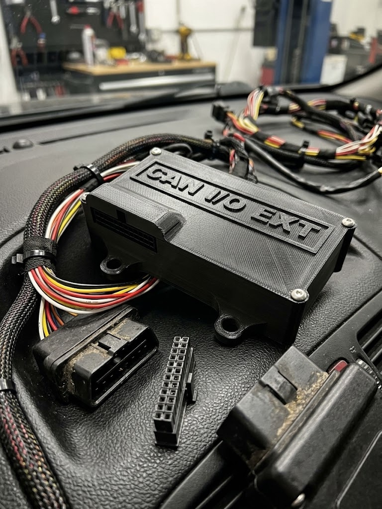
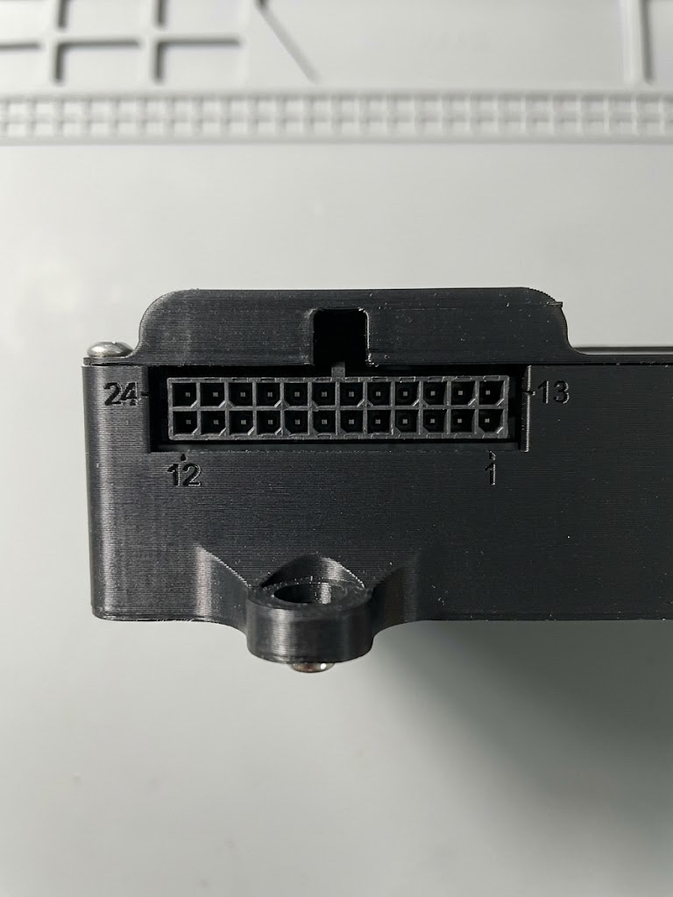

# CAN IO Extender

## Gambaran Umum



CAN IO Extender menambah **input dan output** ke Racedash lewat bus CAN yang
sama dengan ECU. Modul ini membaca sensor dan saklar yang tidak diketahui ECU —
misalnya lampu sein, rem tangan, lampu jauh, sensor tekanan tambahan, atau
sensor kecepatan roda — lalu mem-broadcast-nya sebagai frame CAN yang bisa dibaca
dash. Sebaliknya, dash juga bisa menyalakan output modul ini untuk menggerakkan
relay, pompa, kipas, atau solenoid.

Modul bekerja mandiri: bitrate bus dideteksi sendiri, dan tidak ada yang perlu
diatur lewat aplikasi. Fungsi tiap pin ditentukan saat pemasangan, sesuai
kebutuhan kendaraan.

| Kemampuan | Jumlah | Keterangan |
| :--- | :---: | :--- |
| Analog input | 11 | Satu dipakai untuk tegangan aki; dua di antaranya sudah ber-pull-up untuk sensor NTC |
| Switch input 12 V | 4 | Berbagi pin dengan sebagian analog input |
| Hall / frequency input | 4 | Berbagi pin dengan sebagian analog input |
| Low-side output | 5 + 2 | Lima arus kecil, dua arus besar |
| High-side output | 2 | Mendukung PWM dan melaporkan fault |
| Logic output | 2 | Output sinyal 5 V atau 12 V |

Tujuh output tersedia sekaligus di konektor utama; dua lagi berbagi pin dengan
logic output.

## Konektor Utama (J2)

Semua kabel kendaraan masuk lewat satu konektor **Molex Micro-Fit 3.0, 24 pin
(2 baris × 12)**.

| | Part number Molex |
| :--- | :--- |
| Header di board | 43045-2400 |
| Konektor kabel (pasangannya) | 43025-2400, dengan terminal crimp female Micro-Fit 3.0 |



Dilihat dari depan modul dengan latch di atas, **pin 1 ada di kanan bawah**.
Baris bawah berisi pin 1–12 dari kanan ke kiri, dan baris atas berisi pin 13–24
dari kanan ke kiri. Konektor kabel yang dilihat dari sisi masuk kabel, dengan
latch di atas, memakai susunan yang sama.

```
                                     ┌─ latch ─┐
  24     23     22     21     20     19     18     17     16     15     14     13
  12V    LC1    LC2    HS1    LC3   OUT4    HS2   OUT5    LS2    LS1   CANH   CANL
  12     11     10      9      8      7      6      5      4      3      2      1
  GND    AV1    AV2    A3     A4     A5     A6     A7     A8     A9     A10    --
```

| Pin | Fungsi | Pin | Fungsi |
| :---: | :--- | :---: | :--- |
| 1 | Tidak dipakai | 13 | CAN L |
| 2 | Input: A10 atau HALL4 | 14 | CAN H |
| 3 | Input: A9 atau HALL3 | 15 | Output LS1 (low-side, arus besar) |
| 4 | Input: A8 atau HALL2 | 16 | Output LS2 (low-side, arus besar) |
| 5 | Input: A7 atau HALL1 | 17 | Output LC5 **atau** LOGIC2 |
| 6 | Input: A6 atau SW4 | 18 | Output HS2 (high-side) |
| 7 | Input: A5 atau SW3 | 19 | Output LC4 **atau** LOGIC1 |
| 8 | Input: A4 atau SW2 | 20 | Output LC3 (low-side) |
| 9 | Input: A3 atau SW1 | 21 | Output HS1 (high-side) |
| 10 | Input: A2 (untuk sensor NTC) | 22 | Output LC2 (low-side) |
| 11 | Input: A1 (untuk sensor NTC) | 23 | Output LC1 (low-side) |
| 12 | Ground | 24 | 12 V dari kontak (switched) |

Penjelasan tiap kelompok pin ada di bagian [Daya](#daya-can-dan-terminasi),
[Input](#input), dan [Output](#output) di bawah.

## Daya, CAN, dan Terminasi

| Pin konektor | Fungsi |
| :--- | :--- |
| J2-24 | 12 V dari kontak (switched) |
| J2-12 | Ground |
| J2-14 | CAN H |
| J2-13 | CAN L |

Tersedia juga header CAN + daya 4 pin terpisah (J12) sebagai alternatif.

**Terminasi:** modul menyediakan resistor 120 Ω yang bisa diaktifkan di board.
Aktifkan **hanya kalau modul ini berada di salah satu ujung bus**. Sebuah bus
CAN perlu tepat dua terminator, dan menambah yang ketiga akan membuat
komunikasi gagal.

## Input

Delapan pin input bisa dipilih fungsinya, dan dua pin lagi khusus analog.

| Pin konektor | Dapat difungsikan sebagai |
| :--- | :--- |
| J2-9 | Analog input (A3) **atau** switch input 12 V (SW1) |
| J2-8 | Analog input (A4) **atau** switch input 12 V (SW2) |
| J2-7 | Analog input (A5) **atau** switch input 12 V (SW3) |
| J2-6 | Analog input (A6) **atau** switch input 12 V (SW4) |
| J2-5 | Analog input (A7) **atau** Hall / frequency input (HALL1) |
| J2-4 | Analog input (A8) **atau** Hall / frequency input (HALL2) |
| J2-3 | Analog input (A9) **atau** Hall / frequency input (HALL3) |
| J2-2 | Analog input (A10) **atau** Hall / frequency input (HALL4) |
| J2-11 | Analog input (A1), sudah ber-pull-up untuk sensor NTC |
| J2-10 | Analog input (A2), sudah ber-pull-up untuk sensor NTC |

Pull-up pada J2-10 dan J2-11 adalah yang dibutuhkan sensor NTC, seperti sensor
suhu air atau suhu udara masuk. Sensor yang mengeluarkan tegangan 0–5 V sendiri
— misalnya sensor tekanan — dipasang di pin analog mana pun.

**SW1–SW4 menerima 12 V langsung.** Gunakan untuk apa pun yang disaklar oleh
12 V kendaraan: lampu sein, lampu jauh, lampu rem, rem tangan.

**HALL1–HALL4** membaca logic 5 V, tahan terhadap 12 V, dan keempatnya juga
berfungsi sebagai **frequency counter** — cocok untuk sensor kecepatan roda atau
flow meter.

## Output

| Output | Pin konektor | Tipe | Keterangan |
| :--- | :--- | :--- | :--- |
| LC1 | J2-23 | Low-side, arus kecil | |
| LC2 | J2-22 | Low-side, arus kecil | |
| LC3 | J2-20 | Low-side, arus kecil | |
| LC4 | J2-19 | Low-side, arus kecil | Pin ini dipakai untuk LC4 **atau** LOGIC1 |
| LC5 | J2-17 | Low-side, arus kecil | Pin ini dipakai untuk LC5 **atau** LOGIC2 |
| LS1 | J2-15 | Low-side, arus besar | |
| LS2 | J2-16 | Low-side, arus besar | |
| HS1 | J2-21 | **High-side** | Mendukung PWM, melaporkan fault |
| HS2 | J2-18 | **High-side** | Mendukung PWM, melaporkan fault |

**Ini kesalahan wiring yang paling sering terjadi:** output **low-side**
menyaklar sisi **ground**, jadi ujung beban yang lain harus di 12 V. Output
**high-side** justru mengeluarkan 12 V, jadi ujung beban yang lain harus di
ground. Tertukar berarti beban tidak akan bekerja.

Hanya **HS1 dan HS2** yang menerima nilai PWM; output lain hanya on/off.

**Logic output** (LOGIC1 dan LOGIC2) adalah output sinyal, bukan driver coil.
Tegangannya bisa dipilih **5 V atau 12 V** saat pemasangan. Keduanya memakai pin
yang sama dengan LC4 dan LC5, jadi pilih salah satu fungsi per pin.

!!! danger "Output mati sendiri kalau perintah berhenti"
    Semua output dimatikan bila perintah dari dash tidak diterima selama
    **500 ms**, dan modul memang menyala dalam keadaan semua output mati. Jadi
    kalau dash mati atau kabel CAN lepas, pompa atau solenoid tidak akan terus
    menyala. Kondisi ini normal, bukan kerusakan.

## Memakai dengan Racedash Pro (M4, M5, M7)

Bisa langsung dipakai tanpa ganti firmware, **bersamaan dengan protokol ECU yang
sedang aktif**.

!!! tip "CAN ID: heksadesimal atau desimal"
    Halaman ini menulis CAN ID dalam heksadesimal, misalnya `0x643`. Beberapa
    software, seperti rusEFI dan TunerStudio, menampilkan angka yang sama dalam
    desimal: `0x643` = `1603`.

    Di DashTune, pilih tampilannya di **Settings → Format CAN ID**. Pilihan ini
    juga berlaku di editor CAN Button pada layar dash. Di bawah setiap kolom CAN
    ID, DashTune menampilkan padanannya, misalnya "= 1603 (desimal)". Angka yang
    diawali `0x` selalu dibaca sebagai heksadesimal, apa pun pilihannya.

### Lampu indikator dari saklar kendaraan

Di DashTune, buka pengaturan indikator, pilih mode **CAN**, lalu isi:

| Lampu | CAN ID | Byte | Bit | Sambungkan ke |
| :--- | :--- | :---: | :---: | :--- |
| Turn left | `0x643` | 0 | 0 | J2-9 |
| Turn right | `0x643` | 0 | 1 | J2-8 |
| High beam | `0x643` | 0 | 2 | J2-7 |
| Hand brake | `0x643` | 0 | 3 | J2-6 |
| Head light | `0x643` | 0 | 4 | J2-5 |
| Park light | `0x643` | 0 | 5 | J2-4 |

Pastikan keenam pin itu difungsikan sebagai **switch input 12 V**, dan biarkan
pilihan **invert dalam keadaan mati** — modul sudah melaporkan 1 = aktif.

### Nilai sensor tambahan

Nilai seperti tegangan aki, sensor analog, atau frequency input bisa
ditampilkan lewat **Custom Channel** di DashTune. Custom Channel menumpang pada
protokol ECU yang sedang aktif, jadi data ECU tetap terbaca seperti biasa.

Gunakan daftar frame di [bagian berikutnya](#data-yang-dikirim-modul) sebagai
acuan CAN ID, posisi byte, dan skalanya.

### Menyalakan output

Output dinyalakan lewat **CAN Buttons**: satu tombol untuk satu output, diatur
di DashTune atau langsung di layar dash. Semua tombol memakai CAN ID yang sama,
`0x648` (desimal **1608**), dan harus dalam mode **Toggle**. Selama tombol
menyala, dash mengirim ulang perintahnya terus-menerus. Tombol mode Momentary
hanya mengirim sekali, jadi outputnya akan mati lagi setelah 500 ms.

| Output | Byte | Nilai ON |
| :--- | :---: | :---: |
| LC1 | 0 | 1 |
| LC2 | 0 | 2 |
| LC3 | 0 | 4 |
| LC4 | 0 | 8 |
| LC5 | 0 | 16 |
| LS1 | 0 | 32 |
| LS2 | 0 | 64 |
| HS1 | 1 | 1 |
| HS2 | 1 | 2 |
| LOGIC1 | 1 | 4 |
| LOGIC2 | 1 | 8 |

Isi **nilai OFF dengan 0** untuk semua tombol. Beberapa tombol boleh berada di
byte yang sama; dash menggabungkannya, jadi LC1 dan LS1 bisa menyala bersamaan.

HS1 dan HS2 langsung menyala penuh. Untuk PWM, tambahkan satu tombol Toggle
lagi di byte **2** (HS1) atau byte **3** (HS2), dengan nilai ON 1–254 sebagai
duty, misalnya 128 untuk sekitar 50%. Selama tombol duty itu mati, outputnya
kembali menyala penuh.

!!! note "Butuh firmware terbaru"
    Cara di atas memerlukan firmware Racedash dan firmware CAN IO Extender
    versi terbaru. Pada firmware lama, tombol-tombol yang berada di byte yang
    sama saling menimpa, dan modul mengabaikan perintah yang lebih pendek dari
    4 byte.

## Memakai dengan Racedash 3.5" dan 4"

!!! warning "Tidak bisa bersamaan dengan protokol ECU"
    Pada varian ini, modul hanya terbaca kalau protokol dash diset ke
    **Custom**, dan mode Custom menggantikan decoder ECU bawaan. Artinya dash
    bisa membaca **modul ini atau ECU**, tidak keduanya sekaligus. Kalau Anda
    butuh dua-duanya, gunakan Racedash Pro.

Langkahnya: set protokol dash ke **Custom**, samakan bitrate dengan bus, lalu
susun channel-nya lewat DashTune. Semua nilai **little-endian**, jadi biarkan
pilihan **MSB first (Motorola) mati**.

Kalau Anda memakai Custom CAN map untuk keperluan lain, jangan memakai CAN ID
`0x640`–`0x67F` (desimal 1600–1663) agar tidak bentrok dengan modul ini.

## Data yang Dikirim Modul

CAN ID di bawah berlaku untuk modul node 0. Semua nilai **little-endian**.

| CAN ID | Desimal | Isi | Rate |
| :--- | :--- | :--- | :--- |
| `0x640` | 1600 | Tegangan aki, lalu AV1, AV2, AV3 | 50 Hz |
| `0x641` | 1601 | AV4, AV5, AV6, AV7 | 50 Hz |
| `0x642` | 1602 | AV8, AV9, AV10 | 50 Hz |
| `0x643` | 1603 | Status digital input, diagnosa, status output | 50 Hz |
| `0x644` | 1604 | Frekuensi HALL1–HALL4 | 20 Hz |

**Frame analog** (`0x640`–`0x642`) berisi empat nilai `uint16` berurutan, dalam
**milivolt**. Tegangan aki sudah dikalikan faktor pembaginya, jadi angka `13800`
berarti 13,8 V. Untuk menampilkan sebagai volt, pakai scale `0.001`.

**Frame digital** (`0x643`):

| Byte | Isi |
| :---: | :--- |
| 0 | bit 0–3 = SW1–SW4, bit 4–7 = HALL1–HALL4 |
| 1 | bit 0–1 = fault high-side output |
| 2–3 | status output yang benar-benar aktif |
| 4 | bit 0 = failsafe aktif, bit 1 = bitrate sudah terkunci |
| 5–6 | uptime dalam detik |
| 7 | versi firmware dan nomor node |

**Frame frekuensi** (`0x644`) berisi empat nilai `uint16` dalam satuan 0,1 Hz —
kalikan `0.1` untuk mendapatkan Hz.

## Memakai Dua Modul

Satu bus bisa memuat sampai **empat** modul. Tiap modul harus memakai nomor node
berbeda, yang ditentukan oleh [file firmware](#firmware) yang di-flash. Nomor
node menggeser blok CAN ID-nya:

| Node | Blok CAN ID | Desimal |
| :---: | :--- | :--- |
| 0 | `0x640`–`0x64F` | 1600–1615 |
| 1 | `0x650`–`0x65F` | 1616–1631 |
| 2 | `0x660`–`0x66F` | 1632–1647 |
| 3 | `0x670`–`0x67F` | 1648–1663 |

## Firmware

Modul dikirim sudah berisi firmware untuk **node 0**. Flash ulang hanya
diperlukan untuk memperbarui firmware, atau untuk modul kedua dan seterusnya di
bus yang sama ([Memakai Dua Modul](#memakai-dua-modul)).

### Unduh

Ambil file `.hex` dari
**[github.com/mazduino/can-io-extender/releases](https://github.com/mazduino/can-io-extender/releases)**.
Nama file menyebut nomor node-nya:

| File | Dipakai untuk |
| :--- | :--- |
| `can-io-extender-8mhz-node0.hex` | Modul pertama (bawaan pabrik) |
| `can-io-extender-8mhz-node1.hex` | Modul kedua |
| `can-io-extender-8mhz-node2.hex` | Modul ketiga |
| `can-io-extender-8mhz-node3.hex` | Modul keempat |

Pakai file berakhiran `8mhz`. File `16mhz` hanya untuk board yang sudah
dimodifikasi, dan hanya dipakai kalau tim Mazduino mengarahkan Anda ke sana.

### Flash

Modul ini berbasis Arduino Mega 2560 dan di-flash lewat kabel USB-nya.

!!! warning "Lepas 12 V sebelum menyambungkan USB"
    Cabut konektor utama (J2) atau matikan kunci kontak dulu. Board akan
    mendapat daya dari USB selama proses flash.

**Cara termudah: script flash.** Unduh `flash.bat` (Windows) atau `flash.sh`
(macOS/Linux) dari halaman Releases yang sama. Script ini mengunduh firmware
yang benar sendiri, jadi file `.hex` tidak perlu diunduh terpisah.

- **Windows:** double-click `flash.bat`, lalu ketik port COM saat ditanya
  (lihat di Device Manager, misalnya `COM5`). Untuk modul kedua dan seterusnya,
  jalankan dari Command Prompt dengan nomor node: `flash.bat COM5 1`.
- **macOS / Linux:** pasang `avrdude` dulu (`brew install avrdude` atau
  `sudo apt install avrdude`), lalu jalankan `./flash.sh`. Port dicari
  otomatis; nomor node ditulis setelah port: `./flash.sh /dev/ttyUSB0 1`.

Kalau ingin flash manual:

**Windows** — pakai [XLoader](https://github.com/xinabox/xLoader) atau
[AVRDUDESS](https://github.com/ZakKemble/AVRDUDESS):

1. Sambungkan USB, lalu cari nomor port-nya di Device Manager (misalnya `COM5`).
2. Di XLoader, pilih file `.hex`, device **Mega(ATMEGA2560)**, port tadi, dan
   baud rate **115200**.
3. Klik **Upload** dan tunggu sampai muncul jumlah byte yang ter-upload.

**macOS / Linux** — pakai `avrdude`:

```sh
avrdude -p m2560 -c wiring -P /dev/ttyUSB0 -b 115200 -D \
  -U flash:w:can-io-extender-8mhz-node0.hex:i
```

Ganti `/dev/ttyUSB0` dengan port board Anda (di macOS biasanya
`/dev/cu.usbserial-…` atau `/dev/cu.usbmodem…`).

Setelah selesai, cabut USB dan sambungkan lagi 12 V. Output tetap mati sampai
dash mengirim perintah; itu kondisi normal (failsafe), bukan tanda flash gagal.

## Troubleshooting

| Gejala | Penyebab yang paling sering |
| :--- | :--- |
| Modul tidak pernah mengunci bitrate | CAN H dan CAN L tertukar, terminasi kurang, atau tidak ada perangkat lain yang mengirim di bus — modul mengunci pada frame valid pertama, jadi bus yang sepi tidak akan pernah terkunci |
| Bus terkunci, tetapi dash tidak menampilkan apa-apa | CAN ID di dash tidak sama dengan blok node modul, atau CAN ID diketik dalam notasi yang salah (`643` dibaca desimal padahal yang dimaksud `0x643`) — cek **Settings → Format CAN ID** di DashTune |
| Output tidak mau menyala | Dash belum mengirim perintah output, sehingga modul tetap dalam kondisi failsafe. Pastikan tombolnya memakai CAN ID `0x648` (1608) dan mode **Toggle** |
| Output menyala sebentar lalu mati | Tombolnya dalam mode Momentary. Ganti ke **Toggle** |
| LC4 atau LC5 tidak bekerja | Pin itu sedang difungsikan sebagai logic output — satu pin hanya bisa satu fungsi |
| Tegangan aki terbaca meleset | Rail 5 V board tidak tepat 5,000 V. Hubungi support@mazduino.com untuk firmware yang dikalibrasi ke board Anda |
| Switch input tidak terbaca | Pin itu masih difungsikan sebagai analog input, bukan switch input |
