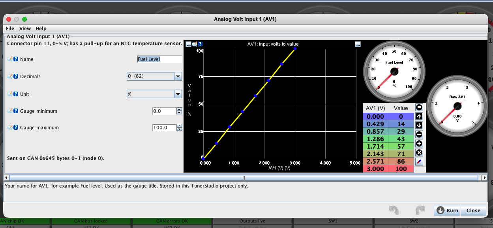
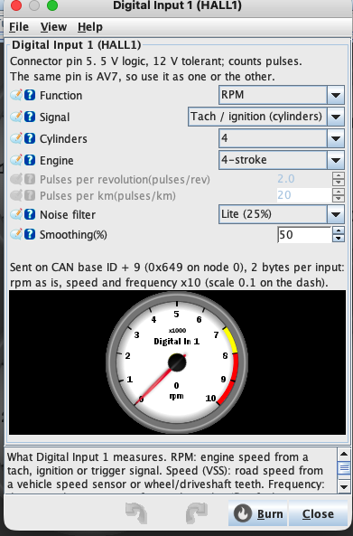

# CAN IO Extender

## Gambaran Umum


CAN IO Extender menambah **input dan output** ke Racedash lewat bus CAN yang
sama dengan ECU. Modul ini membaca sensor dan saklar yang tidak diketahui ECU —
misalnya turn signal, handbrake, high beam, oil pressure tambahan, clutch
switch, atau wheel speed sensor — lalu mem-broadcast-nya sebagai frame CAN yang bisa dibaca
dash. Sebaliknya, dash juga bisa menyalakan output modul ini untuk menggerakkan
relay, pompa, kipas, atau solenoid.

Ada dua cara memakainya:

- **Kendaraan dengan ECU ber-CAN** — modul menambah input dan output yang tidak
  dimiliki ECU. Data ECU tetap terbaca seperti biasa.
- **Kendaraan tanpa CAN bus** — misalnya mesin karburator atau ECU lama tanpa
  CAN. Modul menjadi satu-satunya sumber data dash lewat protokol
  [M-Link](#kendaraan-tanpa-can-bus-protokol-m-link): ia membaca sinyal
  analog, digital, dan RPM langsung dari kendaraan, lalu mengirimnya ke dash
  lewat CAN.

Bitrate bus dideteksi sendiri. Fungsi tiap pin ditentukan saat pemasangan,
sesuai kebutuhan kendaraan, dan kalibrasi sensor diatur lewat
[TunerStudio](#kalibrasi-sensor-di-tunerstudio).

| Kemampuan | Jumlah | Keterangan |
| :--- | :---: | :--- |
| Analog input | 11 | Satu dipakai untuk tegangan aki; lima di antaranya (AV1–AV5) sudah ber-pull-up 2,7 kΩ untuk sensor NTC |
| Switch input 12 V | 4 | Untuk turn signal dan lampu indikator OEM; berbagi pin dengan sebagian analog input |
| Digital input (HALL) | 4 | RPM, VSS, frequency, atau switch aktif-ground (clutch, launch control); berbagi pin dengan sebagian analog input |
| Low-side output | 5 + 2 | Lima arus kecil, dua arus besar |
| High-side output | 2 | Mendukung PWM dan melaporkan fault |
| Logic output | 2 | Output sinyal 5 V atau 12 V |

Tujuh output tersedia sekaligus di konektor utama; dua lagi berbagi pin dengan
logic output.

## Konektor Utama (J2)

Semua kabel kendaraan masuk lewat satu konektor **Molex Micro-Fit 3.0, 24 pin
(2 baris × 12)**.

| | Part number Molex |
| :--- | :--- |
| Header di board | 43045-2400 |
| Konektor kabel (pasangannya) | 43025-2400, dengan terminal crimp female Micro-Fit 3.0 |


Dilihat dari depan modul dengan **kait pengunci** (tonjolan kecil di tengah
atas konektor) menghadap ke atas, **pin 1 ada di kanan bawah**.
Baris bawah berisi pin 1–12 dari kanan ke kiri, dan baris atas berisi pin 13–24
dari kanan ke kiri. Konektor kabel yang dilihat dari sisi masuk kabel, dengan
kait pengunci di atas, memakai susunan yang sama.

<table class="pin-grid">
<tr><th></th><th colspan="12" align="center">▼ kait pengunci ▼</th></tr>
<tr><th>Atas</th><td align="center"><b>24</b><br>12V</td><td align="center"><b>23</b><br>LC1</td><td align="center"><b>22</b><br>LC2</td><td align="center"><b>21</b><br>HS1</td><td align="center"><b>20</b><br>LC3</td><td align="center"><b>19</b><br>OUT4</td><td align="center"><b>18</b><br>HS2</td><td align="center"><b>17</b><br>OUT5</td><td align="center"><b>16</b><br>LS2</td><td align="center"><b>15</b><br>LS1</td><td align="center"><b>14</b><br>CAN H</td><td align="center"><b>13</b><br>CAN L</td></tr>
<tr><th>Bawah</th><td align="center"><b>12</b><br>GND</td><td align="center"><b>11</b><br>A1</td><td align="center"><b>10</b><br>A2</td><td align="center"><b>9</b><br>A3</td><td align="center"><b>8</b><br>A4</td><td align="center"><b>7</b><br>A5</td><td align="center"><b>6</b><br>A6</td><td align="center"><b>5</b><br>A7</td><td align="center"><b>4</b><br>A8</td><td align="center"><b>3</b><br>A9</td><td align="center"><b>2</b><br>A10</td><td align="center"><b>1</b><br>—</td></tr>
</table>

| Pin | Fungsi | Pin | Fungsi |
| :---: | :--- | :---: | :--- |
| 1 | Tidak dipakai | 13 | CAN L |
| 2 | Input: A10 atau HALL4 | 14 | CAN H |
| 3 | Input: A9 atau HALL3 | 15 | Output LS1 (low-side, arus besar) |
| 4 | Input: A8 atau HALL2 | 16 | Output LS2 (low-side, arus besar) |
| 5 | Input: A7 atau HALL1 | 17 | Output LC5 **atau** LOGIC2 |
| 6 | Input: A6 atau SW4 | 18 | Output HS2 (high-side) |
| 7 | Input: A5 (pull-up NTC) atau SW3 | 19 | Output LC4 **atau** LOGIC1 |
| 8 | Input: A4 (pull-up NTC) atau SW2 | 20 | Output LC3 (low-side) |
| 9 | Input: A3 (pull-up NTC) atau SW1 | 21 | Output HS1 (high-side) |
| 10 | Input: A2 (pull-up NTC) | 22 | Output LC2 (low-side) |
| 11 | Input: A1 (pull-up NTC) | 23 | Output LC1 (low-side) |
| 12 | Ground | 24 | 12 V dari kontak (switched) |

Penjelasan tiap kelompok pin ada di bagian [Daya](#daya-can-dan-terminasi),
[Input](#input), dan [Output](#output) di bawah.

## Daya, CAN, dan Terminasi

| Pin konektor | Fungsi |
| :--- | :--- |
| J2-24 | 12 V dari kontak (switched) |
| J2-12 | Ground |
| J2-14 | CAN H |
| J2-13 | CAN L |

Tersedia juga header CAN + daya 4 pin terpisah (J12) sebagai alternatif.

**Terminasi:** modul menyediakan resistor 120 Ω yang bisa diaktifkan di board.
Aktifkan **hanya kalau modul ini berada di salah satu ujung bus**. Sebuah bus
CAN perlu tepat dua terminator, dan menambah yang ketiga akan membuat
komunikasi gagal.

## Input

Delapan pin input bisa dipilih fungsinya, dan dua pin lagi khusus analog.

| Pin konektor | Dapat difungsikan sebagai |
| :--- | :--- |
| J2-9 | Analog input (A3, pull-up NTC) **atau** switch input 12 V (SW1) |
| J2-8 | Analog input (A4, pull-up NTC) **atau** switch input 12 V (SW2) |
| J2-7 | Analog input (A5, pull-up NTC) **atau** switch input 12 V (SW3) |
| J2-6 | Analog input (A6) **atau** switch input 12 V (SW4) |
| J2-5 | Analog input (A7) **atau** Hall / frequency input (HALL1) |
| J2-4 | Analog input (A8) **atau** Hall / frequency input (HALL2) |
| J2-3 | Analog input (A9) **atau** Hall / frequency input (HALL3) |
| J2-2 | Analog input (A10) **atau** Hall / frequency input (HALL4) |
| J2-11 | Analog input (A1, pull-up NTC) |
| J2-10 | Analog input (A2, pull-up NTC) |

**AV1–AV5** (J2-11, J2-10, J2-9, J2-8, J2-7) punya resistor pull-up **2,7 kΩ ke
5 V**, yaitu bias yang dibutuhkan sensor temperatur NTC seperti Coolant
Temperature (CLT), Intake Air Temperature (IAT) atau Oil Temperature. Input ini
yang tidak tersambung terbaca mendekati 5 V.

Untuk mengisi kurva NTC di TunerStudio, hitung tegangan tiap titik dari tabel
resistansi sensor:

> volt = 5 × R ÷ (R + 2700), dengan R = resistansi sensor (ohm) pada suhu itu

Contoh: sensor 2.500 Ω pada 20 °C → 5 × 2500 ÷ 5200 = **2,40 V**.

Sensor yang mengeluarkan tegangan 0–5 V sendiri — misalnya sensor Oil Pressure —
paling baik dipasang di **AV6–AV10**, yang tanpa pull-up, supaya sinyalnya tidak
ikut tertarik.

**SW1–SW4 adalah switch input 12 V** (tahan 12 V), untuk sinyal 12 V dari
kelistrikan mobil: turn signal kiri/kanan, high beam, handbrake, dan lampu
indikator OEM lainnya.

**Digital Input 1–4 (HALL1–HALL4)** membaca logic 5 V, tahan terhadap 12 V, dan
sudah punya pull-up 1 kΩ ke 5 V. Fungsinya dipilih di TunerStudio:

- **Sinyal pulsa** — RPM dari tachometer atau ignition, VSS (Vehicle Speed
  Sensor), wheel speed sensor, atau frequency apa adanya (flex fuel sensor,
  flow meter).
- **Switch** — saklar **aktif-ground** seperti clutch switch atau launch control
  switch (cukup disambung ke ground, tanpa resistor tambahan), atau sinyal 12 V
  seperti head light dan park light.

## Output

| Output | Pin konektor | Tipe | Keterangan |
| :--- | :--- | :--- | :--- |
| LC1 | J2-23 | Low-side, arus kecil | |
| LC2 | J2-22 | Low-side, arus kecil | |
| LC3 | J2-20 | Low-side, arus kecil | |
| LC4 | J2-19 | Low-side, arus kecil | Pin ini dipakai untuk LC4 **atau** LOGIC1 |
| LC5 | J2-17 | Low-side, arus kecil | Pin ini dipakai untuk LC5 **atau** LOGIC2 |
| LS1 | J2-15 | Low-side, arus besar | |
| LS2 | J2-16 | Low-side, arus besar | |
| HS1 | J2-21 | **High-side** | Mendukung PWM, melaporkan fault |
| HS2 | J2-18 | **High-side** | Mendukung PWM, melaporkan fault |

**Ini kesalahan wiring yang paling sering terjadi:** output **low-side**
menyaklar sisi **ground**, jadi ujung beban yang lain harus di 12 V. Output
**high-side** justru mengeluarkan 12 V, jadi ujung beban yang lain harus di
ground. Tertukar berarti beban tidak akan bekerja.

Hanya **HS1 dan HS2** yang menerima nilai PWM; output lain hanya on/off.

**Logic output** (LOGIC1 dan LOGIC2) adalah output sinyal, bukan driver coil.
Tegangannya bisa dipilih **5 V atau 12 V** saat pemasangan. Keduanya memakai pin
yang sama dengan LC4 dan LC5, jadi pilih salah satu fungsi per pin.

!!! danger "Output mati sendiri kalau perintah berhenti"
    Semua output dimatikan bila perintah dari dash tidak diterima selama
    **500 ms**, dan modul memang menyala dalam keadaan semua output mati. Jadi
    kalau dash mati atau kabel CAN lepas, pompa atau solenoid tidak akan terus
    menyala. Kondisi ini normal, bukan kerusakan.

## Memakai dengan Racedash Pro (M4, M5, M7)

Bisa langsung dipakai tanpa ganti firmware, **bersamaan dengan protokol ECU yang
sedang aktif**.

!!! tip "CAN ID: heksadesimal atau desimal"
    Halaman ini menulis CAN ID dalam heksadesimal, misalnya `0x643`. Beberapa
    software, seperti rusEFI dan TunerStudio, menampilkan angka yang sama dalam
    desimal: `0x643` = `1603`.

    Di DashTune, pilih tampilannya di **Settings → Format CAN ID**. Pilihan ini
    juga berlaku di editor CAN Button pada layar dash. Di bawah setiap kolom CAN
    ID, DashTune menampilkan padanannya, misalnya "= 1603 (desimal)". Angka yang
    diawali `0x` selalu dibaca sebagai heksadesimal, apa pun pilihannya.

### Kendaraan tanpa CAN bus: protokol M-Link

Pilih protokol ECU **M-Link** (Mazduino Link) bila kendaraan belum memakai CAN
bus. M-Link tersedia di Racedash Pro M4, M5, dan M7. CAN IO Extender lalu menggantikan ECU sebagai sumber data dash: modul
membaca sinyal dari kendaraan dan mengirimnya ke dash lewat CAN.

| Yang dibaca modul | Contoh | Masuk lewat |
| :--- | :--- | :--- |
| **Analog** | Coolant Temperature (CLT), Intake Air Temperature (IAT), Oil Pressure, Fuel Level | AV1–AV10 |
| **Switch 12 V** | Turn signal kiri/kanan, high beam, handbrake, lampu indikator OEM | SW1–SW4 |
| **Sinyal pulsa** | RPM dari tachometer atau ignition, VSS | Digital Input 1–4 |
| **Switch aktif-ground** | Clutch switch, launch control switch | Digital Input 1–4 |

**Langkah pemasangan:**

1. Sambungkan CAN H dan CAN L modul ke dash, dan pastikan bus punya dua
   terminator 120 Ω (lihat [Daya, CAN, dan Terminasi](#daya-can-dan-terminasi)).
2. Di dash, buka **Setting → CAN → ECU protocol → M-Link**, atau di DashTune
   **General Setting → ECU → M-Link**. Bitrate-nya 500 kbps dan dash mengirim
   sinyal "hidup" ke modul setiap 100 ms, jadi modul langsung terkunci ke bus.
3. Kalibrasi sensor di [TunerStudio](#kalibrasi-sensor-di-tunerstudio). Untuk
   RPM, atur **Digital Input 1** ke Function **RPM** dengan jumlah silinder
   mesin. Sinyal ignition coil mentah harus lewat tach adapter dulu.
4. Di DashTune, jalankan preset **CAN IO Extender** (lihat
   [Nilai sensor tambahan](#nilai-sensor-tambahan)) untuk sensor lainnya.

**Yang langsung terbaca tanpa pengaturan:** RPM dari Digital Input 1, battery
voltage, dan lampu indikator dari tabel di bawah.

**Sensor lain mengisi gauge bawaan dash** lewat preset: pada tiap input, pilih
**Sekalian isi kanal bawaan**, misalnya AV1 → **CLT**, AV2 → **IAT**,
Digital Input 2 → **Speed**. Gauge, warning, dan shift light bawaan dash
lalu membaca nilai dari modul seperti dari ECU biasa.

!!! warning "Digital Input 1 dipakai untuk RPM dan head light"
    Di M-Link, dash membaca **RPM** dari Digital Input 1 dan **head light**
    dari pin yang sama (J2-5). Kalau J2-5 dipakai untuk sinyal RPM, indikator
    head light di dash ikut berkedip. Di DashTune buka **General Setting →
    Indikator**, lalu ganti sumber head light ke input lain atau matikan.

### Lampu indikator dari saklar kendaraan

Di DashTune, buka pengaturan indikator, pilih mode **CAN**, lalu isi:

| Lampu | CAN ID | Byte | Bit | Sambungkan ke |
| :--- | :--- | :---: | :---: | :--- |
| Turn left | `0x643` | 0 | 0 | J2-9 |
| Turn right | `0x643` | 0 | 1 | J2-8 |
| High beam | `0x643` | 0 | 2 | J2-7 |
| Handbrake | `0x643` | 0 | 3 | J2-6 |
| Head light | `0x643` | 0 | 4 | J2-5 |
| Park light | `0x643` | 0 | 5 | J2-4 |

J2-9 sampai J2-6 harus difungsikan sebagai **switch input 12 V** (SW1–SW4).
J2-5 dan J2-4 adalah Digital Input 1 dan 2: di TunerStudio atur Function-nya
ke **Switch**, **Active at 12 V**. Biarkan pilihan **invert dalam keadaan
mati** — modul sudah melaporkan 1 = aktif.

### Nilai sensor tambahan

Sensor di AV1–AV10 ditampilkan lewat **Custom Channel** di DashTune. Custom
Channel menumpang pada protokol ECU yang sedang aktif, jadi data ECU tetap
terbaca seperti biasa.

Cara termudah: di DashTune buka **Custom Channels**, ketuk **CAN IO Extender**,
pilih nomor node modul, lalu centang input yang ingin ditampilkan. Untuk tiap
input pilih:

- **Terkalibrasi** — nilai hasil kurva yang diisi di
  [TunerStudio](#kalibrasi-sensor-di-tunerstudio), misalnya % bensin atau bar.
  Pilih jumlah desimal yang sama dengan yang diatur di TunerStudio.
- **Volt** — tegangan input mentah, untuk sensor linier atau sekadar memeriksa
  wiring.

Aktifkan **Sekalian atur lampu indikator** untuk memetakan turn signal, high
beam, handbrake, head light dan park light sekaligus (tabel di atas).

Kalau modul berhenti mengirim — kabel CAN lepas atau modul mati — nilainya
berubah menjadi **"--"** setelah sekitar 1,5 detik, dan tidak memicu peringatan.
Dash tidak akan menampilkan angka terakhir seolah masih hidup.

!!! note "Custom Channel tersimpan per protokol ECU"
    Pengaturan ini menempel pada protokol ECU yang aktif saat disimpan. Kalau
    protokol ECU di dash diganti, ulangi preset CAN IO Extender di protokol yang
    baru.

Untuk mengisi Custom Channel secara manual, gunakan daftar frame di
[Data yang Dikirim Modul](#data-yang-dikirim-modul) sebagai acuan CAN ID,
posisi byte, dan skalanya.

### Menyalakan output

Output dinyalakan lewat **CAN Buttons**: satu tombol untuk satu output, diatur
di DashTune atau langsung di layar dash. Semua tombol memakai CAN ID yang sama,
`0x648` (desimal **1608**), dan harus dalam mode **Toggle**. Selama tombol
menyala, dash mengirim ulang perintahnya terus-menerus. Tombol mode Momentary
hanya mengirim sekali, jadi outputnya akan mati lagi setelah 500 ms.

| Output | Byte | Nilai ON |
| :--- | :---: | :---: |
| LC1 | 0 | 1 |
| LC2 | 0 | 2 |
| LC3 | 0 | 4 |
| LC4 | 0 | 8 |
| LC5 | 0 | 16 |
| LS1 | 0 | 32 |
| LS2 | 0 | 64 |
| HS1 | 1 | 1 |
| HS2 | 1 | 2 |
| LOGIC1 | 1 | 4 |
| LOGIC2 | 1 | 8 |

Isi **nilai OFF dengan 0** untuk semua tombol. Beberapa tombol boleh berada di
byte yang sama; dash menggabungkannya, jadi LC1 dan LS1 bisa menyala bersamaan.

HS1 dan HS2 langsung menyala penuh. Untuk PWM, tambahkan satu tombol Toggle
lagi di byte **2** (HS1) atau byte **3** (HS2), dengan nilai ON 1–254 sebagai
duty, misalnya 128 untuk sekitar 50%. Selama tombol duty itu mati, outputnya
kembali menyala penuh.

!!! note "Butuh firmware terbaru"
    Cara di atas memerlukan firmware Racedash dan firmware CAN IO Extender
    versi terbaru. Pada firmware lama, tombol-tombol yang berada di byte yang
    sama saling menimpa, dan modul mengabaikan perintah yang lebih pendek dari
    4 byte.

## Memakai dengan Racedash 3.5" dan 4"

!!! warning "Tidak bisa bersamaan dengan protokol ECU"
    Pada varian ini, modul hanya terbaca kalau protokol dash diset ke
    **Custom**, dan mode Custom menggantikan decoder ECU bawaan. Artinya dash
    bisa membaca **modul ini atau ECU**, tidak keduanya sekaligus. Kalau Anda
    butuh dua-duanya, gunakan Racedash Pro.

Langkahnya: set protokol dash ke **Custom**, samakan bitrate dengan bus, lalu
susun channel-nya lewat DashTune. Semua nilai **little-endian**, jadi biarkan
pilihan **MSB first (Motorola) mati**.

Kalau Anda memakai Custom CAN map untuk keperluan lain, jangan memakai CAN ID
`0x640`–`0x67F` (desimal 1600–1663) agar tidak bentrok dengan modul ini.

## Kalibrasi Sensor di TunerStudio

Modul bisa dihubungkan ke **TunerStudio** lewat kabel USB-nya, seperti ECU.
Dari sana, setiap input AV1–AV10 bisa diberi kurva kalibrasi, dan nomor node
serta bitrate CAN bisa diubah tanpa flash ulang.

1. Unduh file `mazduino-iox.ini` dari halaman
   [Releases](https://github.com/mazduino/can-io-extender/releases).
2. Di TunerStudio buat project baru, pilih ECU definition **Other / Browse**,
   lalu arahkan ke file `mazduino-iox.ini`.
3. Pilih port USB modul dengan baud **115200**, lalu hubungkan.

**Mengisi kurva** — buka menu **Analog Volt Inputs → AV1** (dan seterusnya):



- **Name**: nama input, misalnya "Fuel level". Dipakai sebagai judul gauge.
- **Decimals** dan **Unit**: cara nilai ditampilkan. Desimal juga menentukan
  scale di dash: desimal 1 berarti scale `0.1`.
- **Kurva**: isi tegangan dari yang terendah, dan nilai di setiap tegangan.
  Minimal dua baris; baris kosong di bawahnya diabaikan. Kurva yang semuanya
  nol berarti input itu tidak dikalibrasi.
- Gauge **Raw AV1** di samping kurva menunjukkan tegangan saat ini, sehingga
  titik kurva bisa diambil langsung sambil mengubah kondisi sensor (misalnya
  mengisi tangki bertahap).

Tekan **Burn** agar kurva tersimpan di modul. Ikon **?** di setiap kolom berisi
penjelasan singkat.

**Digital Input (RPM, VSS, frequency, switch)** — buka menu **Digital Inputs →
Digital Input 1** (dan seterusnya). Digital Input 1–4 adalah pin HALL1–HALL4 di
konektor.



- **Function**: **RPM** (engine speed), **Speed (VSS)** (vehicle speed),
  **Frequency** (frequency apa adanya, misalnya flow meter), atau **Switch**.
- **Switch active** (khusus Switch): **Active to ground** untuk saklar ke ground
  seperti clutch switch atau launch control switch, atau **Active at 12 V**
  untuk sinyal 12 V seperti head light. Nilainya 1 saat aktif.
- **Signal** (khusus RPM): **Tach / ignition (cylinders)** untuk sinyal
  tachometer atau ignition — isi **Cylinders** dan **Engine** (2-stroke atau
  4-stroke); atau **Custom pulses per rev** untuk trigger wheel, isi jumlah pulsa
  per putaran.
- **Pulses per km** (khusus Speed): jumlah pulsa sensor kecepatan per kilometer.
- **Noise filter**: mengabaikan pulsa palsu dari sinyal yang berdering, misalnya
  keluaran tach adapter. **Lite** cukup untuk kebanyakan sinyal.
- **Smoothing**: meredam angka yang meloncat; makin besar makin halus tetapi
  makin lambat mengikuti perubahan.

Gauge di bawahnya menunjukkan nilai saat ini. Hasilnya dikirim di CAN
`0x649` (node 0): RPM apa adanya, speed dan frequency dikali 10, switch 0
atau 1. Tekan
**Burn** untuk menyimpan.

**Node dan CAN** — menu **Module → Node and CAN bus**:

- **Node number**: lihat [Memakai Dua Modul](#memakai-dua-modul).
- **Bitrate**: **Auto detect** (disarankan) atau bitrate tetap. Bitrate tetap
  langsung mengirim tanpa mendengarkan bus dulu, jadi pilih hanya kalau sudah
  pasti sama dengan bus.

Di halaman depan TunerStudio, indikator **CAN CHIP NOT FOUND**, **NO CAN BUS**
dan **CAN ERROR PASSIVE** menyala merah bila ada masalah di sisi CAN.

## Data yang Dikirim Modul

CAN ID di bawah berlaku untuk modul node 0. Semua nilai **little-endian**.

| CAN ID | Desimal | Isi |
| :--- | :--- | :--- |
| `0x640` | 1600 | Tegangan aki, lalu AV1, AV2, AV3 (mV) |
| `0x641` | 1601 | AV4, AV5, AV6, AV7 (mV) |
| `0x642` | 1602 | AV8, AV9, AV10 (mV) |
| `0x643` | 1603 | Status digital input, diagnosa, status output |
| `0x644` | 1604 | Frequency HALL1–HALL4 |
| `0x645` | 1605 | AV1–AV4 terkalibrasi |
| `0x646` | 1606 | AV5–AV8 terkalibrasi |
| `0x647` | 1607 | AV9–AV10 terkalibrasi |

Frame dikirim begitu nilainya berubah (paling cepat tiap 25 ms) dan tetap
diulang minimal tiap 200 ms saat tidak ada perubahan (frame digital tiap
500 ms, frame frekuensi tiap 50 ms).

**Frame analog** (`0x640`–`0x642`) berisi empat nilai `uint16` berurutan, dalam
**milivolt**. Tegangan aki sudah dikalikan faktor pembaginya, jadi angka `13800`
berarti 13,8 V. Untuk menampilkan sebagai volt, pakai scale `0.001`.

**Frame digital** (`0x643`):

| Byte | Isi |
| :---: | :--- |
| 0 | bit 0–3 = SW1–SW4, bit 4–7 = HALL1–HALL4 |
| 1 | bit 0–1 = fault high-side output |
| 2–3 | status output yang benar-benar aktif |
| 4 | bit 0 = failsafe aktif, bit 1 = bitrate sudah terkunci |
| 5–6 | uptime dalam detik |
| 7 | versi firmware dan nomor node |

**Frame frekuensi** (`0x644`) berisi empat nilai `uint16` dalam satuan 0,1 Hz —
kalikan `0.1` untuk mendapatkan Hz.

**Frame terkalibrasi** (`0x645`–`0x647`) berisi nilai `int16` **signed**, dua
byte per input: `0x645` byte 0–1 = AV1, byte 2–3 = AV2, byte 4–5 = AV3,
byte 6–7 = AV4, dan seterusnya. Nilainya adalah hasil kurva TunerStudio tanpa
koma: dengan desimal 1, nilai 62,5 dikirim sebagai `625`, jadi pakai scale
`0.1`. Input tanpa kurva bernilai 0.

## Memakai Dua Modul

Satu bus bisa memuat sampai **empat** modul. Tiap modul harus memakai nomor node
berbeda. Atur di TunerStudio (**Module → Node and CAN bus**, lalu Burn), atau
flash [file firmware](#firmware) untuk node tersebut. Nomor node menggeser blok
CAN ID-nya:

| Node | Blok CAN ID | Desimal |
| :---: | :--- | :--- |
| 0 | `0x640`–`0x64F` | 1600–1615 |
| 1 | `0x650`–`0x65F` | 1616–1631 |
| 2 | `0x660`–`0x66F` | 1632–1647 |
| 3 | `0x670`–`0x67F` | 1648–1663 |

## Firmware

Modul dikirim sudah berisi firmware untuk **node 0**. Flash ulang hanya
diperlukan untuk memperbarui firmware, atau untuk modul kedua dan seterusnya di
bus yang sama ([Memakai Dua Modul](#memakai-dua-modul)).

### Unduh

Ambil file `.hex` dari
**[github.com/mazduino/can-io-extender/releases](https://github.com/mazduino/can-io-extender/releases)**.
Nama file menyebut nomor node-nya:

| File | Dipakai untuk |
| :--- | :--- |
| `can-io-extender-8mhz-node0.hex` | Modul pertama (bawaan pabrik) |
| `can-io-extender-8mhz-node1.hex` | Modul kedua |
| `can-io-extender-8mhz-node2.hex` | Modul ketiga |
| `can-io-extender-8mhz-node3.hex` | Modul keempat |

Pakai file berakhiran `8mhz`. File `16mhz` hanya untuk board yang sudah
dimodifikasi, dan hanya dipakai kalau tim Mazduino mengarahkan Anda ke sana.

### Flash

Modul ini berbasis Arduino Mega 2560 dan di-flash lewat kabel USB-nya.

!!! warning "Lepas 12 V sebelum menyambungkan USB"
    Cabut konektor utama (J2) atau matikan kunci kontak dulu. Board akan
    mendapat daya dari USB selama proses flash.

**Dengan script flash (build dari source).** Script `flash.bat` (Windows) dan
`flash.sh` (macOS/Linux) ada di source code firmware. Script ini mem-build
firmware untuk nomor node yang dipilih, lalu langsung meng-upload-nya lewat USB.

1. Unduh source code dari
   [github.com/mazduino/can-io-extender](https://github.com/mazduino/can-io-extender)
   (**Code → Download ZIP**), lalu ekstrak.
2. Pasang [PlatformIO](https://platformio.org/install/cli):
   `pip install platformio`.
3. Jalankan dari folder hasil ekstrak, dengan nomor node sebagai argumen:
    - **Windows:** `flash.bat` untuk node 0, atau `flash.bat 1 COM5` untuk node
      1 di port COM5.
    - **macOS / Linux:** `./flash.sh` untuk node 0, atau `./flash.sh 1` untuk
      node 1. Port dicari otomatis.

Kalau ingin flash file `.hex` siap pakai tanpa build:

**Windows** — pakai [XLoader](https://github.com/xinabox/xLoader) atau
[AVRDUDESS](https://github.com/ZakKemble/AVRDUDESS):

1. Sambungkan USB, lalu cari nomor port-nya di Device Manager (misalnya `COM5`).
2. Di XLoader, pilih file `.hex`, device **Mega(ATMEGA2560)**, port tadi, dan
   baud rate **115200**.
3. Klik **Upload** dan tunggu sampai muncul jumlah byte yang ter-upload.

**macOS / Linux** — pakai `avrdude`:

```sh
avrdude -p m2560 -c wiring -P /dev/ttyUSB0 -b 115200 -D \
  -U flash:w:can-io-extender-8mhz-node0.hex:i
```

Ganti `/dev/ttyUSB0` dengan port board Anda (di macOS biasanya
`/dev/cu.usbserial-…` atau `/dev/cu.usbmodem…`).

Setelah selesai, cabut USB dan sambungkan lagi 12 V. Output tetap mati sampai
dash mengirim perintah; itu kondisi normal (failsafe), bukan tanda flash gagal.

## Troubleshooting

| Gejala | Penyebab yang paling sering |
| :--- | :--- |
| Modul tidak pernah mengunci bitrate | CAN H dan CAN L tertukar, terminasi kurang, atau tidak ada perangkat lain yang mengirim di bus — modul mengunci pada frame valid pertama, jadi bus yang sepi tidak akan pernah terkunci |
| Bus terkunci, tetapi dash tidak menampilkan apa-apa | CAN ID di dash tidak sama dengan blok node modul, atau CAN ID diketik dalam notasi yang salah (`643` dibaca desimal padahal yang dimaksud `0x643`) — cek **Settings → Format CAN ID** di DashTune |
| Output tidak mau menyala | Dash belum mengirim perintah output, sehingga modul tetap dalam kondisi failsafe. Pastikan tombolnya memakai CAN ID `0x648` (1608) dan mode **Toggle** |
| Output menyala sebentar lalu mati | Tombolnya dalam mode Momentary. Ganti ke **Toggle** |
| LC4 atau LC5 tidak bekerja | Pin itu sedang difungsikan sebagai logic output — satu pin hanya bisa satu fungsi |
| Tegangan aki terbaca meleset | Rail 5 V board tidak tepat 5,000 V. Hubungi support@mazduino.com untuk firmware yang dikalibrasi ke board Anda |
| Switch input tidak terbaca | Pin itu masih difungsikan sebagai analog input, bukan switch input |
| Nilai di dash menjadi "--" | Dash tidak lagi menerima frame-nya: kabel CAN lepas, modul mati, nomor node berubah, atau Custom Channel dibuat di protokol ECU lain |
| Nilai terkalibrasi selalu 0 | Kurva input itu belum berisi minimal dua baris dengan tegangan yang naik, atau belum di-**Burn** di TunerStudio |
| TunerStudio menampilkan **CAN CHIP NOT FOUND** | Chip CAN di board tidak menjawab — hubungi support@mazduino.com |
| TunerStudio menampilkan **NO CAN BUS** | Modul belum menemukan bus: periksa wiring CAN H/L, terminasi, dan apakah ECU atau dash sudah menyala |
| TunerStudio tidak bisa terhubung | Port dipakai aplikasi lain (serial monitor, flasher), atau baud bukan 115200 |
