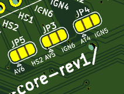
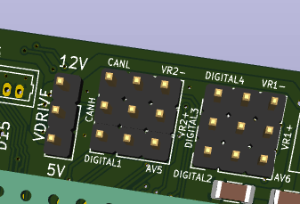

# Mazduino Core Rev1

## Overview

The Mazduino Core Rev1 is the follow-up revision of the [Mazduino Core Rev0](mazduino-core-rev0.md), an ECU built on a 48-pin automotive connector with a more complete I/O architecture than the Mini 6CH line. It uses an **ARM Cortex-M4 180 MHz** as its main MCU for advanced engine control, including support for **dual ETB**, **dual CAN bus**, combined **Hall + VR** inputs, and more actuator outputs for modern engines.

Rev1 brings several improvements over Rev0, including a new **12V Out** sensor supply (pin 17, for example for CKP/CMP sensors that need 12V power), an improved **5V sensor supply** that now delivers up to **3A** without running hot, named optional jumper channels (CON21, CON22, CON37, CON38), and new jumper options on pin 21 and pin 37. See [Changes in Rev1](#changes-in-rev1) for the full summary.

This documentation is based on the Mazduino Core product specification and the hardware reference in the MAZDUINO CORE document.


## Key Features

- **ARM Cortex-M4 180 MHz** MCU
- Built-in **5V sensor supply** up to **3A** with internal protection, more heat tolerant than Rev0
- Built-in **12V sensor supply** (pin 17) for sensors that need 12V power, for example 12V-type CKP/CMP sensors
- **4x Hall/Digital inputs** for CKP, CMP, VSS, clutch, launch, or other switches (all with an alternative jumper option)
- **11x analog inputs** for MAP, TPS, O2, pressure, temperature, PPS, and additional sensors
- **6x ignition outputs** (for smart coils, 5V/12V depending on configuration)
- **10x 3A low side outputs** for injectors, idle PWM, boost, VVT, and medium-load actuators
- **5x low current low side outputs** for relays (main relay, fuel pump, fan, AC, tach)
- **2x 1.3A high side outputs** for 12V switching loads
	- Example uses: **alternator control**, 12V solenoids, and other switching actuators within the current limit.

- **2x CAN bus** (depending on trace/jumper configuration)
- **2x VR inputs** for variable reluctor CKP/CMP sensors
- **2x ETB outputs** (ETB1 and ETB2)
- **Dual ETB IC (ETB1 and ETB2)** can also be used for **Idle Stepper** control
- USB, Serial, and CAN communication
- Firmware support for **rusEFI based** firmware only (official or custom firmware for the F4 MCU)

## Changes in Rev1

Compared with Rev0, Rev1 has the following fixes and changes:

| Pin | Rev0 | Rev1 | Notes |
|-----|------|------|------------|
| 4 (JP3) | AVS2 (Analog Volt 5) or Ignition 6 | AVS5 (Analog Volt 5) or Ignition 6 | Jumper option renamed; the signal is still Analog Volt 5 |
| 5 (JP5) | AVS3 (Analog Volt 6) or High Side 2 | AVS6 (Analog Volt 6) or High Side 2 | Jumper option renamed; the signal is still Analog Volt 6 |
| 6 | 5V Sensor Supply | 5V Sensor Supply (up to **3A**) | Higher 5V supply current capacity, more heat tolerant than Rev0 |
| 17 | Ground (Power ground) | **12V Out** (Sensor 12V power) | New pin for 12V sensor supply, for example 12V-type CKP/CMP sensors; no longer ground |
| 20 (JP4) | ATS2 (Analog Temp 4) or Ignition 5 | ATS4 (Analog Temp 4) or Ignition 5 | Jumper option renamed; the signal is still Analog Temp 4 |
| 21 | Digital 1 (fixed) | **CON21**: Digital 1 or AV5 (Analog Volt 5) — Jumper Option | Pin 21 now has an extra jumper option to Analog Volt 5 |
| 22 | IN22: Digital 3 or VR1+ | **CON22**: Digital 3 or VR1+ | Pin renamed; function unchanged |
| 37 | Digital 2 (fixed) | **CON37**: Digital 2 or AVS6 (Analog Volt 6) — Jumper Option | Pin 37 now has an extra jumper option to Analog Volt 6 |
| 38 | IN38: Digital 4 or VR1- | **CON38**: Digital 4 or VR1- — Jumper Option | Pin renamed; function unchanged |
| 41 | Analog Volt 8 | Analog Volt 5 | The Analog Volt 8 channel was removed; pin 41 now carries Analog Volt 5 directly |

> **Caution:** On Rev1, pin 17 changes from **Ground** to **12V Out** (12V supply for sensors). Do not wire pin 17 as ground when moving a harness from Rev0 to Rev1. Use pin 18, 39, or 40 for ground.

## Hardware and Jumper Configuration

The Mazduino Core has several pins whose function can be switched with solder jumpers. This lets one board be used for many different engine configurations.

### Solder Jumper Positions JP3, JP4, and JP5



The **JP3**, **JP4**, and **JP5** solder jumpers are on the bottom of the board.

On the back of the board there are jumpers that can be set to suit your needs, or as requested when you order: whether the board will be used on a 6-cylinder or only a 4-cylinder car, or whether you need extra analog inputs or a high side output (12v switching).

On JP3, JP4 and JP5, solder the jumper across 2 pins toward the center to pass the signal through to the ECU connector.

### Solderless Pin Header Jumpers



The solderless pin header jumpers are set as requested when you order, or you can move them yourself as needed. The ECU connector will then carry CANL or VR2-, Digital 4 or VR1-, CANH or VR2+, Digital 3 or VR1+ (pins IN33/IN34/CON22/CON38).

In addition, on Rev1 the **CON21** (Digital 1 or AV5) and **CON37** (Digital 2 or AVS6) pins use the same type of solderless pin header jumper.

### Additional Pin Headers (Prototype)

For prototyping, there are 4 six-pin headers that accept **JST XH 2.54** connectors.

| Header | Pinout |
|--------|--------|
| J2 | 5V, Analog Temp 4, Analog Volt 2, Analog Volt 3, GND, GND |
| J5 | 12V, CANL1, CANH1, CANL2, CANH2, GND |
| J6 | 5V, 5V, 5V, USB D-, USB D+, GND |
| J7 | 3.3V, 3.3V, 3.3V, 3.3V, GND |

### Ignition Volt Drive Jumper (12V / 5V)

The **Ignition Volt Drive** jumper selects the voltage level of the coil trigger signal: **12V** or **5V**.

Be careful and make sure the coil signal voltage is correct. If the voltage level is wrong, the coil can be damaged beyond use.

### ETB and Idle Stepper Notes

Because there are dual ICs for **ETB1** and **ETB2** control, those driver channels can also be used for **Idle Stepper** control, depending on the firmware configuration and wiring.

### Important Jumper Options

- **JP3 (Pin 4)**: select **AVS5 (Analog Volt 5)** or **Ignition 6**

- **JP4 (Pin 20)**: select **ATS4 (Analog Temp 4)** or **Ignition 5**

- **JP5 (Pin 5)**: select **AVS6 (Analog Volt 6)** or **High Side 2**

- **CON21 (Pin 21)**: select **Digital 1** or **AV5 (Analog Volt 5)**

- **CON22 (Pin 22)**: select **Digital 3** or **VR1+**

- **CON37 (Pin 37)**: select **Digital 2** or **AVS6 (Analog Volt 6)**

- **CON38 (Pin 38)**: select **Digital 4** or **VR1-**

- **IN33 (Pin 33)**: select **CANH1** or **VR2+**

- **IN34 (Pin 34)**: select **CANL1** or **VR2-**

### Configuration Notes

- For a **full 6-ignition** setup, enable ignition mode on Pin 4 and Pin 20.
- For a setup that needs extra analog inputs, enable analog mode on Pin 4/5/20/21/37.
- For VR trigger sensors, switch the Digital 3/4 or CANH/CANL channels to VR as needed.
- Always switch off ECU power before changing the jumper configuration.

## Wiring and Installation


### 48-pin Connector Layout

```
 1   2   3   4   5   6   7   8   9  10  11  12  13  14  15  16
17  18  19  20  21  22  23  24  25  26  27  28  29  30  31  32
33  34  35  36  37  38  39  40  41  42  43  44  45  46  47  48
```

### 48-pin ECU Connector Pin Assignment

| Pin | Function | Description |
|-----|--------|------------|
| 1 | 12V ECU | Main ECU power supply |
| 2 | Ignition 1 | Ignition output 1 |
| 3 | High Side 1 | 1.3A high side output for 12V switching (example: alternator control) |
| 4 | OUT4 (JP3) | Select AVS5 (Analog Volt 5) or Ignition 6 |
| 5 | OUT5 (JP5) | Select AVS6 (Analog Volt 6) or High Side 2 for 12V switching |
| 6 | 5V Sensor Supply | 5V sensor reference, up to 3A |
| 7 | ETB1+ | ETB 1 positive output |
| 8 | ETB1- | ETB 1 negative output |
| 9 | ETB2+ | ETB 2 positive output |
| 10 | ETB2- | ETB 2 negative output |
| 11 | Low Side 10 | 3A low side output |
| 12 | Low Side 9 | 3A low side output |
| 13 | Low Side 8 | 3A low side output |
| 14 | Low Side 7 | 3A low side output |
| 15 | Low Side 6 | 3A low side output |
| 16 | Low Side 5 | 3A low side output |
| 17 | 12V Out | Sensor 12V power, for example for 12V-type CKP/CMP sensors |
| 18 | Ground | Power ground |
| 19 | Ignition 2 | Ignition output 2 |
| 20 | OUT20 (JP4) | Select ATS4 (Analog Temp 4) or Ignition 5 |
| 21 | CON21 | Select Digital 1 or AV5 (Analog Volt 5) |
| 22 | CON22 | Select Digital 3 or VR1+ |
| 23 | Analog Temp 1 | Temperature input |
| 24 | Analog Temp 2 | Temperature input |
| 25 | Analog Volt 7 | 0-5V analog input |
| 26 | Analog Temp 3 | Temperature input |
| 27 | Low Side LC 15 | Low current output |
| 28 | Low Side LC 14 | Low current output |
| 29 | Low Side LC 13 | Low current output |
| 30 | Low Side LC 12 | Low current output |
| 31 | Low Side LC 11 / RPM | Low current output / tach |
| 32 | Low Side 4 | 3A low side output |
| 33 | IN33 | Select CANH1 or VR2+ |
| 34 | IN34 | Select CANL1 or VR2- |
| 35 | Ignition 3 | Ignition output 3 |
| 36 | Ignition 4 | Ignition output 4 |
| 37 | CON37 | Select Digital 2 or AVS6 (Analog Volt 6) |
| 38 | CON38 | Select Digital 4 or VR1- |
| 39 | Ground | Ground |
| 40 | Ground | Ground |
| 41 | Analog Volt 5 | 0-5V analog input |
| 42 | Analog Volt 1 | 0-5V analog input |
| 43 | Analog Volt 2 | 0-5V analog input |
| 44 | Analog Volt 3 | 0-5V analog input |
| 45 | Analog Volt 4 | 0-5V analog input |
| 46 | Low Side 3 | 3A low side output |
| 47 | Low Side 2 | 3A low side output |
| 48 | Low Side 1 | 3A low side output |

## I/O Count Summary

| Group | Count | Notes |
|----------|--------|------------|
| Hall/Digital Input | 4 | Digital 1, 2, 3, 4 (all with an alternative jumper option to AV/VR) |
| VR Input | 2 | VR1 (+/-) and VR2 (+/-) via jumper channels |
| Analog Input | 11 | Analog Volt (1-7) + Analog Temp (1-4), including jumper option pins |
| Ignition Output | 6 | Ignition 1-6 (5/6 via jumper) |
| Low Side 3A | 10 | Lowside 1-10 |
| Low Side Low Current | 5 | LC 11-15 |
| High Side 1.3A | 2 | High Side 1 + High Side 2 (via jumper), usable for 12V switching such as alternator control |
| ETB Output | 2 sets | ETB1 (+/-), ETB2 (+/-) |
| CAN Bus | 2 | CAN1 via jumper pins; CAN2 depending on board/firmware configuration |

## Firmware Function Mapping

Below is a typical function mapping for the firmware setup. The assignment can be adapted to the engine and the tuning strategy.

| Typical Function | Default Channel |
|------------|---------------|
| Ignition 1-6 | Ign 1 to Ign 6 |
| Injector 1-10 | Low Side 1 to Low Side 10 |
| Main Relay / Fuel Pump / Fan / AC / Tacho | Low Side Low Current 11 to 15 |
| MAP / TPS / O2 / PPS / Pressure sensors | Analog Volt 1 to 7 |
| CLT / IAT / Additional temp | Analog Temp 1 to 4 |
| CKP / CMP Hall | Digital 1 and Digital 2 |
| CKP / CMP VR | VR1 and VR2 (via jumper configuration) |
| ETB1 | ETB1+ and ETB1- |
| ETB2 | ETB2+ and ETB2- |

## Example I/O Usage Scenarios

The Low Side, Analog Volt, and Analog Temp channels are generic, so how they are allocated depends on the engine configuration and the ignition mode used. Some example scenarios:

- **Low Side as injectors**: Low Side 1 to 8 can be used as injector outputs for an **8-cylinder full sequential** engine (1 injector per channel). For engines with fewer cylinders, or in **batch/semi-sequential** mode, the number of Low Side channels used for injectors changes accordingly (the rest are free for idle PWM, boost, VVT, or other actuators).
- **Wasted Spark ignition mode**: used for engines with **8 cylinders or more**, with **4 ignition channels** (each coil serves a pair of cylinders). For engines with **6 cylinders or fewer**, ignition can be wired **individually/COP** (1 channel per cylinder) because the board provides up to 6 ignition channels. Unused ignition channels can be switched by jumper (Pin 4/Pin 20) to Analog Volt 5 / Analog Temp 4 for additional sensors.
- **Analog Volt**: used for 0-5V analog sensor inputs such as **MAP**, **TPS**, **O2/wideband**, **PPS**, or other pressure sensors.
- **Analog Temp**: used for temperature sensor inputs such as **CLT (Coolant Temp)** and **IAT (Intake Air Temp)**.

## MCU Information

- **MCU**: ARM Cortex-M4 180 MHz

- In the firmware, the ETB control lines are usually mapped to dedicated MCU pins (DIR/DIS/PWM) according to the firmware package.
- Use the firmware configuration file made specifically for the **Mazduino Core Rev1** so that all pins work as the board was designed.
- Firmware for this board is **rusEFI based** only (either official or custom firmware for the F4 MCU).

## Quick Installation Guide

1. Make sure all main grounds (pins 18/39/40) are well connected.
2. Connect pin 1 to a stable 12V ECU supply.
3. If you need a 12V supply for sensors (for example 12V-type CKP/CMP sensors), use pin 17 (**12V Out**). Do not wire it as ground.
4. Configure the jumpers before fitting the ECU to the final harness.
5. Select Hall or VR trigger mode according to the CKP/CMP sensor type.
6. If you use 6 ignition channels, enable the ignition option on the related jumper pins.
7. If you use dual ETB, verify the ETB1 and ETB2 wiring and calibrate TPS/PPS.
8. Check the outputs with test mode in TunerStudio/rusEFI before starting the engine.

## Important Notes

- **Pin 17 has a different function than on Rev0**: it changed from **Ground** to **12V Out** (12V supply for sensors, for example 12V-type CKP/CMP). Recheck the harness when moving from Rev0 to Rev1.
- The **5V Sensor Supply** (pin 6) on Rev1 delivers up to **3A** and is more heat tolerant than on Rev0, so it is safer when powering many 5V sensors at once.
- The ignition outputs are intended for **smart coils**. Dumb coils require an external driver/IGBT.
- The low current outputs are for relays or light loads, not for driving motors directly.
- **HS1 and HS2** can be used as **12V switching** outputs, for example for **alternator control**.
- Make sure the **Ignition Volt Drive** setting (12V/5V) matches the coil specification before powering up the system.
- All jumper changes must be made with the ECU **unpowered**.
- To use **CAN2**, follow the hardware schematic and the firmware configuration for your board revision.

## Software Tuning

- Download TunerStudio: [TunerStudio Downloads][tunerstudio-dl]

- rusEFI firmware reference: [wiki.rusefi.com][rusefi-wiki]

- Product information: [www.mazduino.com][mazduino-site]

[tunerstudio-dl]: https://www.tunerstudio.com/index.php/downloads
[rusefi-wiki]: https://wiki.rusefi.com
[mazduino-site]: https://www.mazduino.com
