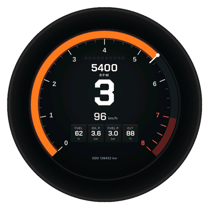
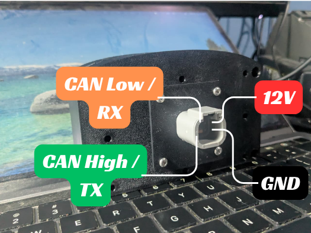
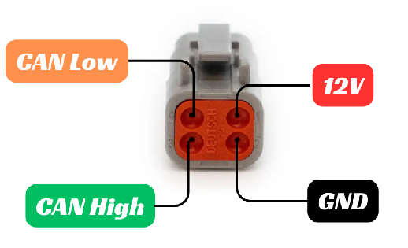

# Mazduino Dash R4

## Overview



*Some Dash R4 themes: Street (default), Wangan Night, Classic Beetle,
Motorsport, Car Status, Retro VFD, Synthwave, Halo, Ink Wave, and Classic*

Mazduino Dash R4 is a **round 4 inch** dash display with a touch screen.
What it shows comes as **themes**, which you can install, remove, and adjust
yourself from the **DashTune** app over Bluetooth. The choices range from
racing gauges and classic gauges to themes with a photo of your own car.

| Variant | Screen Size | Connector |
| :---- | :---- | :---- |
| Dash R4 | 4 inch, round | DTM4 (Deutsch DTM 4 Pin) |

## Key Features

- Dozens of ready-to-install themes from the **Theme Store** in DashTune, with
  **up to 10 themes** stored on the dash at once. The **Street** theme is built
  into the firmware and is always there.
- You can change what each data panel in a theme shows, for example from Oil
  Pressure to IAT.
- Supports **rusEFI**, **Haltech**, **MaxxECU**, **ECUMASTER EMU Black**,
  **Link Generic Dash**, **Speeduino**, **OBD-II**, and **M-Link**
  ([CAN IO Extender](can-io-extender.md#vehicles-without-a-can-bus-m-link-protocol)).
- **Fuel consumption (km/l)** is calculated on the dash, if the ECU sends fuel
  flow and speed data.
- Warnings (alarms) for Oil Pressure, Fuel Pressure, CLT, Oil Temp, Fuel
  Level, and Battery.
- **Extra inputs**: turn signal, head light, and fuel level signals can be taken
  from the car, and the screen dims automatically when the lights are on. The
  head light input can also be used for a theme change button.
- **Google Maps directions** and **music** from your phone show up as short
  notifications on the screen.
- Your own **splash screen** at power-up, which can be animated, or made from a
  GIF or video.
- **Firmware updates** through the app, with no cable.

## DTM4 / 4 Pin Connector

Dash R4 uses the same **DTM4 (Deutsch DTM 4 Pin)** connector as
[Racedash Pro](mazduino-racedash-pro.md#dtm4-4-pin-connector), both in physical
form and in the function of each pin. A cable from a Racedash Pro can be used
as is.



*Dash connector side*



*Cable connector side*

| Pin No. | Description |
| :---- | :---- |
| 1 | 12V Power Supply |
| 2 | Ground |
| 3 | CAN High / TX |
| 4 | CAN Low / RX |

**Note:**

- Pins 3 and 4 work as **CAN High/CAN Low** for all ECUs that use CAN Bus
  (rusEFI, Haltech, MaxxECU, ECUMASTER, Link, OBD-II, M-Link).
- For **Speeduino** ECUs only, pins 3 and 4 work as **Serial TX/RX**, because
  Speeduino has no native CAN Bus.

## Supported ECUs

| ECU | Connection |
| :---- | :---- |
| rusEFI | CAN Bus 500 kbps |
| Haltech | CAN Bus 1 Mbps |
| MaxxECU | CAN Bus 500 kbps |
| ECUMASTER EMU Black | CAN Bus 1 Mbps |
| Link Generic Dash | CAN Bus 1 Mbps |
| Speeduino | Serial |
| OBD-II | CAN Bus (ISO 15765-4) |
| M-Link (CAN IO Extender) | CAN Bus 500 kbps |

The ECU type is selected from the menu on the dash screen (**Settings → ECU**)
or from DashTune (**General Setting**). **No firmware change is needed**, and
the CAN speed adjusts by itself.

- Switching between ECUs that both use CAN Bus takes effect immediately,
  without a restart.
- Switching **from or to Speeduino** only takes effect after the dash is turned
  off and on again, because the function of pins 3 and 4 changes too.

What must be enabled on each ECU is covered in
[ECU Configuration for Racedash](setting-ecu-racedash.md). The settings are the
same for Dash R4.

> **OBD-II**: not every OBD-II car can be read, and the data depends on what
> your car answers. The limits are the same as on Racedash Pro; read
> [OBD-II limitations](mazduino-racedash-pro.md#obd-ii-limitations) before buying for
> OBD-II use.

## Themes

A theme is the look of the dashboard. Each theme carries its own gauge layout,
colors, and images, like the examples in the [Overview](#overview).

The full list is in the DashTune **Theme Store**, and new themes keep being
added.

### Switching themes

- **Swipe left or right** on the screen to move to the next theme.
- Or open the dash menu, choose **Themes**, then tap the theme you want.

The dash remembers the last theme shown. If you want the dash to always start
with a particular theme, open **Themes** in the dash menu and press
**Set default** on that theme.

### Installing themes from DashTune

1. Connect DashTune to the dash (see
   [Connecting for the first time](#connecting-for-the-first-time)).
2. Open the **Themes** menu. It shows the themes already installed on the dash,
   with their images, and how many there are (for example "4 of 10 themes on
   the dash").
3. Open the **Theme Store**, choose a theme, then press download.
4. The theme is sent to the dash over the dash's WiFi. This runs by itself, so
   **keep the phone screen on and do not close the app** until it finishes.

The dash stores **at most 10 themes**. When it is full, DashTune asks which
theme to remove to make room for the new one. A removed theme stays in the
Theme Store and can be installed again at any time.

If an installed theme has a newer version in the store, DashTune marks it with
**UPDATE**.

### Adjusting a theme (Customize)

In the **Themes** menu, choose an installed theme and press **Customize**. What
can be adjusted differs per theme:

- **Data panel contents**: the panels are named **Data 1**, **Data 2**, and so
  on. Choose the data to show in that panel, for example Oil Pressure, Fuel
  Pressure, CLT, IAT, AFR, Battery, or KM/L.
- **Car photo** (Car Status theme): replace the default car photo with a photo
  of your own car.
- **Text** (for example the Ink Wave and Sticker Bomb themes): replace the text
  on the theme with the name of your car or team.
- **Colors** and other options the theme provides.

Changes are sent to the dash and stay saved even when the dash is turned off.

#### Using a photo of your own car (Car Status)

1. In **Customize**, choose **Change photo**, then **Take a photo** or
   **Choose from gallery**. A photo of the car from the front side gives the
   best result.
2. Choose how to handle the **photo background**:
    - **Automatic**: the app cuts the car out of its background by itself.
    - **Manual**: erase the background with your finger, using the **Erase**,
      **Restore**, and **Undo** buttons.
    - **Keep**: the photo is used as it is, background included.
3. **Drag and pinch** the photo so the car fits inside the frame. The frame
   shows the area that appears on the dash.
4. Tap the lights you are asked for (for example the headlights), following
   the **Example** below the frame. This tells the dash where the lights are
   that light up with data from the ECU.
5. Press **Save** to send the photo to the dash.

## Dash screen menu

### Screen gestures

| Gesture | Result |
| :---- | :---- |
| Swipe left / right | Change theme |
| Swipe up from the bottom of the screen | Open the menu |
| Swipe down | Close the menu |
| Tap the warning banner | Silence that warning for 60 seconds |
| Tap the splash screen | Skip the splash, go straight to the dashboard |

The way to open the menu can be changed to **Double tap** in
**Settings → Open menu**.

### Menu layout

```
MENU
├── Settings   → Brightness, ECU, Max RPM, Shift RPM, Fuel tank, Open menu
├── Themes     → list of themes; tap to show one, Set default for the theme at power-up
└── Music      → song playing on the phone, with previous / play-pause / next buttons
```

### Settings

| Setting | Function |
| :---- | :---- |
| Brightness | Screen brightness, 20–100% |
| ECU | ECU type / protocol |
| Max RPM | Full RPM scale, in steps of 500 RPM |
| Shift RPM | RPM at which the shift light starts to light |
| Fuel tank | Tank capacity in liters, to calculate the remaining fuel |
| Open menu | How to open the menu: Swipe up or Double tap |

These values are the same ones set in DashTune **General Setting**, and are
saved when the menu is closed (**Done**).

## Warnings (alarms)

When a value stays past its limit for more than 1 second, a warning banner
appears at the bottom of the screen for 6 seconds. The theme stays visible
above it. After that the banner goes away for 20 seconds so it does not cover
the display, then appears again if the problem is still there. When there are
several warnings at once, the banners take turns.

| Data | Default limit |
| :---- | :---- |
| Oil Pressure | Below 1.0 bar with the engine above 1200 RPM |
| Fuel Pressure | Below 2.5 bar |
| CLT | Above 102 °C |
| Oil Temp | Above 125 °C |
| Fuel Level | Below 10% |
| Battery | Below 11.5 V |

The limit for each data item can be changed in DashTune, in
**General Setting → Data Sources**. Tap the banner to silence that warning for
60 seconds.

Gauge colors in all themes follow the same limits: normal, yellow when nearing
the limit, then red when past it.

## Fuel consumption (km/l)

The dash calculates **fuel consumption in km/l** from two pieces of ECU data:

- **Fuel flow**, for example from rusEFI or Haltech
- **Vehicle speed** (VSS)

The figure appears in themes that show it, or you can add it yourself through
**Customize** by choosing **KM/L** in one of the data panels. When the vehicle
is stopped or moving very slowly (below 3 km/h), the figure is 0. If your ECU
does not send fuel flow or speed, this value is not available.

## Extra inputs: turn signal, head light, and fuel level

For ECUs that do not send this data, signals from the car can be connected to
spare pins on the Dash R4 and then set up in DashTune in the **Extra inputs**
menu.

> **Important:** all pins work at **3.3 V**. A 12 V signal must go through
> optocoupler protection. **Do not connect car wires directly to the pins.**

Pin choices, settings, and fuel level calibration are on the
[Dash R4 Extra Inputs](input-tambahan-dash-r4.md) page.

---

## DashTune App Guide

DashTune is an Android app for setting up the dash from your phone over
**Bluetooth**.

> **Getting the app:** go to **[www.mazduino.com](https://www.mazduino.com/)**
> and look for the DashTune section on the home page. The app is still in
> closed testing, so access is granted per account. Enter the email address of
> your Google Play account there, and an invitation will be sent by email.

### Connecting for the first time

1. Turn the ignition key on until the dash lights up.
2. Open DashTune, go to the **Device** tab, and press **Add Dash**.
3. Press **Scan**. The dash appears with the name **MazduinoDash-R4**.
4. Choose that dash. Once connected, the app goes straight to the menu page.

If it is not found: make sure the phone's Bluetooth is on, the dash is powered
on, and the dash is not connected to another phone.

A dash that has been connected before is remembered, and the app connects by
itself the next time it is opened, also after the dash has been turned off and
on again.

### DashTune menu contents

| Menu | Function |
| :---- | :---- |
| **Themes** | Installed themes, Theme Store, and Customize |
| **General Setting** | ECU type, units, MAP mode, RPM, tank, and warning limits |
| **Extra inputs** | Pins for turn signals, head light (and screen dimming) or theme change button, and fuel level |
| **Splash** | Make your own splash screen |
| **Info** | Firmware version and device status |
| **Update Firmware** | Update the dash firmware |

### Splash screen

The splash screen shows for a few seconds when the dash is turned on, then
changes to the theme. In the **Splash** menu, choose how to make it:

- **Layers**: arrange images, logos, and text in layers. Each layer can have
  its own entrance animation (for example fade, pop, spin, slide, flicker,
  glitch, drop) and appear one after another. Many fonts and text effects are
  available, plus a button to remove an image's background.
- **GIF**: choose a GIF file from the phone.
- **Video**: choose a video from the gallery, then set its length (1–8
  seconds), the frames per second, and whether it loops.

GIFs and videos are converted on the phone first so the dash can play them
smoothly. The longer the animation, the larger the file and the longer the dash
takes to start, so the app limits it to about 2 MB and cuts off the end if it
is larger.

Once sent, press **Play on the dash** or **Restart the dash** on the same page
to see the result right away.

Like themes, the splash is sent over the dash's WiFi, so **keep the phone
screen on and do not close the app** until it finishes.

### Firmware update

Go to the **Update Firmware** menu. The app checks the server for the latest
version and shows the version installed now. If there is a new version, press
the update button.

During the update, the dashboard keeps showing until the firmware has been
fully sent, then the dash restarts by itself with the new firmware, and
DashTune reconnects. If the new firmware fails to start, the dash automatically
goes back to the previous firmware.

> **Warning**: Do not update while driving. The dash refuses updates while the
> engine is running. Make sure the vehicle is in a safe state, power is not
> interrupted, and the app is not closed until it finishes.

### Relay feature: Google Maps and music

DashTune can forward **Google Maps directions** and the **song that is
playing** to the dash. The settings are in the **More → Relay** tab.

- Directions appear at the top of the screen as a short, slightly transparent
  notification, then go away by themselves. The notification appears again
  when there is a new turn or road, or when the distance to the next turn
  drops below 200 meters.
- The song title appears briefly when the song changes or when it is
  played/paused. The song that is playing can also be viewed and controlled
  from the dash menu, under **Music**.
- Tap a notification to close it sooner.

This feature needs notification access permission on the phone, and the app
takes you to that settings page the first time it is turned on.

## References

- Mazduino Website - [https://www.mazduino.com/](https://www.mazduino.com/)
- Mazduino Wiki - [https://wiki.mazduino.com/](https://wiki.mazduino.com/)
- Mazduino Github - [https://github.com/mazduino/mazduino](https://github.com/mazduino/mazduino)
