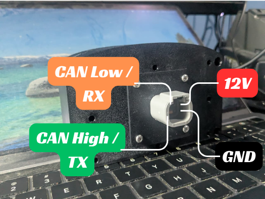
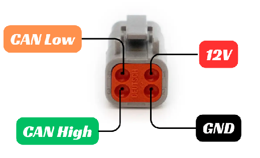

# Mazduino Dash R4

## Gambaran Umum

<!-- Simulator renders of three themes; the round face is the whole screen. -->
<div style="display:flex;flex-wrap:wrap;gap:12px;margin:16px 0">
  
  
  
</div>

*Dash R4 dengan tema Street (bawaan), Wangan Night, dan Classic Beetle*

Mazduino Dash R4 adalah dash display **bulat 4 inch** dengan layar sentuh.
Tampilannya berupa **tema**, yang bisa dipasang, dilepas, dan diatur sendiri
dari aplikasi **DashTune** lewat Bluetooth. Pilihannya mulai dari gauge
balap, gauge klasik, sampai tema dengan foto mobil Anda sendiri.

| Varian | Ukuran Layar | Konektor |
| :---- | :---- | :---- |
| Dash R4 | 4 inch, bulat | DTM4 (Deutsch DTM 4 Pin) |

## Fitur Utama

- Puluhan tema siap pasang dari **Theme Store** di DashTune, dan **sampai 10
  tema** tersimpan di dash sekaligus. Tema **Street** sudah tertanam di
  firmware dan selalu ada.
- Isi panel data di tiap tema bisa diganti sendiri, misalnya dari Oil
  Pressure menjadi IAT.
- Mendukung **rusEFI**, **Haltech**, **MaxxECU**, **ECUMASTER EMU Black**,
  **Link Generic Dash**, **Speeduino**, **OBD-II**, dan **M-Link**
  ([CAN IO Extender](can-io-extender.md#kendaraan-tanpa-can-bus-protokol-m-link)).
- **Konsumsi bahan bakar (km/l)** dihitung di dash, kalau ECU mengirim data
  fuel flow dan kecepatan.
- Peringatan (alarm) untuk Oil Pressure, Fuel Pressure, CLT, Oil Temp, Fuel
  Level, dan Battery.
- **Petunjuk arah Google Maps** dan **musik** dari HP tampil sebagai notifikasi
  singkat di layar.
- **Splash screen** sendiri saat dinyalakan, bisa beranimasi, atau dari GIF dan
  video.
- **Update firmware** lewat aplikasi, tanpa kabel.

## Konektor DTM4 / 4 Pin

Dash R4 memakai konektor **DTM4 (Deutsch DTM 4 Pin)** yang sama dengan
[Racedash Pro](mazduino-racedash-pro.md#konektor-dtm4-4-pin), baik bentuk
fisiknya maupun fungsi tiap pin. Kabel dari Racedash Pro bisa langsung
dipakai.



*Dash connector side*



*Cable connector side*

| No. Pin | Deskripsi |
| :---- | :---- |
| 1 | 12V Power Supply |
| 2 | Ground |
| 3 | CAN High / TX |
| 4 | CAN Low / RX |

**Catatan:**

- Pin 3 dan 4 berfungsi sebagai **CAN High/CAN Low** untuk semua ECU yang
  memakai CAN Bus (rusEFI, Haltech, MaxxECU, ECUMASTER, Link, OBD-II, M-Link).
- Khusus untuk ECU **Speeduino**, pin 3 dan 4 berfungsi sebagai **TX/RX
  Serial**, karena Speeduino tidak memiliki CAN Bus native.

## ECU yang didukung

| ECU | Cara sambung |
| :---- | :---- |
| rusEFI | CAN Bus 500 kbps |
| Haltech | CAN Bus 1 Mbps |
| MaxxECU | CAN Bus 500 kbps |
| ECUMASTER EMU Black | CAN Bus 1 Mbps |
| Link Generic Dash | CAN Bus 1 Mbps |
| Speeduino | Serial |
| OBD-II | CAN Bus (ISO 15765-4) |
| M-Link (CAN IO Extender) | CAN Bus 500 kbps |

Tipe ECU dipilih dari menu di layar dash (**Settings → ECU**) atau dari
DashTune (**General Setting**). **Tidak perlu ganti firmware**, dan kecepatan
CAN ikut menyesuaikan sendiri.

- Berpindah antar-ECU yang sama-sama memakai CAN Bus langsung berlaku, tanpa
  restart.
- Berpindah **dari atau ke Speeduino** baru berlaku setelah dash dimatikan dan
  dinyalakan kembali, karena fungsi pin 3 dan 4 ikut berubah.

Apa yang harus diaktifkan di masing-masing ECU dibahas di
[Konfigurasi ECU untuk Racedash](setting-ecu-racedash.md). Pengaturannya sama
untuk Dash R4.

> **OBD-II**: tidak semua mobil OBD-II bisa dibaca, dan datanya bergantung
> pada apa yang dijawab mobil Anda. Batasannya sama dengan Racedash Pro, baca
> [Batasan OBD-II](mazduino-racedash-pro.md#batasan-obd-ii) sebelum membeli
> untuk keperluan OBD-II.

## Tema

Tema adalah tampilan dashboard. Setiap tema membawa susunan gauge, warna,
dan gambarnya sendiri. Beberapa contoh:

<!-- A flex row rather than a table, as on the Racedash Pro page: it wraps
     and scales on a phone instead of cutting the second column off. -->
<div style="display:flex;flex-wrap:wrap;gap:12px;margin:16px 0">
  
  
  
  
  
</div>

*Motorsport, Retro VFD, Halo, Car Status, dan Synthwave*

Daftar lengkap ada di **Theme Store** DashTune, dan tema baru terus
ditambahkan.

### Berpindah tema

- **Geser kiri atau kanan** di layar untuk pindah ke tema berikutnya.
- Atau buka menu dash, pilih **Themes**, lalu ketuk tema yang diinginkan.

Dash mengingat tema terakhir yang tampil. Kalau ingin dash selalu menyala
dengan tema tertentu, buka **Themes** di menu dash lalu tekan **Set default**
pada tema tersebut.

### Memasang tema dari DashTune

1. Sambungkan DashTune ke dash (lihat
   [Menyambungkan pertama kali](#menyambungkan-pertama-kali)).
2. Buka menu **Tema**. Di sini tampil tema yang sudah terpasang di dash,
   lengkap dengan gambarnya, beserta jumlahnya (misalnya "4 dari 10 tema").
3. Buka **Theme Store**, pilih tema, lalu tekan unduh.
4. Tema dikirim ke dash lewat WiFi dash. Prosesnya berjalan sendiri, jadi
   **biarkan layar HP menyala dan jangan tutup aplikasi** sampai selesai.

Dash menyimpan **paling banyak 10 tema**. Kalau sudah penuh, DashTune akan
menanyakan tema mana yang dihapus untuk memberi tempat bagi tema baru. Tema
yang dihapus tetap ada di Theme Store dan bisa dipasang lagi kapan saja.

Kalau tema yang terpasang punya versi lebih baru di store, DashTune
menandainya dengan **UPDATE**.

### Mengatur tema (Sesuaikan)

Di menu **Tema**, pilih tema yang terpasang lalu tekan **Sesuaikan**. Yang
bisa diatur berbeda-beda per tema:

- **Isi panel data**: tiap panel diberi nama **Data 1**, **Data 2**, dan
  seterusnya. Pilih data yang ingin ditampilkan di panel itu, misalnya Oil
  Pressure, Fuel Pressure, CLT, IAT, AFR, Battery, atau KM/L.
- **Foto mobil** (tema Car Status): ganti foto mobil bawaan dengan foto mobil
  Anda sendiri.
- **Tulisan** (misalnya tema Ink Wave dan Sticker Bomb): ganti tulisan pada
  tema dengan nama mobil atau tim Anda.
- **Warna** dan pilihan lain yang disediakan tema.

Perubahan dikirim ke dash dan tetap tersimpan meski dash dimatikan.

#### Memasang foto mobil sendiri (Car Status)

1. Di **Sesuaikan**, pilih **Ganti foto**, lalu **Ambil foto** atau **Pilih
   dari galeri**. Foto mobil dari samping depan memberi hasil terbaik.
2. Pilih cara menangani **latar belakang foto**:
    - **Otomatis**: aplikasi memotong mobil dari latarnya sendiri.
    - **Manual**: hapus latar dengan jari, dengan tombol **Hapus**,
      **Kembalikan**, dan **Urungkan**.
    - **Biarkan**: foto dipakai apa adanya, lengkap dengan latarnya.
3. **Geser dan cubit** foto agar mobil pas di dalam bingkai. Bingkai
   menunjukkan area yang tampil di dash.
4. Ketuk bagian lampu yang diminta (misalnya lampu depan), mengikuti
   **Contoh** di bawah bingkai. Dari sini dash tahu letak lampu yang menyala
   bersama data dari ECU.
5. Tekan **Simpan** untuk mengirim foto ke dash.

## Menu di layar dash

### Gerakan di layar

| Gerakan | Hasil |
| :---- | :---- |
| Geser kiri / kanan | Ganti tema |
| Geser ke atas dari bagian bawah layar | Buka menu |
| Geser ke bawah | Tutup menu |
| Ketuk banner peringatan | Diamkan peringatan itu selama 60 detik |
| Ketuk splash screen | Lewati splash, langsung ke dashboard |

Cara membuka menu bisa diganti menjadi **ketuk dua kali** (Double tap) lewat
**Settings → Open menu**.

### Susunan menu

```
MENU
├── Settings   → Brightness, ECU, Max RPM, Shift RPM, Fuel tank, Open menu
├── Themes     → daftar tema; ketuk untuk menampilkan, Set default untuk tema saat menyala
└── Music      → lagu yang sedang diputar di HP, dengan tombol sebelumnya / putar-jeda / berikutnya
```

### Settings

| Pengaturan | Fungsi |
| :---- | :---- |
| Brightness | Kecerahan layar, 20–100% |
| ECU | Tipe ECU / protokol |
| Max RPM | Skala penuh RPM, naik-turun 500 RPM |
| Shift RPM | RPM saat shift light mulai menyala |
| Fuel tank | Kapasitas tangki dalam liter, untuk menghitung sisa bahan bakar |
| Open menu | Cara membuka menu: Swipe up atau Double tap |

Nilai-nilai ini sama dengan yang diatur di **General Setting** DashTune, dan
disimpan saat menu ditutup (**Done**).

## Peringatan (alarm)

Kalau sebuah nilai melewati batas selama lebih dari 1 detik, banner peringatan
muncul di bagian bawah layar. Tema tetap terlihat di atasnya.

| Data | Batas bawaan |
| :---- | :---- |
| Oil Pressure | Di bawah 1,0 bar saat mesin di atas 1200 RPM |
| Fuel Pressure | Di bawah 2,5 bar |
| CLT | Di atas 102 °C |
| Oil Temp | Di atas 125 °C |
| Fuel Level | Di bawah 10% |
| Battery | Di bawah 11,5 V |

Batas tiap data bisa diubah di DashTune, di **General Setting → Sumber
Data**. Ketuk banner untuk mendiamkan
peringatan itu selama 60 detik.

Warna gauge di semua tema juga ikut batas yang sama: normal, kuning saat
mendekati batas, lalu merah saat melewatinya.

## Konsumsi bahan bakar (km/l)

Dash menghitung **konsumsi bahan bakar dalam km/l** dari dua data ECU:

- **Fuel flow**, misalnya dari rusEFI atau Haltech
- **Kecepatan kendaraan** (VSS)

Angkanya muncul di tema yang menampilkannya, atau bisa dipasang sendiri
lewat **Sesuaikan** dengan memilih **KM/L** di salah satu panel data. Saat
kendaraan berhenti atau sangat pelan (di bawah 3 km/jam), angkanya 0. Kalau
ECU Anda tidak mengirim fuel flow atau kecepatan, nilai ini tidak tersedia.

---

## Panduan Aplikasi DashTune

DashTune adalah aplikasi Android untuk mengatur dash dari HP lewat
**Bluetooth**.

> **Mendapatkan aplikasinya:** buka **[www.mazduino.com](https://www.mazduino.com/)**
> dan cari bagian DashTune di halaman depan. Aplikasi ini masih dalam tahap uji
> tertutup, jadi aksesnya diberikan per akun. Masukkan alamat email akun Google
> Play Anda di sana, dan undangan akan dikirim lewat email.

### Menyambungkan pertama kali

1. Nyalakan kunci kontak sampai dash menyala.
2. Buka DashTune, masuk ke tab **Perangkat**, tekan **Tambah Dash**.
3. Tekan **Pindai**. Dash muncul dengan nama **MazduinoDash-R4**.
4. Pilih dash tersebut. Setelah tersambung, aplikasi langsung membuka halaman
   menu.

Kalau tidak ketemu: pastikan Bluetooth HP menyala, dash dalam keadaan hidup,
dan dash tidak sedang tersambung ke HP lain.

Dash yang sudah pernah disambungkan akan diingat, dan aplikasi menyambung
sendiri saat dibuka berikutnya, juga setelah dash dimatikan lalu dinyalakan
lagi.

### Isi menu DashTune

| Menu | Fungsi |
| :---- | :---- |
| **Tema** | Tema yang terpasang, Theme Store, dan Sesuaikan |
| **General Setting** | Tipe ECU, satuan, mode MAP, RPM, tangki, dan batas peringatan |
| **Splash** | Membuat splash screen sendiri |
| **Info** | Versi firmware dan kondisi perangkat |
| **Update Firmware** | Memperbarui firmware dash |

### Splash screen

Splash screen tampil beberapa detik saat dash dinyalakan, lalu berganti ke
tema. Di menu **Splash**, pilih cara membuatnya:

- **Buat sendiri**: susun gambar, logo, dan tulisan per layer. Tiap layer bisa
  diberi animasi masuk sendiri (misalnya fade, pop, spin, slide, flicker,
  glitch, drop) dan muncul bergantian. Tersedia banyak pilihan font dan efek
  tulisan, serta tombol untuk menghapus latar belakang gambar.
- **GIF**: pilih file GIF dari HP.
- **Video**: pilih video dari galeri, lalu atur panjangnya (1–8 detik), jumlah
  frame per detik, dan apakah diputar berulang.

GIF dan video diubah dulu di HP agar bisa diputar dash dengan lancar. Semakin
panjang animasinya, semakin besar ukurannya dan semakin lama dash menyala, jadi
aplikasi membatasinya sekitar 2 MB dan memotong bagian akhir kalau lebih.

Setelah terkirim, tekan **Putar di dash** atau **Mulai ulang dash** di halaman
yang sama untuk langsung melihat hasilnya.

Seperti tema, splash dikirim lewat WiFi dash, jadi **biarkan layar HP menyala
dan jangan tutup aplikasi** sampai selesai.

### Update firmware

Masuk ke menu **Update Firmware**. Aplikasi memeriksa versi terbaru di server
dan menampilkan versi yang terpasang sekarang. Kalau ada versi baru, tekan
tombol update.

Selama update, dashboard tetap tampil sampai firmware selesai terkirim, lalu
dash menyala ulang sendiri dengan firmware baru, dan DashTune menyambung
kembali. Kalau firmware baru gagal menyala, dash otomatis kembali ke firmware
sebelumnya.

> **Peringatan**: Jangan lakukan update sambil berkendara. Dash menolak update
> selama mesin hidup. Pastikan kendaraan dalam keadaan aman, listrik tidak
> terputus, dan aplikasi tidak ditutup sampai selesai.

### Fitur relay: Google Maps dan musik

DashTune bisa meneruskan **petunjuk arah Google Maps** dan **lagu yang sedang
diputar** ke dash. Pengaturannya ada di tab **Lainnya → Relay**.

- Petunjuk arah muncul di bagian atas layar sebagai notifikasi singkat dan
  agak transparan, lalu hilang sendiri. Notifikasi muncul lagi saat ada
  belokan atau jalan baru, atau saat jarak ke belokan berikutnya di bawah
  200 meter.
- Judul lagu muncul sebentar saat lagu berganti atau saat diputar/dijeda.
  Lagu yang sedang diputar juga bisa dilihat dan dikendalikan dari menu dash,
  di **Music**.
- Ketuk notifikasi untuk menutupnya lebih cepat.

Fitur ini perlu izin akses notifikasi di HP, dan aplikasi akan mengarahkan ke
halaman pengaturannya saat pertama kali diaktifkan.

## Referensi

- Website Mazduino - [https://www.mazduino.com/](https://www.mazduino.com/)
- Wiki Mazduino - [https://wiki.mazduino.com/](https://wiki.mazduino.com/)
- Github Mazduino - [https://github.com/mazduino/mazduino](https://github.com/mazduino/mazduino)
