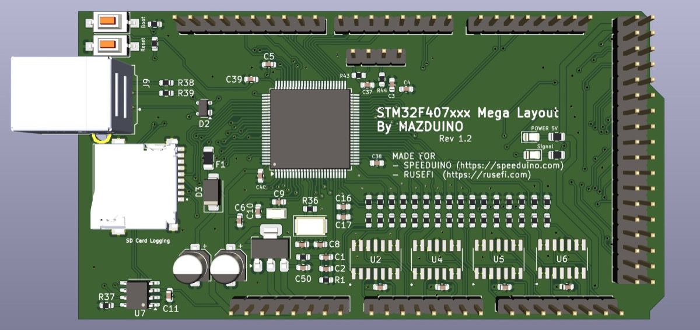
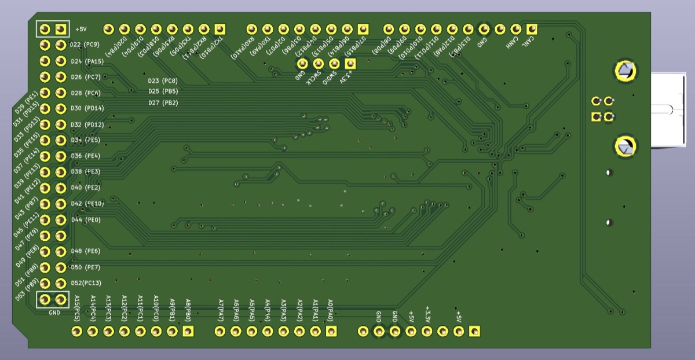

# Mazduino Mega100

## Overview

The Mazduino Mega100 is an **STM32F407** MCU board with the same size and headers as the Arduino Mega 2560. It plugs into the Arduino Mega socket on a Speeduino board in place of the Arduino Mega, so an existing Speeduino board can run the **rusEFI Mazduino** firmware.

With the Mega100, a Speeduino board gets a 168 MHz ARM Cortex-M4 MCU, USB, a microSD slot, CAN bus, and rusEFI firmware features such as Lua, boost, VVT, launch control and data logging. Injector, coil, trigger, sensor and output pins are set from TunerStudio with a single preset button for the Speeduino board in use.

This documentation follows the **Mega100 v1.3** hardware (Mega converter v1.3).

*Render of rev1.2. The component layout on v1.3 may differ slightly.*

## Firmware Variants

There are two firmware builds, chosen by the STM32 chip fitted:

| Firmware | Chip | Flash | Notes |
|----------|------|-------|------------|
| `mazduino-mega100` | STM32F407VGT6 | 1 MB | Full features: Lua, ETB, traction control, software knock, SD card logging, automatic transmission (TCU) |
| `mazduino-mega100-512` | STM32F407VET6 | 512 KB | Reduced features to fit: no Lua, ETB, traction control, software knock, SD card logging, boost, launch, anti-lag, VVT, speed sensor, alternator, main relay or TCU |

A full feature comparison per board is in [FEATURES.md](https://github.com/mazduino/mazduino-fw/blob/master/boards/FEATURES.md). Mega100 and Mega100-512 have no [BIGFUEL](firmware/bigfuel.md) variant.

Mazduino recommends the rusEFI Mazduino firmware from the [Downloads](downloads.md) page. Speeduino firmware is also available for the 1 MB Mega100, but it is still **pre-release and not yet tested on hardware**. Mega100-512 is not supported by the Speeduino firmware. See [Speeduino Firmware](downloads.md#firmware-speeduino).

## Buffered and Unbuffered Versions

The Mega100 comes in two versions. The difference is the voltage of the digital outputs (D pins) that drive the injectors, coils and other outputs on the Speeduino board:

| Version | Digital output | Notes |
|-------|----------------|------------|
| Buffered | 5V | Outputs raised to 5V like the Arduino Mega |
| Unbuffered | 3.3V | Outputs directly from the MCU |

The Arduino Mega outputs 5V, and some Speeduino boards use MOSFETs that need a 5V gate to turn fully on. For the **unbuffered** version, replace those MOSFETs with logic-level types that turn fully on at a 3.3V gate.

!!! warning "MOSFET not fully on"
    A 5V-gate MOSFET driven with only 3.3V does not turn fully on, so the MOSFET can get hot and the output may not work correctly. Check the datasheet of the MOSFETs on your Speeduino board before using the unbuffered version.

The word "buffer" here refers to the digital outputs. The A0–A15 analog inputs have their own buffer (see Hardware Features).

The v1.3 schematic used for this page is the unbuffered version.

## Hardware Features

- **STM32F407** MCU (ARM Cortex-M4, 168 MHz), 8 MHz crystal and 32.768 kHz RTC crystal
- Same size and headers as the Arduino Mega 2560, fits straight into the Speeduino board socket
- **16 analog inputs** (A0–A15) with buffers and voltage dividers, so 0–5V sensor signals are safe for the 3.3V MCU
- **USB Type-B** for TunerStudio and firmware updates (DFU), with ESD protection and a polyfuse
- **microSD slot** for data logging (SPI3)
- **CAN bus** with an on-board transceiver
- **RESET** and **BOOT** buttons to enter DFU mode
- **SWD** header for ST-Link
- Power LED and status LED
- On-board 3.3V regulator, fed from the Speeduino board's 5V supply

## Connectors and Headers

### Arduino Mega Header

The labels on the back of the board show each header pin name and its STM32 pin.

All Arduino Mega headers (D0–D53, A0–A15, power) are in the same positions as on the Arduino Mega 2560. Some pins differ:

- **D21** and **D46** are not connected to the MCU.
- **D43** also drives the board status LED (PB7). The presets do not use this pin.
- **A0–A15** are inputs only. Because they go through a buffer, the analog pins cannot be used as outputs.
- On the 10-pin header next to D8–D13, the **SDA** and **SCL** positions carry **CANH** and **CANL**, and the **AREF** position is not connected. Make sure the Speeduino board does not connect anything to the SDA/SCL pins on that header.

### CAN Bus

CANH and CANL are available on the 2-pin header **J11** (pin 1 CANL, pin 2 CANH), and also on the SDA/SCL positions of the 10-pin header described above. The transceiver is already on the board, so CAN wires from a dash, wideband or other device connect directly to CANH/CANL. CAN settings are in [CAN Bus Configuration](tunerstudio-canbus.md).

### SWD (J10)

| Pin | Function |
|-----|--------|
| 1 | 3.3V |
| 2 | SWDIO |
| 3 | SWCLK |
| 4 | GND |

### Buttons and LEDs

| Component | Function |
|----------|--------|
| RESET | Restarts the MCU |
| BOOT | Hold during reset or while plugging in USB to enter DFU mode |
| Power LED | On when 5V supply is present |
| Status LED | Error indicator on PB7 (D43) |

## Installing on a Speeduino Board

1. Turn off the Speeduino board, then remove the Arduino Mega from its socket.
2. Fit the Mega100 in the same socket, facing the same way as the Arduino Mega. Make sure every pin goes in and none are offset.
3. Flash the `mazduino-mega100` firmware (or `mazduino-mega100-512` for the 512 KB chip) over USB DFU or ST-Link. See the Flashing section on the [Downloads](downloads.md) page.
4. Open TunerStudio with the `.ini` file from the same firmware bundle.
5. Apply the pin preset for your Speeduino board (see the next section).

## Speeduino Board Pin Presets

Injector, coil, trigger, sensor and output pins differ between Speeduino boards. The firmware provides presets that fill them all in at once.

In TunerStudio, open **Controller → Base Tunes**, then press the **Speeduino pins** button that matches your board. Presets are available for Speeduino v0.2, v0.3, v0.4, 96-97 MX5 PNP, NA6 MX5 PNP, UA4C, and several other Speeduino boards. The full list is shown in that menu.

When the button is pressed, the ECU saves the new pins immediately. Reconnect TunerStudio so it reads the new values, then turn the ECU off and on again.

A preset fills in:

- Injectors 1–4 and coils 1–4
- Trigger (crank) and cam inputs, or the second trigger for boards that use one
- TPS, MAP, IAT, CLT, O2, battery voltage and baro
- Fuel pump, tach, fan, idle, boost and VVT
- Idle stepper driver, VSS, flex fuel and launch, if the board has them

A preset clears the old pins on the Mega header before filling in the new ones, so no pins are left over from another board. Pins that the Speeduino board does not have are left empty. After a preset is applied, pins can still be changed manually in TunerStudio.

New firmware uses the **Speeduino v0.4** preset as the default.

!!! note "01-05 MX5 PNP board"
    There is no preset for the 01-05 MX5 PNP, because coil 2 on that board is on D43 (status LED) and injector 2 is on D46 (not connected).

## Pin Mapping Examples

Two examples of preset results. The header pin is the pin number on the Arduino Mega header, and the STM32 pin is the name shown in TunerStudio.

### Speeduino v0.4

| Function | Header pin | STM32 pin |
|--------|------------|-----------|
| Injector 1 | D8 | PD8 |
| Injector 2 | D9 | PD9 |
| Injector 3 | D10 | PD10 |
| Injector 4 | D11 | PD11 |
| Coil 1 | D40 | PE2 |
| Coil 2 | D38 | PE3 |
| Coil 3 | D52 | PC13 |
| Coil 4 | D50 | PE7 |
| Trigger (crank) | D19 | PD3 |
| Cam | D18 | PD4 |
| TPS | A2 | PA2 |
| MAP | A3 | PA3 |
| IAT | A0 | PA0 |
| CLT | A1 | PA1 |
| O2 1 | A8 | PB0 |
| Battery voltage | A4 | PA4 |
| Baro | A5 | PA5 |
| Fuel pump | D45 | PE11 |
| Tach | D49 | PE8 |
| Fan | D47 | PE9 |
| Idle 1 | D5 | PB13 |
| Idle 2 | D6 | PB14 |
| Boost | D7 | PB15 |
| VVT 1 | D4 | PB12 |
| Stepper direction | D16 | PB10 |
| Stepper step | D17 | PB11 |
| Stepper enable | D24 | PA15 |
| Flex fuel | D2 | PD7 |
| Launch | D51 | PB8 |

O2 2 and VSS are not filled in by this preset. D16/D17 are used by the stepper driver, so the Bluetooth port is off. Pin A3 is used for MAP, so software knock cannot be used.

### UA4C

| Function | Header pin | STM32 pin |
|--------|------------|-----------|
| Injector 1 | D8 | PD8 |
| Injector 2 | D7 | PB15 |
| Injector 3 | D6 | PB14 |
| Injector 4 | D5 | PB13 |
| Coil 1 | D35 | PE15 |
| Coil 2 | D36 | PE4 |
| Coil 3 | D33 | PD13 |
| Coil 4 | D34 | PE5 |
| Trigger (crank) | D19 | PD3 |
| Cam | D18 | PD4 |
| TPS | A3 | PA3 |
| MAP | A0 | PA0 |
| IAT | A5 | PA5 |
| CLT | A4 | PA4 |
| O2 1 | A1 | PA1 |
| O2 2 | A9 | PB1 |
| Battery voltage | A2 | PA2 |
| Baro | A7 | PA7 |
| Fuel pump | D23 | PC8 |
| Tach | D22 | PC9 |
| Fan | D24 | PA15 |
| Idle 1 | D9 | PD9 |
| Idle 2 | D10 | PD10 |
| Boost | D12 | PA8 |
| VVT 1 | D11 | PD11 |
| Stepper direction | D32 | PD12 |
| Stepper step | D31 | PD15 |
| Stepper enable | D30 | PD14 |
| VSS | D2 | PD7 |
| Launch | D37 | PE14 |

Flex fuel is not filled in by this preset. D16/D17 are not used, so the Bluetooth port stays available. Pin A3 is used for TPS, so software knock cannot be used.

## Feature Notes

### Bluetooth

The TunerStudio Bluetooth port is on D16 (TX, PB10) and D17 (RX, PB11). Many Speeduino boards use D16/D17 for the idle stepper driver, including Speeduino v0.4. With such a preset, the Bluetooth port is turned off automatically. Wiring details are in [Bluetooth](firmware/bluetooth.md).

### Software Knock

Software knock reads pin **PA3**, which is **A3** on the Mega header. On presets that use A3 for a sensor, for example MAP on Speeduino v0.4 or TPS on UA4C, leave knock turned off.

### SD Card

The `mazduino-mega100` firmware uses the on-board microSD slot for data logging. The `mazduino-mega100-512` firmware has no SD card logging.

## Header to STM32 Pin Table

TunerStudio shows pins by their STM32 pin name. Use this table when changing pins manually.

### Digital Pins

| Header | STM32 | Header | STM32 | Header | STM32 |
|--------|-------|--------|-------|--------|-------|
| D0 | PA10 | D18 | PD4 | D36 | PE4 |
| D1 | PA9 | D19 | PD3 | D37 | PE14 |
| D2 | PD7 | D20 | PB4 | D38 | PE3 |
| D3 | PB6 | D21 | not connected | D39 | PE13 |
| D4 | PB12 | D22 | PC9 | D40 | PE2 |
| D5 | PB13 | D23 | PC8 | D41 | PE12 |
| D6 | PB14 | D24 | PA15 | D42 | PE10 |
| D7 | PB15 | D25 | PB5 | D43 | PB7 (status LED) |
| D8 | PD8 | D26 | PC7 | D44 | PE0 |
| D9 | PD9 | D27 | PB2 | D45 | PE11 |
| D10 | PD10 | D28 | PC6 | D46 | not connected |
| D11 | PD11 | D29 | PE1 | D47 | PE9 |
| D12 | PA8 | D30 | PD14 | D48 | PE6 |
| D13 | PB3 | D31 | PD15 | D49 | PE8 |
| D14 | PD5 | D32 | PD12 | D50 | PE7 |
| D15 | PD6 | D33 | PD13 | D51 | PB8 |
| D16 | PB10 | D34 | PE5 | D52 | PC13 |
| D17 | PB11 | D35 | PE15 | D53 | PB9 |

### Analog Pins

| Header | STM32 | Header | STM32 |
|--------|-------|--------|-------|
| A0 | PA0 | A8 | PB0 |
| A1 | PA1 | A9 | PB1 |
| A2 | PA2 | A10 | PC0 |
| A3 | PA3 | A11 | PC1 |
| A4 | PA4 | A12 | PC2 |
| A5 | PA5 | A13 | PC3 |
| A6 | PA6 | A14 | PC4 |
| A7 | PA7 | A15 | PC5 |

### Internal Pins

These pins are used inside the board and do not come out on the Mega header:

| Function | STM32 |
|--------|-------|
| CAN TX / RX | PD1 / PD0 |
| SD card SPI3 (SCK, MISO, MOSI) | PC10, PC11, PC12 |
| SD card CS | PD2 |
