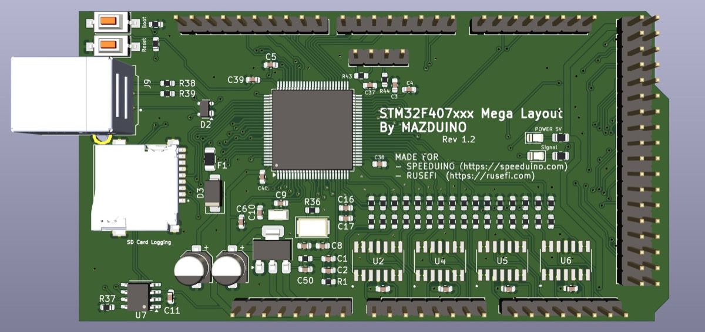
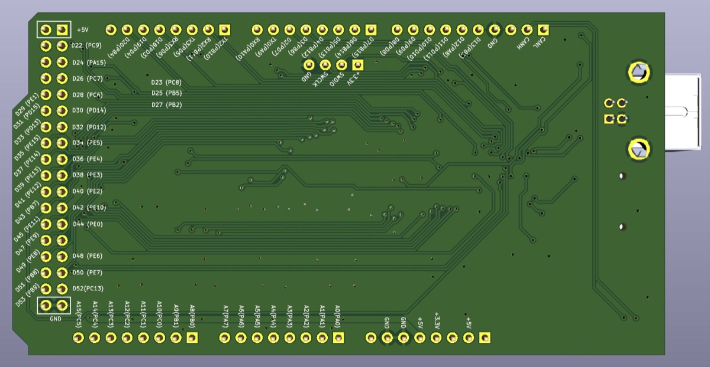

# Mazduino Mega100

## Gambaran Umum

Mazduino Mega100 adalah board MCU **STM32F407** dengan ukuran dan header yang sama dengan Arduino Mega 2560. Board ini dipasang di soket Arduino Mega pada board Speeduino, menggantikan Arduino Mega, sehingga board Speeduino yang sudah ada bisa menjalankan firmware **rusEFI Mazduino**.

Dengan Mega100, board Speeduino mendapat MCU ARM Cortex-M4 168 MHz, USB, slot microSD, CAN bus, dan fitur firmware rusEFI seperti Lua, boost, VVT, launch control dan data logging. Pin injektor, coil, trigger, sensor dan output diatur dari TunerStudio dengan satu tombol preset sesuai board Speeduino yang dipakai.

Dokumentasi ini mengikuti hardware **Mega100 v1.3** (Mega converter v1.3).

*Render rev1.2. Tata letak komponen di v1.3 bisa sedikit berbeda.*

## Varian Firmware

Ada dua firmware, dipilih sesuai chip STM32 yang terpasang:

| Firmware | Chip | Flash | Keterangan |
|----------|------|-------|------------|
| `mazduino-mega100` | STM32F407VGT6 | 1 MB | Fitur lengkap: Lua, ETB, traction control, software knock, SD card logging, transmisi otomatis (TCU) |
| `mazduino-mega100-512` | STM32F407VET6 | 512 KB | Fitur dikurangi supaya muat: tanpa Lua, ETB, traction control, software knock, SD card logging, boost, launch, anti-lag, VVT, sensor kecepatan, alternator, main relay dan TCU |

Perbandingan lengkap fitur per board ada di [FEATURES.md](https://github.com/mazduino/mazduino-fw/blob/master/boards/FEATURES.md). Mega100 dan Mega100-512 tidak punya varian [BIGFUEL](firmware/bigfuel.md).

Firmware Speeduino tidak bisa dipakai di Mega100. Gunakan firmware rusEFI Mazduino dari halaman [Unduhan](downloads.md).

## Versi Dengan Buffer dan Tanpa Buffer

Mega100 tersedia dalam dua versi. Bedanya ada di tegangan output digital (pin D) yang menggerakkan injektor, coil dan output lain di board Speeduino:

| Versi | Output digital | Keterangan |
|-------|----------------|------------|
| Dengan buffer | 5V | Output dinaikkan ke 5V seperti Arduino Mega |
| Tanpa buffer | 3,3V | Output langsung dari MCU |

Arduino Mega mengeluarkan output 5V, dan sebagian board Speeduino memakai MOSFET yang butuh gate 5V untuk terbuka penuh. Untuk versi **tanpa buffer**, ganti MOSFET tersebut dengan tipe logic level yang terbuka penuh di gate 3,3V.

!!! warning "MOSFET tidak terbuka penuh"
    MOSFET gate 5V yang hanya diberi 3,3V tidak terbuka penuh, sehingga MOSFET bisa panas dan output tidak bekerja dengan benar. Cek datasheet MOSFET di board Speeduino Anda sebelum memakai versi tanpa buffer.

Kata "buffer" di sini mengacu ke output digital. Input analog A0–A15 punya buffer sendiri (lihat Fitur Hardware).

Skematik v1.3 yang dipakai halaman ini adalah versi tanpa buffer.

## Fitur Hardware

- MCU **STM32F407** (ARM Cortex-M4, 168 MHz), kristal 8 MHz dan kristal RTC 32,768 kHz
- Ukuran dan header sama dengan Arduino Mega 2560, langsung masuk soket board Speeduino
- **16 input analog** (A0–A15) dengan buffer dan pembagi tegangan, sehingga sinyal sensor 0–5V aman untuk MCU 3,3V
- **USB Type-B** untuk TunerStudio dan update firmware (DFU), dengan proteksi ESD dan polyfuse
- **Slot microSD** untuk data logging (SPI3)
- **CAN bus** dengan transceiver di board
- Tombol **RESET** dan **BOOT** untuk masuk mode DFU
- Header **SWD** untuk ST-Link
- LED power dan LED status
- Regulator 3,3V di board, diambil dari suplai 5V board Speeduino

## Konektor dan Header

### Header Arduino Mega

Label di sisi belakang board menunjukkan nama pin header dan pin STM32-nya.

Semua header Arduino Mega (D0–D53, A0–A15, power) ada di posisi yang sama dengan Arduino Mega 2560. Beberapa pin berbeda:

- **D21** dan **D46** tidak tersambung ke MCU.
- **D43** juga menyalakan LED status board (PB7). Pin ini tidak dipakai preset.
- **A0–A15** hanya input. Karena lewat buffer, pin analog tidak bisa dipakai sebagai output.
- Pada header 10-pin di sisi D8–D13, posisi **SDA** dan **SCL** membawa **CANH** dan **CANL**, dan posisi **AREF** tidak tersambung. Pastikan board Speeduino tidak menyambungkan apa pun ke pin SDA/SCL di header itu.

### CAN Bus

CANH dan CANL tersedia di header 2-pin **J11** (pin 1 CANL, pin 2 CANH), dan juga di posisi SDA/SCL header 10-pin seperti di atas. Transceiver sudah ada di board, jadi kabel CAN dari dash, wideband atau perangkat lain langsung disambungkan ke CANH/CANL. Pengaturan CAN ada di [Konfigurasi CAN Bus](tunerstudio-canbus.md).

### SWD (J10)

| Pin | Fungsi |
|-----|--------|
| 1 | 3,3V |
| 2 | SWDIO |
| 3 | SWCLK |
| 4 | GND |

### Tombol dan LED

| Komponen | Fungsi |
|----------|--------|
| RESET | Restart MCU |
| BOOT | Tahan saat reset atau saat USB dicolok untuk masuk mode DFU |
| LED power | Menyala saat ada suplai 5V |
| LED status | Indikator error di PB7 (D43) |

## Memasang di Board Speeduino

1. Matikan board Speeduino, lalu lepas Arduino Mega dari soketnya.
2. Pasang Mega100 di soket yang sama dengan arah yang sama seperti Arduino Mega. Pastikan semua pin masuk dan tidak ada yang bergeser.
3. Flash firmware `mazduino-mega100` (atau `mazduino-mega100-512` untuk chip 512 KB) lewat USB DFU atau ST-Link. Lihat bagian Flashing di halaman [Unduhan](downloads.md).
4. Buka TunerStudio dengan file `.ini` dari bundle firmware yang sama.
5. Terapkan preset pin sesuai board Speeduino Anda (lihat bagian berikut).

## Preset Pin Board Speeduino

Pin injektor, coil, trigger, sensor dan output berbeda antar board Speeduino. Firmware menyediakan preset untuk mengisi semuanya sekaligus.

Di TunerStudio, buka **Controller → Base Tunes**, lalu tekan tombol **Speeduino pins** yang sesuai board Anda. Tersedia preset untuk Speeduino v0.2, v0.3, v0.4, 96-97 MX5 PNP, NA6 MX5 PNP, UA4C, dan beberapa board Speeduino lain. Daftar lengkapnya terlihat di menu tersebut.

Setelah tombol ditekan, ECU langsung menyimpan pin baru. Sambungkan ulang TunerStudio supaya nilai baru terbaca, lalu matikan dan nyalakan ECU.

Preset mengisi:

- Injektor 1–4 dan coil 1–4
- Input trigger (crank) dan cam, atau trigger kedua untuk board yang memakainya
- TPS, MAP, IAT, CLT, O2, tegangan baterai dan baro
- Fuel pump, tach, fan, idle, boost dan VVT
- Driver stepper idle, VSS, flex fuel dan launch, jika ada di board tersebut

Preset menghapus pin lama di header Mega sebelum mengisi pin baru, jadi tidak ada sisa pin dari board lain. Pin yang tidak ada di board Speeduino dibiarkan kosong. Setelah preset diterapkan, pin tetap bisa diubah manual di TunerStudio.

Firmware baru memakai preset **Speeduino v0.4** sebagai bawaan.

!!! note "Board 01-05 MX5 PNP"
    Preset untuk 01-05 MX5 PNP tidak tersedia, karena coil 2 board itu ada di D43 (LED status) dan injektor 2 di D46 (tidak tersambung).

## Catatan Fitur

### Bluetooth

Port Bluetooth TunerStudio ada di D16 (TX, PB10) dan D17 (RX, PB11). Banyak board Speeduino memakai D16/D17 untuk driver stepper idle, termasuk Speeduino v0.4. Pada preset seperti itu, port Bluetooth otomatis dimatikan. Detail wiring ada di [Bluetooth](firmware/bluetooth.md).

### Software Knock

Software knock membaca pin **PA3**, yaitu **A3** di header Mega. Pada preset yang memakai A3 untuk sensor MAP, misalnya Speeduino v0.4, biarkan knock tetap mati.

### SD Card

Firmware `mazduino-mega100` memakai slot microSD di board untuk data logging. Firmware `mazduino-mega100-512` tidak punya SD card logging.

## Tabel Pin Header ke STM32

Di TunerStudio, pin ditampilkan dengan nama pin STM32. Tabel ini dipakai saat mengubah pin secara manual.

### Pin Digital

| Header | STM32 | Header | STM32 | Header | STM32 |
|--------|-------|--------|-------|--------|-------|
| D0 | PA10 | D18 | PD4 | D36 | PE4 |
| D1 | PA9 | D19 | PD3 | D37 | PE14 |
| D2 | PD7 | D20 | PB4 | D38 | PE3 |
| D3 | PB6 | D21 | tidak tersambung | D39 | PE13 |
| D4 | PB12 | D22 | PC9 | D40 | PE2 |
| D5 | PB13 | D23 | PC8 | D41 | PE12 |
| D6 | PB14 | D24 | PA15 | D42 | PE10 |
| D7 | PB15 | D25 | PB5 | D43 | PB7 (LED status) |
| D8 | PD8 | D26 | PC7 | D44 | PE0 |
| D9 | PD9 | D27 | PB2 | D45 | PE11 |
| D10 | PD10 | D28 | PC6 | D46 | tidak tersambung |
| D11 | PD11 | D29 | PE1 | D47 | PE9 |
| D12 | PA8 | D30 | PD14 | D48 | PE6 |
| D13 | PB3 | D31 | PD15 | D49 | PE8 |
| D14 | PD5 | D32 | PD12 | D50 | PE7 |
| D15 | PD6 | D33 | PD13 | D51 | PB8 |
| D16 | PB10 | D34 | PE5 | D52 | PC13 |
| D17 | PB11 | D35 | PE15 | D53 | PB9 |

### Pin Analog

| Header | STM32 | Header | STM32 |
|--------|-------|--------|-------|
| A0 | PA0 | A8 | PB0 |
| A1 | PA1 | A9 | PB1 |
| A2 | PA2 | A10 | PC0 |
| A3 | PA3 | A11 | PC1 |
| A4 | PA4 | A12 | PC2 |
| A5 | PA5 | A13 | PC3 |
| A6 | PA6 | A14 | PC4 |
| A7 | PA7 | A15 | PC5 |

### Pin Internal

Pin ini dipakai di dalam board dan tidak keluar di header Mega:

| Fungsi | STM32 |
|--------|-------|
| CAN TX / RX | PD1 / PD0 |
| SD card SPI3 (SCK, MISO, MOSI) | PC10, PC11, PC12 |
| SD card CS | PD2 |
