# Mazduino Racedash Pro

## Overview

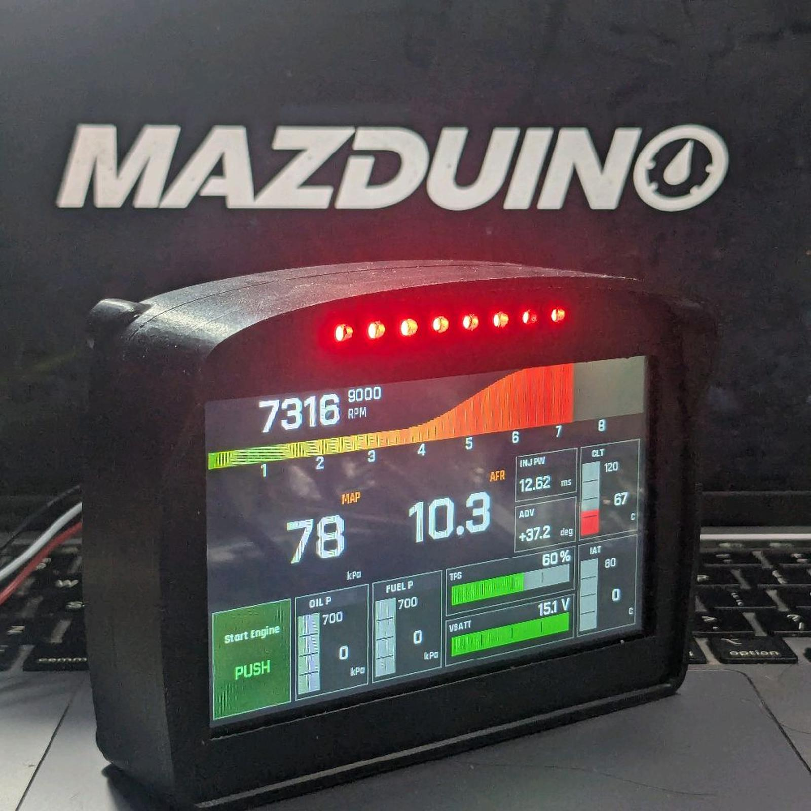

*Racedash Pro M4 (4.3"): eight shift light LEDs above the screen, with
Template 1 and a "Start Engine" switch from the Switch Panel*

Mazduino Racedash Pro is the digital dash display variant with a larger screen, available in **4.3", 5" and 7"**. Unlike the [Mazduino Racedash](mazduino-racedash.md) variants (3.5" and 4"), which are configured over WiFi and a browser, the Racedash Pro can be set up **directly on the screen (touchscreen)** without connecting to a phone/laptop. The **DashTune** Android app is also available over Bluetooth for settings that are not in the on-screen menu.

| Variant | Screen Size | Connector |
| :---- | :---- | :---- |
| Racedash Pro 4.3" (M4) | 4.3 inch | DTM4 (Deutsch DTM 4 Pin) |
| Racedash Pro 5" (M5) | 5 inch | DTM4 (Deutsch DTM 4 Pin) |
| Racedash Pro 7" (M7) | 7 inch | DTM4 (Deutsch DTM 4 Pin) |

## Key Features

- Touchscreen, so the dashboard can be set up directly on the screen, with no extra app or WiFi connection
- Shows RPM, gear indicator, speed and other sensor data in real time
- Communicates with the ECU over **CAN Bus** or **Serial**, depending on the ECU used. **Speeduino**-based ECUs use Serial mode, while **rusEFI**, **Haltech** and **MaxxECU** use CAN Bus mode
- Vehicles without a CAN bus can use the **M-Link** protocol together with the [CAN IO Extender](can-io-extender.md#vehicles-without-a-can-bus-m-link-protocol), which reads sensors, switches and RPM and sends them to the dash

## DTM4 / 4 Pin Connector

The Racedash Pro uses the same **DTM4 (Deutsch DTM 4 Pin)** connector as the [Racedash 4"](mazduino-racedash.md#racedash-4-cabus-dtm4-connector) variant, in both the physical connector and the pin functions.

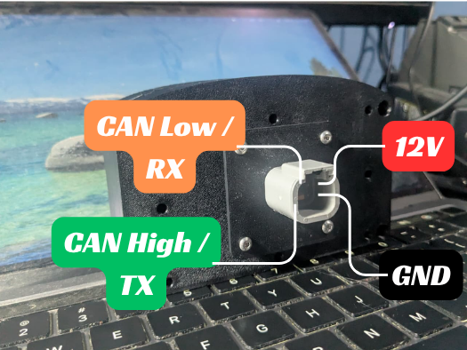

*Dash connector side*

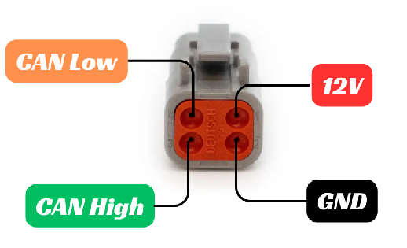

*Cable connector side*

| Pin No. | Description |
| :---- | :---- |
| 1 | 12V Power Supply |
| 2 | Ground |
| 3 | CAN High / TX |
| 4 | CAN Low / RX |

**Note:**

- Pins 3 and 4 work as **CAN High/CAN Low** for **rusEFI**, **Haltech** and **MaxxECU** ECUs (CAN Bus mode).
- For **Speeduino** ECUs only, pins 3 and 4 work as **Serial TX/RX**, because Speeduino has no native CAN Bus.

## Racedash Pro M4 / M5 / M7

This section covers the M4 (4.3"), M5 (5") and M7 (7"). The connector and
wiring are exactly the same as described in
[DTM4 / 4 Pin Connector](#dtm4-4-pin-connector) above.

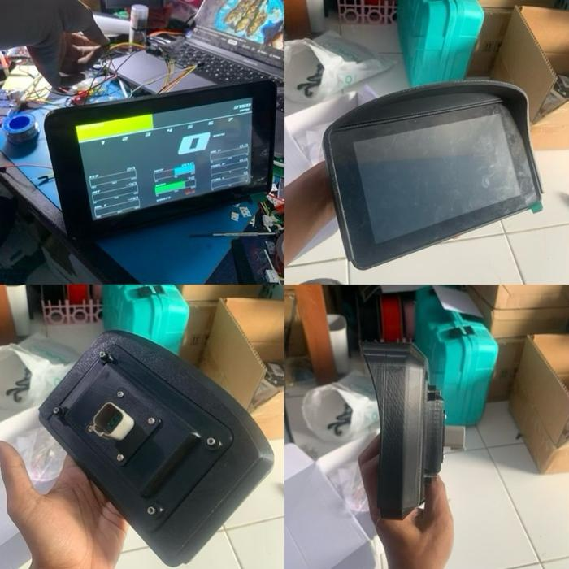

*Racedash Pro M7 (7"): front view powered on, front view, rear side
with its mount, and side view*

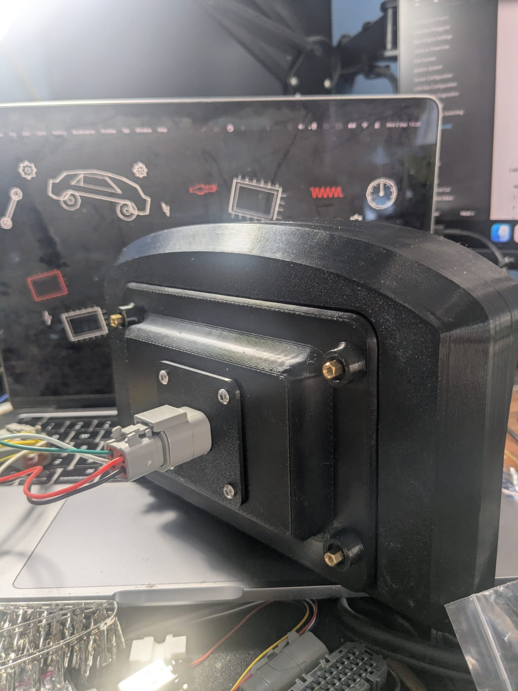

*Rear side with the connector fitted*

### Supported ECUs

| ECU | Connection | Notes |
| :---- | :---- | :---- |
| rusEFI | CAN Bus 500 kbps | Most complete data |
| Haltech | CAN Bus 1 Mbps | The only one that sends turn signal, handbrake and tire pressure data |
| MaxxECU | CAN Bus 500 kbps | |
| Speeduino | Serial | Speeduino has no CAN, so pins 3 and 4 are used as TX/RX |
| OBD-II | CAN Bus (ISO 15765-4) | For the car's stock factory ECU, [read the limitations](#obd-ii-limitations) |

The ECU type is selected in the DashTune app or in the on-screen menu, and **no
firmware change is needed**. The CAN speed follows the selected ECU
automatically.

Besides rusEFI, Haltech, MaxxECU, Speeduino and OBD-II in this table, the Racedash
Pro also supports **ECUMASTER EMU Black** and **Link Generic Dash**. What
has to be enabled on each ECU is covered in
[ECU Configuration for Racedash](setting-ecu-racedash.md).

Data shown for all ECUs: RPM, MAP, TPS, ignition timing, injector duty,
AFR/lambda, pressures and temperatures (coolant, oil, fuel, intake air), EGT 1–4,
gear, ethanol content and battery voltage.

> **Note**: The **turn signal**, **handbrake** and **tire pressure** lights only
> come on with **Haltech**, because only Haltech sends that
> data. On rusEFI and MaxxECU these three lights will never come on;
> this is not a fault.

#### OBD-II Limitations

> **Not every OBD-II car can be read by this dash, and we do not guarantee
> that your car is one that can.** Check the following before buying for
> OBD-II use.

Only **OBD-II over CAN Bus** is supported, that is **ISO 15765-4** with
**11-bit identifiers**, at **500 kbps**.

**Not** supported:

| Protocol | Description |
| :---- | :---- |
| ISO 9141-2 | K-line, common on older cars |
| ISO 14230-4 (KWP2000) | K-line |
| SAE J1850 PWM / VPW | Common on older American cars |
| ISO 15765-4 29-bit identifier | CAN variant used by some vehicles |

In general, cars built from **2008 onward** in many markets already use
OBD-II over CAN, but this is not a guarantee: the changeover year differs
between brands and countries.

Even when the protocol matches, the data shown **depends on what your car
responds to**. The dash first asks which PIDs are supported, then only reads
the ones that are answered. The PIDs read are: RPM, speed, TPS, MAP, coolant temperature, intake air
temperature, voltage and oil temperature. Many
cars do not answer some of these; oil temperature is among the ones most
often unavailable.

OBD-II is also slower than the dedicated CAN protocols of standalone ECUs, because
the dash has to ask and then wait for an answer for each value, instead of receiving
periodic broadcasts.

### Changing the display (template)

The dash offers several dashboard displays. To switch, **swipe left
or right on the top part of the screen** (in the RPM bar area). The bottom part of the screen
deliberately ignores swipes so that the switches there are not touched by accident.

The last display used is remembered, so when powered on again the dash
opens the same display straight away.

Some example displays on the Racedash Pro M7:

<!-- A flex row rather than a table: a two-column table gives each cell a fixed
     share of the width and the images do not shrink to fit it, so the second
     column was being cut off. These wrap and scale instead. -->
<div style="display:flex;flex-wrap:wrap;gap:12px;margin:16px 0">
  
  
  
  
</div>

The gauge colors and the content of each panel can be changed, so the display on your dash may
differ from the examples above.

### On-screen menu (M4 / M5 / M7)

#### Screen gestures

| Gesture | Result |
| :---- | :---- |
| Swipe left / right **on the RPM bar (top part of the screen)** | Change the dashboard display |
| Swipe up | Open the **Switch Panel** |
| **Two-finger pinch** | Open the main menu |

Swipes are only picked up on the top part of the screen. The bottom part is deliberately left
free so that switches placed there are not touched by accident when
changing displays.

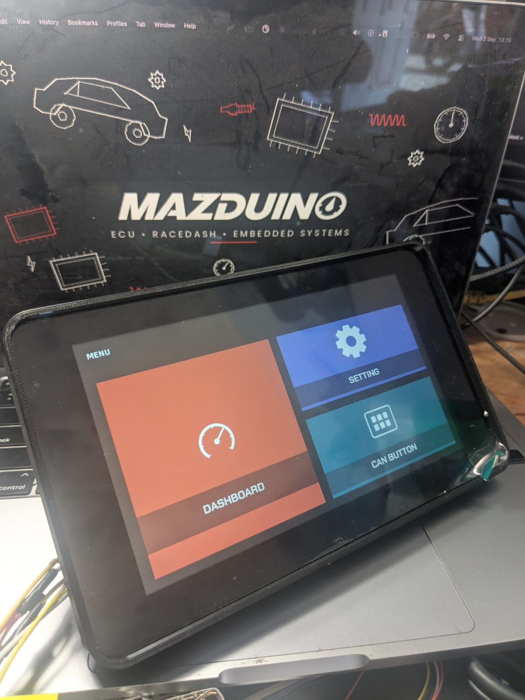

*Main menu, opened with a two-finger pinch*

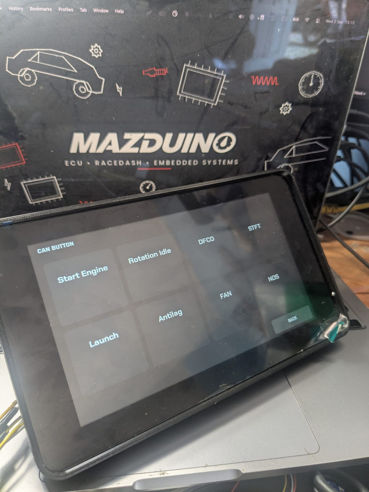

*Switch Panel, opened by swiping up*

#### Menu structure

```
Menu
├── Dash          → back to the last dashboard
├── Switch Panel  → Switch Panel page
└── Setting
    ├── Display Setting   → choose a template, then set the content of each panel
    ├── General Setting   → units, maximum RPM, range of each data item
    └── CAN
        ├── Protocol      → choose the ECU type
        └── Switch Panel  → create and edit switches
```

#### Display Setting: setting the content of each template

**Menu → Setting → Display Setting**, then choose the template you want to change
(Template 1 to Template 5). The content of each data box on the template can be changed,
for example from oil pressure to gearbox temperature, with the
left/right arrow buttons.

Press **Save** to save, or **Discard** to cancel. The settings are
stored on the dash and are not lost when the engine is switched off.

> **Note for the M7**: **Template 3** on the M7 has fixed content, so
> choosing it in Display Setting opens its display directly, not the
> settings page.

#### General Setting: units and data ranges

**Menu → Setting → General Setting**:

- **Pressure unit**: kPa or PSI
- **Temperature unit**: °C or °F
- **Maximum RPM**: the full scale of every RPM gauge, adjusted up and down in 250 RPM steps;
  the redline is set automatically at about 5/6 of this number
- **Data Source**: a list of all data sources. Choose one to set its
  **minimum and maximum values**, which set the gauge range and the min/max
  numbers printed on the screen

Changes to the units and maximum RPM show up right away on every template.

#### CAN: ECU type and Switch Panel

**Menu → Setting → CAN** contains two things:

- **Protocol**: selects the ECU type (rusEFI, Haltech, MaxxECU, Speeduino, OBD-II).
  The CAN speed adjusts itself. **No firmware change and
  no restart needed**: once saved, the dash reads with the
  new protocol right away.
- **Switch Panel**: create and edit switches: name, CAN ID and the data that is
  sent. Switches you create appear on the Switch Panel page.

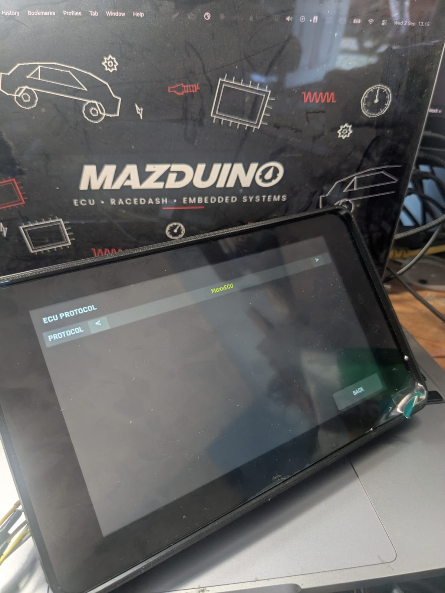

*Menu → Setting → CAN → Protocol*

#### Switch Panel

Swipe up from the dashboard to open the **Switch Panel**. This page is used
to send commands to the ECU or other devices on the CAN network, for example
turning on a fan or nitrous, or triggering launch control, just by pressing a
switch on the screen. Press **DASHBOARD** to go back to the dashboard. The Switch Panel
can also be made a tile on the main menu through **Setting → Menu**.

Switches can be set up on the screen (Setting → CAN → Switch Panel) or in the
DashTune app. There are two kinds of switch:

- **SWITCH**: press once for ON, press again for OFF. While ON, the dash
  keeps sending the ON command. Formerly called Toggle.
- **PUSH**: sends the command once each time it is pressed. Formerly called Momentary.

On a Racedash Pro with the latest firmware, each switch has three extra
settings. All three are set in DashTune: **Switch Panel**, then edit the switch.

- **Icon**: choose from a list of automotive icons, for example engine, fan, nitrous,
  launch, anti-lag, turbo, lights, horn, A/C and wiper. The icon is shown on the switch
  card on the dash and in the app.
- **Hold to activate**: off, 0.5, 1, 2 or 3 seconds.
  The switch only acts after being pressed for that long; while it is held, a
  bar fills along the bottom of the card. This setting prevents a switch from being pressed
  by accident on bumpy roads. Turning off a switch that is ON does not
  need to be held.
- **Stay ON after power-off** (SWITCH type only): off by
  default, meaning every switch starts OFF each
  time the dash powers on. This is safer for nitrous, anti-lag and launch.
  Turn this setting on per switch if that switch really should come back ON.

> **Change for existing owners**: before this update, a switch left ON
> would come back ON after the dash was switched off and on again. Now every
> switch starts OFF, except switches whose **Stay ON after power-off**
> setting is turned on.

### Other settings only in DashTune

Some settings are not available in the on-screen menu and can only be changed in the
app:

- **MAP display**: *Absolute* (the number as is, about 101 kPa at idle) or
  *Boost* (calculated from the outside air pressure, so under vacuum the number is negative and
  0 means no boost yet)
- **Splash duration** at power-on
- **GPS module**: only for units that actually have a GPS module fitted

> **The GPS module is optional and is not included in the unit as sold.**
> The Racedash Pro ships without a GPS module, so this setting does not need to be
> turned on for a standard unit. The GPS module is only fitted on special request
> when ordering. Without that module, speed data is still read from the ECU
> as usual.

The splash and GPS settings only take effect after the dash is switched off and on
again.

### Indicator lights

The warning lights come on automatically:

| Light | Comes on when |
| :---- | :---- |
| Check engine | The ECU reports a fault code |
| Battery | Voltage outside 11.5–15.5 V |
| Coolant temperature | Above 105 °C |
| Oil temperature | Above 130 °C |
| Oil pressure | Engine running (above 800 RPM) but pressure below 100 kPa |
| Left/right turn signal, handbrake, tire pressure | Haltech only |

All lights go out if the connection to the ECU is lost, so no light
stays on after the ignition key is switched off.

For ECUs other than Haltech, the turn signal, handbrake, high beam and parking light
indicators can still be driven from the vehicle's switches by adding the
[CAN IO Extender](can-io-extender.md).

---

## DashTune App Guide

DashTune is an Android app for setting up the dash from your phone. For the Racedash
Pro M4/M5/M7, it connects over **Bluetooth**: no WiFi needed and nothing
to unplug.

> **Getting the app:** DashTune is still in testing. Open
> **[www.mazduino.com/dashtune/tester](https://www.mazduino.com/dashtune/tester)**
> on your Android phone and follow the three steps with the same Google account
> that is active in the Play Store: join the tester group, tap **Become a tester**,
> then install DashTune from the Play Store.

#### If the Play Store shows "Can't download DashTune"

This message usually appears right after tapping **Install** or **Update**,
before the download has started. The cause is in the Play Store on the phone, not in
the app.

1. Open **Settings → Apps → Google Play Store → Storage**, then tap
   **Clear cache** (not Clear storage).
2. Open the Play Store again, find DashTune, and tap **Install** once more.
3. If it still fails, make sure the Google account active in the Play Store (the profile picture
   at the top right) is the account whose email was registered for DashTune testing.
   If the phone has several accounts, switch to that one.
4. A newly released version is sometimes not ready to download for a few minutes.
   If the steps above have not worked, wait a moment and try again.

If it still fails, contact **support@mazduino.com** with your phone model
and the email of the Play Store account you are using.

### Connecting for the first time

1. Turn the ignition key on until the dash powers up.
2. Open DashTune, go to the **Device** tab, tap **Add Dash**.
3. Tap **Scan**. The dash will appear by itself.
4. Select that dash. Once connected, the app opens the menu page
   straight away.

If it is not found: make sure the phone's Bluetooth is on, the dash is powered on,
and the dash is not connected to another phone. You can also choose the model
manually under **Dash model** on the same screen.

A dash that has been connected before is remembered, and the app connects
by itself the next time it is opened.

### DashTune menu contents

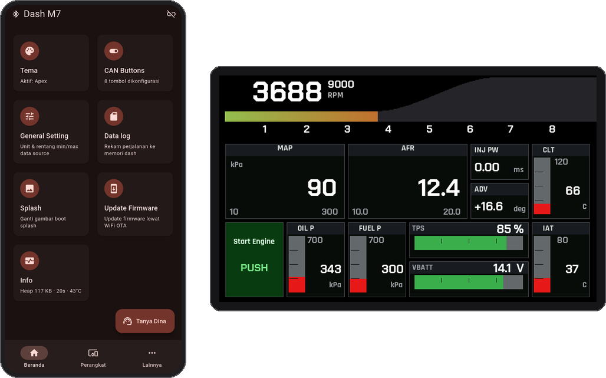

*Left: the DashTune home screen while connected to a Racedash Pro M7. Right: the dash screen
with the Apex theme.*

Order of the menus on the DashTune home screen:

| Menu | Function |
| :---- | :---- |
| **Themes** | Choose the theme shown on the dash and install new themes from the Theme Store. On old firmware this menu is called **Dashboard** and sets the data shown on each template |
| **Switch Panel** | Create and set up the switches shown on the dash's Switch Panel. On old firmware this menu is called **CAN Buttons** |
| **General Setting** | Units, MAP mode, maximum RPM, range of each data item: the same as the menu on the dash screen |
| **Data log** | Records trip data to the dash's memory. When the memory is full, the oldest log is deleted. To retrieve logs, the phone connects briefly to the dash's WiFi |
| **LED lights** | Shift light and indicators, only on dashes that have an LED strip |
| **Splash** | Create your own opening image (see below) |
| **Update Firmware** | Updates the dash firmware. At the bottom is **WiFi OTA Mode**, which turns on the dash's WiFi so it can be reached from a computer |
| **Info** | Firmware version and device status |

#### Themes and Theme Store

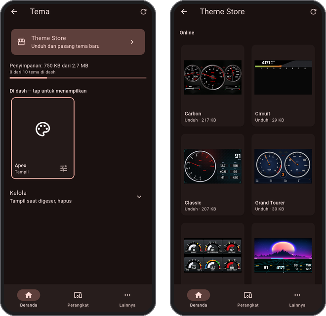

Open **Themes** to see the themes on the dash and choose the one to show.
The **Apex** theme is always installed by default. Tap **Theme Store** to see
other themes with their previews, then choose a theme and tap **Install**. During
installation the phone briefly joins the dash's **Mazduino-Dash** WiFi; the dashboard keeps
running as usual.

#### General Setting and Switch Panel

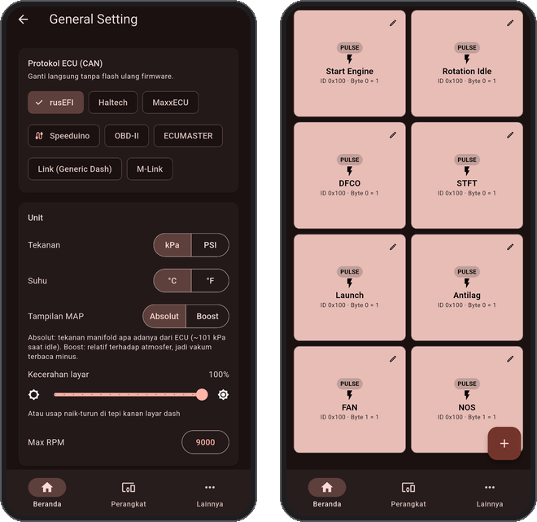

In **General Setting**, the ECU protocol is changed directly without reflashing
the firmware. This is also where you find the pressure and temperature units, MAP mode, screen brightness,
Max RPM, the range of each data item, Custom Channels, the fuel level source and the source of each
indicator. **Switch Panel** holds the switches shown on the dash screen; tap the pencil
icon to edit a switch, or **+** to add a new switch. Icon,
**Hold to activate** and **Stay ON after power-off** are set here (see
[Switch Panel](#switch-panel)).

**Settings history** is in the **More → Account** tab. It stores the
dash settings over time. Check its contents first, then choose the one you
want to restore to the dash.

### Making your own splash screen

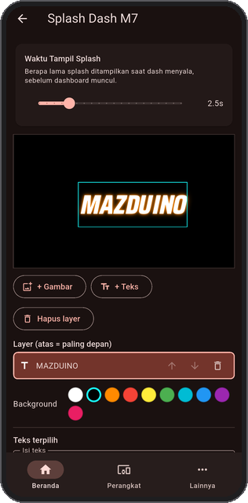

Go to the **Splash** menu. There you can add images from the gallery,
add text, move and resize, then choose the background color.
When finished, tap send.

Because the image is sent over WiFi, the dash automatically turns on its own WiFi
for a moment, the phone switches to it, the image is sent, then the phone returns to the
original network. The process runs by itself: just **keep the phone screen on
and do not close the app** until it finishes.

There is also a splash **display duration** setting, and a button to delete it and
go back to the default image.

#### If sending the splash fails or the splash disappears

On the Racedash Pro M4, M4.1, M5, M5.1, M5.2 and M7 with firmware before
6 November 2026, the dash storage could jam after the splash, template or
animation was changed a few times. The M7 Pro is not affected by this problem. Symptoms:

- Sending the splash fails, for example with **"connection reset by peer"** or
  **"The dash could not save the file"**.
- The old splash is lost as well, so the dash powers on without an opening image.

How to fix it:

1. Update the DashTune app to version **1.2.11** or newer.
2. Update the dash firmware through the **Update Firmware** menu to version
   **2026-11-06** or newer. The firmware update still works
   even when sending the splash fails.
3. Send the splash again. The first send after the update can take about
   one minute longer, because the dash tidies up its storage first. Keep
   the phone screen on and the app open until it finishes.

From that firmware on, the old splash is no longer deleted if sending
fails. If the file really is too large, DashTune shows **"Not enough room on
the dash"**; delete unused themes or animations, or shorten the
splash, then try again.

If the phone is already on the **Mazduino-Dash** WiFi but you get **"connection timed
out"** or a message that the dash cannot be reached, first turn off any VPN or
ad-blocking app on the phone. Apps like these redirect the connection so it does not
reach the dash.

If it still fails, contact support@mazduino.com with the dash model,
the firmware version (Setting > About) and the error message shown.

### Update firmware

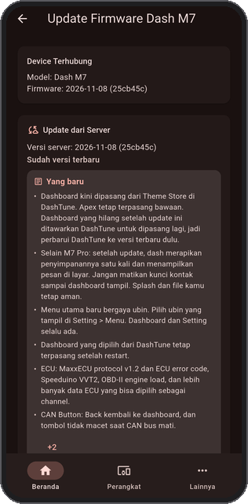

Go to the **Update Firmware** menu; the app checks for the latest version and
shows the version currently installed. If there is a new version, tap the
update button.

> **Warning**: Do not update while driving. During the update the dash
> screen goes off for a while, then comes back on by itself. Make sure the vehicle
> is in a safe state, the power is not cut, and the app is not closed until it
> finishes. An update that is interrupted partway can leave the dash unable to start.

### Relay features: Google Maps and music

DashTune can forward **Google Maps directions** and **the song currently
playing on the phone** to the dash screen. The settings are in the **More → Relay** tab.

The dash does not play music. Music is still played from the phone,
or from a head unit connected to the phone. The **Phone music** page on the dash only
shows the song title, artist and cover, plus play, pause and skip
buttons to control the phone. The **PHONE MUSIC** tile can be shown through
**Setting → Menu**.

This feature needs notification access permission on the phone, and the app will take you to
its settings page the first time it is enabled.

## References

- Mazduino website - [https://www.mazduino.com/](https://www.mazduino.com/)
- Mazduino Wiki - [https://wiki.mazduino.com/](https://wiki.mazduino.com/)
- Mazduino Github - [https://github.com/mazduino/mazduino](https://github.com/mazduino/mazduino)
