# Mazduino Racedash

## Overview

Mazduino Racedash is a digital dash display that shows real-time data from the ECU, such as RPM, gear indicator, speed and other sensor data. This page covers the **3.5"** and **4"** screen variants. For the larger screen variants (4.3", 5" and 7"), see **[Mazduino Racedash Pro](mazduino-racedash-pro.md)**.

| Variant | Screen Size | Connector |
| :---- | :---- | :---- |
| [Racedash 3.5"](#racedash-35-jst-4-pin-connector) | 3.5 inch | JST 4 Pin |
| [Racedash 4" (Cabus)](#racedash-4-cabus-dtm4-connector) | 4 inch | DTM4 (Deutsch DTM 4 Pin) |

Both variants are set up from a phone with the **DashTune** app, over the WiFi
network that the dash broadcasts. Go straight to [Setting Up with DashTune](#setting-up-with-dashtune).

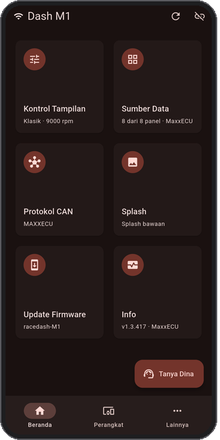

*The DashTune home page while connected to the dash.*

## Key Features

- Digital screen showing RPM, gear indicator, speed and other sensor data in real time
- Set up from the **DashTune** Android app: screen template, data in each panel, indicator lights, ECU protocol, splash screen and firmware updates, all from your phone
- Two screen templates: **Classic** (RPM bar, gear, speed and boxed panels) and **Grid** (one full screen of data panels)
- Communicates with the ECU over **CAN Bus** or **Serial**, depending on what was requested when ordering and on the ECU used. **Speeduino**-based ECUs must use Serial mode (for both the JST 4 Pin and DTM4 variants), while **rusEFI**, **Haltech** and **MaxxECU** use CAN Bus mode

> **The ECU side must be set up too.** The dash only listens: the ECU has to
> broadcast its data, at the right CAN speed. See
> [ECU Configuration for Racedash](setting-ecu-racedash.md).

## Racedash 3.5" (JST 4 Pin Connector)

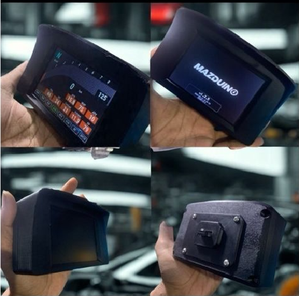

This variant uses a compact **JST 4 Pin** connector for quick installation. There is no USB port exposed outside the case: firmware updates are done over WiFi, see [Update Firmware](#update-firmware).

### JST 4 Pin Connector (Wiring to the Vehicle)

The external connector used to connect the Racedash to the vehicle/ECU.

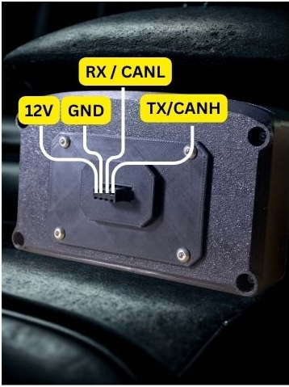

| Pin | Function |
| :---- | :---- |
| 1 | 12V |
| 2 | GND |
| 3 | RX / CANL |
| 4 | TX / CANH |

## Racedash 4" / Cabus (DTM4 Connector)

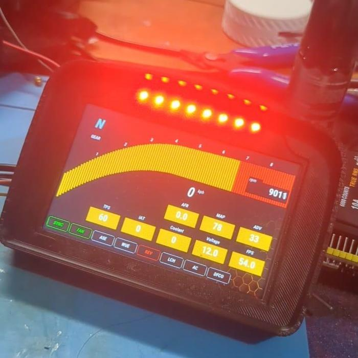

*Racedash 4" powered on: RPM bar, gear indicator and the row of warning
lights below the screen*

This variant uses a **DTM4 (Deutsch DTM 4 Pin)** connector that resists vibration and weather, suited to racing use. It communicates with the ECU over **CAN Bus**, except with **Speeduino** ECUs, which use **Serial** mode (the secondary serial port of the Arduino Mega).

### DTM4 / 4 Pin Connector

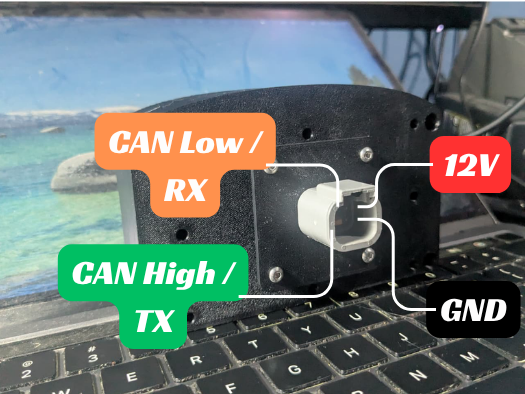

*Dash connector side*

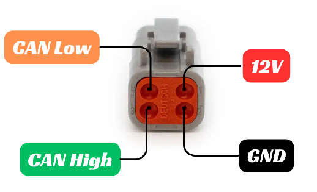

*Cable connector side*

| Pin No. | Description |
| :---- | :---- |
| 1 | 12V Power Supply |
| 2 | Ground |
| 3 | CAN High / TX |
| 4 | CAN Low / RX |

**Note:**

- Pins 3 and 4 work as **CAN High/CAN Low** for **rusEFI**, **Haltech** and **MaxxECU** ECUs (CAN Bus mode).
- For **Speeduino** ECUs only, pins 3 and 4 work as **Serial TX/RX**: Speeduino has no native CAN Bus, so the data is read from the **secondary serial port (Serial3) of the Arduino Mega**.

## Setting Up with DashTune

**DashTune** is the official Android app for setting up the Racedash. Everything
that used to be set up in the browser (Display Control) and in the Splash Screen
Generator is now in one app, and it works without an internet connection as long
as the phone is connected to the dash's WiFi.

The Racedash 3.5" and 4" connect to DashTune over **WiFi**. The Racedash Pro
(M4/M5/M7) uses Bluetooth; its guide is on the
[Racedash Pro](mazduino-racedash-pro.md#dashtune-app-guide) page.

### 1. Install DashTune

DashTune is still in testing, so it is installed through the Google Play tester program.
Open **[www.mazduino.com/dashtune/tester](https://www.mazduino.com/dashtune/tester)**
on your Android phone, then follow the three steps there with **the same Google account**
that is active in the Play Store:

1. Join the DashTune tester group.
2. Tap **Become a tester** on the Google Play tester page.
3. Install DashTune from the Play Store.

If the Play Store shows **"Can't download DashTune"**, see
[how to fix it](mazduino-racedash-pro.md#if-the-play-store-shows-cant-download-dashtune).

### 2. Connect to the dash

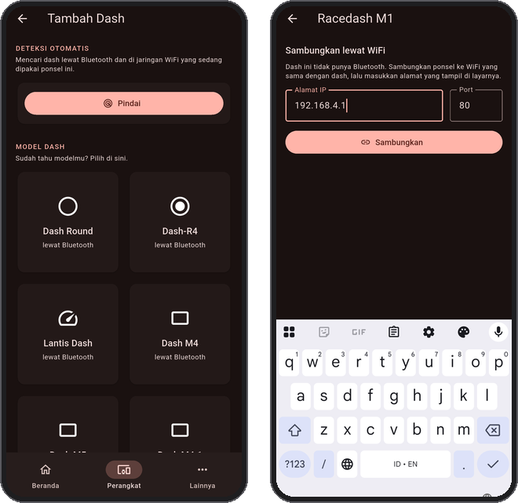

1. Turn on the dash, then connect the phone's WiFi to **"MAZDUINO_Display"** with
   the password **"12345678"**. If Android asks because this WiFi network has no
   internet, choose to stay connected.
2. Open DashTune, go to the **Device** tab, then tap **Add Dash**.
3. Tap **Scan**. The dash will be found on the WiFi network the phone is
   currently using.
4. If it is not found, choose your Racedash model under **Dash model**,
   enter **IP address** `192.168.4.1` (port `80`), then tap **Connect**.

Once connected, the dash appears on the **Home** tab as a set of menu
cards: Display Control, Data Sources, CAN protocol, Splash, Update Firmware and
Info.

### 3. Display Control

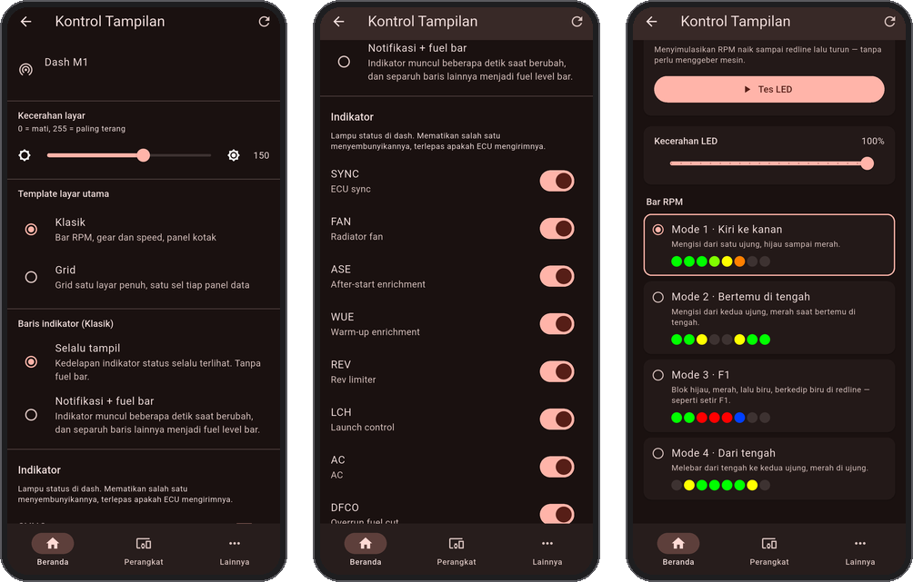

Everything shown on the screen is set here, and sent to the dash right away.

- **Backlight brightness**: 0 = off, 255 = brightest.
- **Main screen template**: **Classic** (RPM bar, gear, speed, boxed panels)
  or **Grid** (one full screen, one cell per data panel).
- **Indicator row** (Classic): **Always on**: the eight status lights are always
  visible. **Notifications + fuel bar**: a light appears for a few seconds when it
  changes, and the other half of the row becomes a fuel level bar.
- **Indicators**: turn each light on or off: SYNC, FAN, ASE, WUE, REV,
  LCH, AC, DFCO, FPMP, CEL, FAN2, KNOCK, TC, ANTL, SCUT. Turning a light off only
  hides it on the screen, whether or not the ECU sends it.
- **RPM bar scale**: the maximum RPM of the on-screen bar, 1000–20000.
- **RPM shift light**: the LED strip above the screen: **Light-up RPM**,
  **LED brightness**, the **RPM bar** pattern (Mode 1–4), and a **Test LEDs** button to
  try it without revving the engine.

The RPM shift light settings only appear on dashes that actually have the LED
strip.

### 4. Data Sources

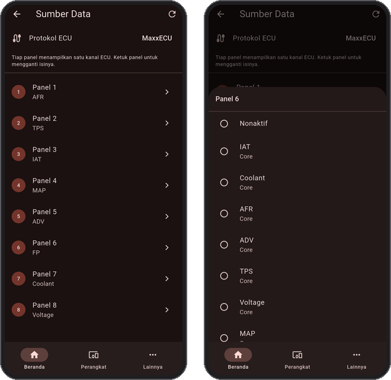

The Racedash has **8 data panels**. Tap a panel to choose the data it
shows, for example AFR, TPS, IAT, MAP, Coolant, Voltage or ADV. Choose
**Disabled** to leave the panel empty.

### 5. CAN Protocol

This menu shows the ECU protocol the dash reads and its CAN bitrate. The firmware of
the Racedash 3.5" and 4" (M1, M2, M3, C1) is built for one ECU, as ordered, so
only that ECU's protocol and **Custom** can be selected here. This is different
from the [Racedash Pro](mazduino-racedash-pro.md) (M4, M5, M7, M7 Pro), whose
protocol can be changed directly in the settings. **Custom** is used for ECUs that are
not on the list, with a CAN data map you set up yourself.

If the car's ECU is changed to another brand, the dash does not need to be sent back: open
[Update Firmware](#7-update-firmware) and choose **Flash a different protocol**.
DashTune asks for confirmation before flashing. This option is only on
CAN Bus mode dashes; Serial mode dashes for Speeduino do not use this menu.

Also make sure the ECU is already broadcasting its CAN data; see
[ECU Configuration for Racedash](setting-ecu-racedash.md).

### 6. Splash Screen

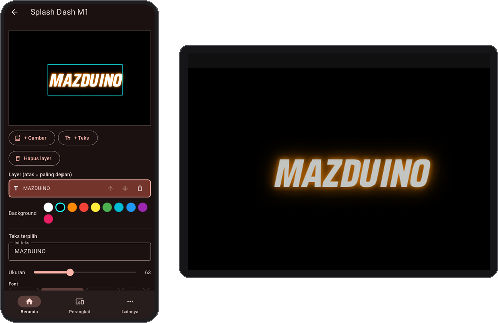

The splash is the opening image shown when the dash first powers on. The splash is made
directly in DashTune; there is no need to open the Splash Screen Generator on the web any more.

1. Open the **Splash** card on the Home tab.
2. Tap **+ Image** to place a photo or logo from the phone's gallery, and
   **+ Text** to write text. You can use more than one layer, for example a
   background image with a logo on top.
3. Tap a layer to select it, drag to move it, and pinch to make it
   larger or smaller. For text, set its content, size and font.
   The background color is chosen from the row of colors below the preview.
4. Tap **Send to Dash**.
5. Turn the dash off and on again (disconnect power) to see the new splash.

To go back to the default splash, tap **Delete splash (revert to default)**.

### 7. Update Firmware

Open the **Update Firmware** card. DashTune checks for the latest version for your
dash and shows the version currently installed.

- **Update from Server**: downloads and installs the latest version. Because the dash's
  WiFi has no internet, DashTune downloads over **mobile data**, so
  turn on mobile data before you start.
- **Pick Firmware File**: installs a firmware file that is already on the phone,
  for example a file sent by the support team.
- **Flash a different protocol**: switches the firmware to another ECU (see
  [CAN Protocol](#5-can-protocol)).

If there is no mobile data, download the firmware first while the phone has internet:
leave the dash's WiFi, open the **Device** tab, tap the **⋮** menu on the dash, then
**Download firmware**. After that, reconnect to the dash's WiFi and open **Update
Firmware** to flash the saved file.

> **Warning**: Do not update while driving. Make sure the dash's power is
> not cut and the app is not closed until the process finishes. An update
> that is interrupted partway can leave the dash unable to start.

### Ask Dina

The **Ask Dina** button on the Home tab opens the assistant inside DashTune. Ask
anything about installing and setting up the dash, for example "why doesn't RPM
show up?".

## Update Firmware

The recommended way is through DashTune; see
[Update Firmware in DashTune](#7-update-firmware). Two other methods still
work:

1. **Mazduino Flasher (laptop, over WiFi)**: no need to open the case.
2. **USB**: open the Racedash case, then connect the internal USB TTL port/pins directly to a computer.

### With Mazduino Flasher

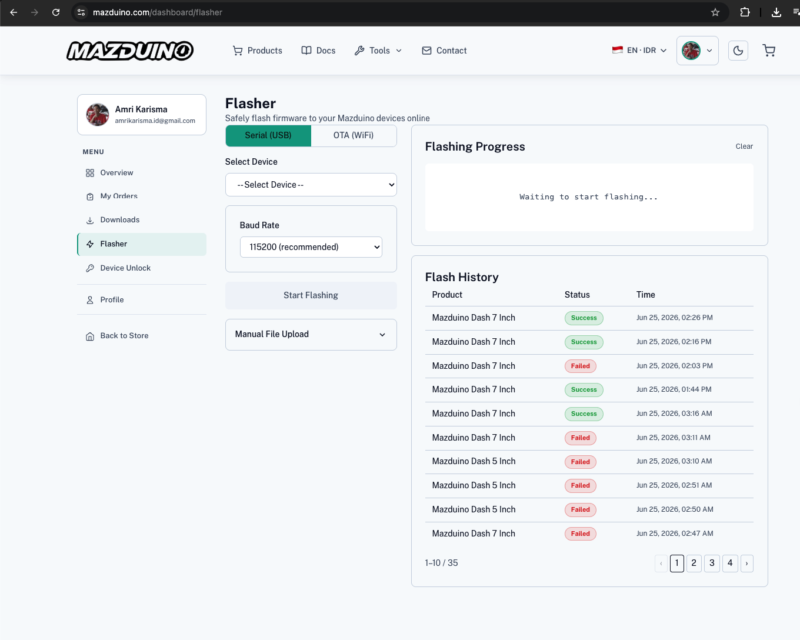

1. First log in to your Mazduino account at [mazduino.com](https://www.mazduino.com/), then open **[mazduino.com/dashboard/flasher](https://www.mazduino.com/dashboard/flasher)**.
2. Select the **OTA (WiFi)** tab.
3. Connect the laptop to the **"MAZDUINO_Display"** WiFi network broadcast by the Racedash, or make sure the Racedash is on the same WiFi network.
4. Select the matching Racedash model under **Select Device** (**make sure the right device is selected**), then click **Start Flashing**.
5. Wait for flashing to finish. The process history can be seen under **Flash History**.

## Old method: browser and the 192.168.4.1 page

Before DashTune, the Racedash was set up in a browser. This method is still available for
those who cannot use DashTune yet (for example, if you only have an iPhone or a laptop),
but new features are only added to DashTune.

<strong>Display Control on mazduino.com</strong> (click to open)

1. Before switching WiFi, open a browser and go to **[https://www.mazduino.com/display-control](https://www.mazduino.com/display-control)** first, while the phone/laptop is still connected to the internet.
2. Once the page is open, connect the phone/laptop's WiFi to **"MAZDUINO_Display"**, broadcast by the Racedash, with the password **"12345678"**. The internet connection will drop, but the page that is already open can still be used.
3. Wait until the Racedash is detected automatically in the **Network Scanner**. If it is not detected automatically, enter the Racedash IP manually in the **Manual IP Address** field: **192.168.4.1**, then click **Test Connection**.

   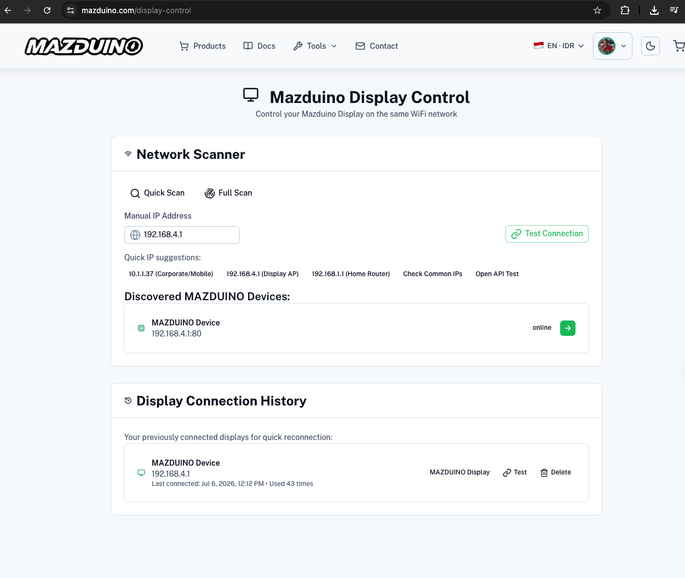

4. Once connected, the **Display Control** page shows the device information and the CAN Bus/ECU data in real time.

   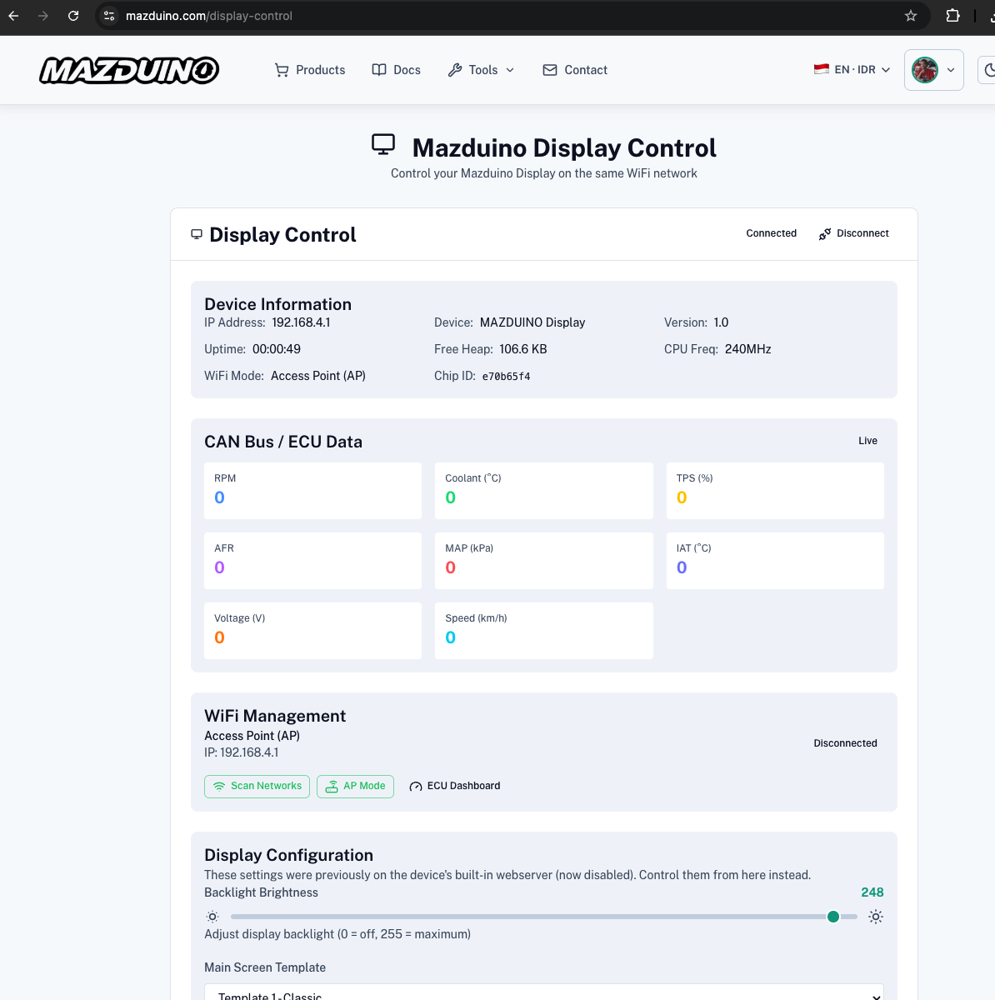

5. Set the data shown in each panel position, the screen template, brightness and the communication mode (CAN Bus/Serial) as needed in the **Display Configuration** section.

   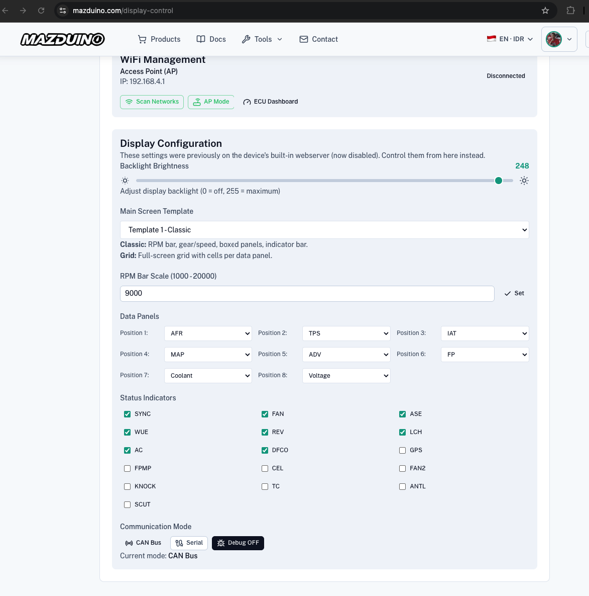

<strong>Splash Screen Generator on mazduino.com</strong> (click to open)

1. Open **[mazduino.com/splash-generator](https://www.mazduino.com/splash-generator)** in a phone/laptop browser.
2. Create the splash screen you want by following the instructions on that page.
3. Upload the result to the Racedash over the **"MAZDUINO_Display"** WiFi connection.

<strong>Old firmware: configuration at 192.168.4.1</strong> (click to open)

This section only applies to old firmware versions, which still use the local
configuration page at `192.168.4.1`. If your Racedash already runs the
latest firmware, use DashTune and skip this section.

1. Connect the phone/laptop to the **"MAZDUINO_Display"** WiFi network with the password **"12345678"**.

   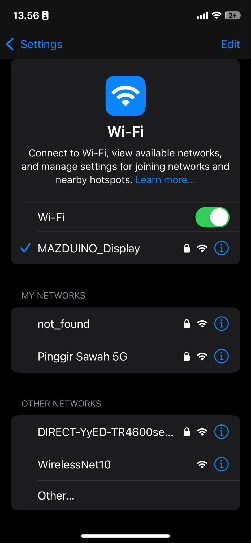

2. Once connected, open a browser and go to [http://192.168.4.1](http://192.168.4.1).

   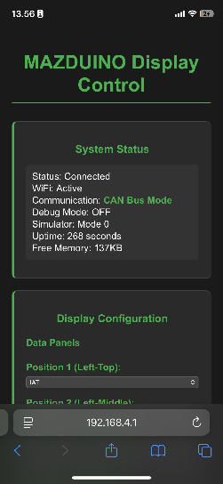

3. Set the data shown in each panel position as needed.

   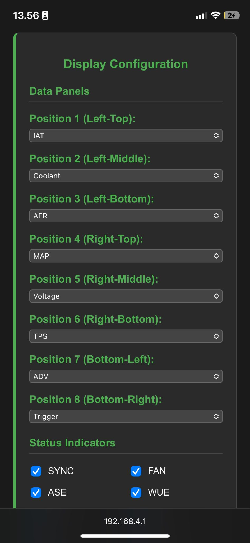

   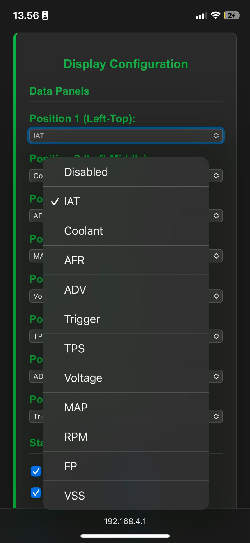

For the larger screen variants (4.3", 5" and 7"), see **[Mazduino Racedash Pro](mazduino-racedash-pro.md)**.

## References

- Mazduino website - [https://www.mazduino.com/](https://www.mazduino.com/)
- Mazduino Wiki - [https://wiki.mazduino.com/](https://wiki.mazduino.com/)
- Mazduino Github - [https://github.com/mazduino/mazduino](https://github.com/mazduino/mazduino)

Schematics and other supporting files are available on the Mazduino website.
