# Mazduino Racedash

## Gambaran Umum

Mazduino Racedash adalah dash display digital yang menampilkan data real-time dari ECU, seperti RPM, gear indicator, kecepatan, dan berbagai data sensor lainnya. Halaman ini membahas varian layar **3.5"** dan **4"**. Untuk varian layar lebih besar (4.3", 5", dan 7"), lihat **[Mazduino Racedash Pro](mazduino-racedash-pro.md)**.

| Varian | Ukuran Layar | Konektor |
| :---- | :---- | :---- |
| [Racedash 3.5"](#racedash-35-konektor-jst-4-pin) | 3.5 inch | JST 4 Pin |
| [Racedash 4" (Cabus)](#racedash-4-cabus-konektor-dtm4) | 4 inch | DTM4 (Deutsch DTM 4 Pin) |

Kedua varian diatur dari HP dengan aplikasi **DashTune**, lewat WiFi yang
dipancarkan dash. Langsung ke [Pengaturan lewat DashTune](#pengaturan-lewat-dashtune).

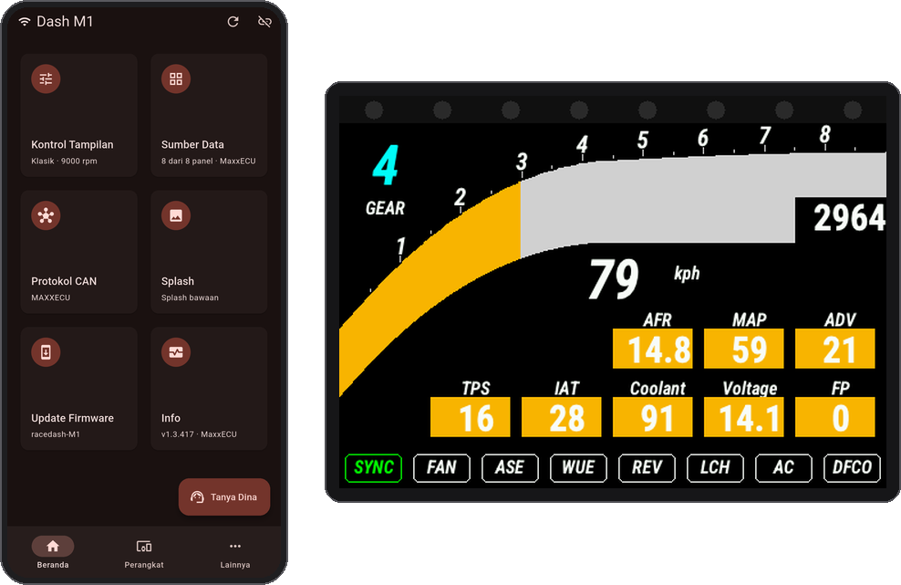

*Kiri: halaman utama DashTune saat tersambung ke dash. Kanan: layar dash dengan
template Klasik.*

## Fitur Utama

- Layar digital menampilkan RPM, gear indicator, kecepatan, dan data sensor lain secara real-time
- Diatur dari aplikasi Android **DashTune**: template layar, data tiap panel, lampu indikator, protokol ECU, splash screen, dan update firmware, semuanya dari HP
- Dua template layar: **Klasik** (bar RPM, gear, speed, dan panel kotak) dan **Grid** (satu layar penuh berisi panel data)
- Mendukung komunikasi ke ECU melalui **CAN Bus** atau **Serial**, tergantung permintaan saat order dan ECU yang digunakan. ECU berbasis **Speeduino** wajib menggunakan mode Serial (berlaku untuk varian JST 4 Pin maupun DTM4), sedangkan **rusEFI**, **Haltech**, dan **MaxxECU** menggunakan mode CAN Bus

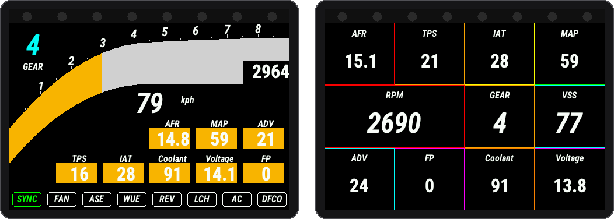

*Template Klasik (kiri) dan Grid (kanan)*

> **Sisi ECU juga harus diatur.** Dash hanya mendengarkan — ECU yang harus
> menyiarkan datanya, pada kecepatan CAN yang tepat. Lihat
> [Konfigurasi ECU untuk Racedash](setting-ecu-racedash.md).

## Racedash 3.5" (Konektor JST 4 Pin)

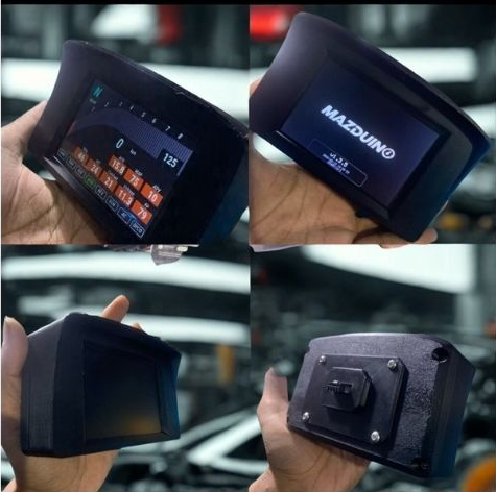

Varian ini menggunakan konektor **JST 4 Pin** yang ringkas untuk instalasi cepat. Tidak ada port USB yang terekspos di luar case — update firmware dilakukan lewat WiFi, lihat bagian [Update Firmware](#update-firmware).

### Konektor JST 4 Pin (Wiring ke Kendaraan)

Konektor eksternal yang digunakan untuk menghubungkan Racedash ke kendaraan/ECU.

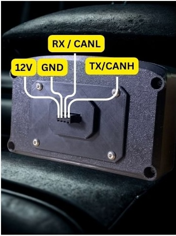

| Pin | Fungsi |
| :---- | :---- |
| 1 | 12V |
| 2 | GND |
| 3 | RX / CANL |
| 4 | TX / CANH |

## Racedash 4" / Cabus (Konektor DTM4)

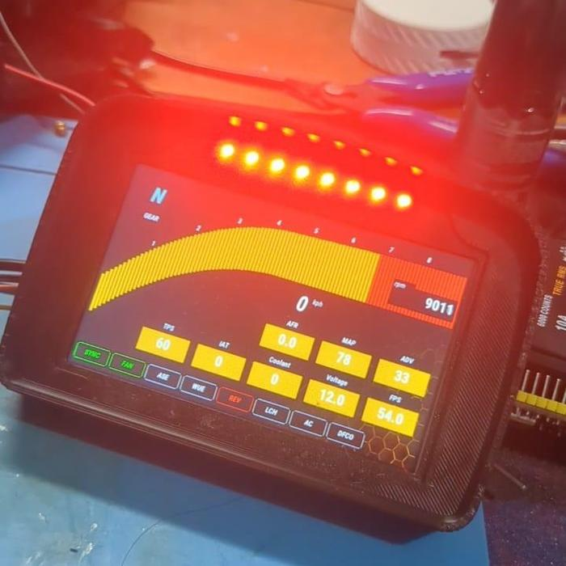

*Racedash 4" saat menyala — bar RPM, indikator gigi, dan deretan lampu
peringatan di bawah layar*

Varian ini menggunakan konektor **DTM4 (Deutsch DTM 4 Pin)** yang tahan getaran dan cuaca, cocok untuk aplikasi racing. Komunikasi ke ECU dilakukan melalui **CAN Bus**, kecuali untuk ECU **Speeduino** yang menggunakan mode **Serial** (secondary serial dari Arduino Mega).

### Konektor DTM4 / 4 Pin

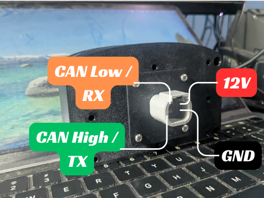

*Dash connector side*

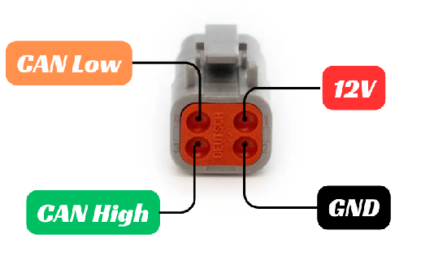

*Cable connector side*

| No. Pin | Deskripsi |
| :---- | :---- |
| 1 | 12V Power Supply |
| 2 | Ground |
| 3 | CAN High / TX |
| 4 | CAN Low / RX |

**Catatan:**

- Pin 3 dan 4 berfungsi sebagai **CAN High/CAN Low** untuk ECU **rusEFI**, **Haltech**, dan **MaxxECU** (mode CAN Bus).
- Khusus untuk ECU **Speeduino**, pin 3 dan 4 berfungsi sebagai **TX/RX Serial** — Speeduino tidak memiliki CAN Bus native, sehingga data diambil melalui **secondary serial (Serial3) Arduino Mega**.

## Pengaturan lewat DashTune

**DashTune** adalah aplikasi Android resmi untuk mengatur Racedash. Semua yang
dulu diatur lewat browser (Display Control) dan Splash Screen Generator
sekarang ada di satu aplikasi, dan bisa dipakai tanpa koneksi internet selama
HP tersambung ke WiFi dash.

Racedash 3.5" dan 4" tersambung ke DashTune lewat **WiFi**. Racedash Pro
(M4/M5/M7) memakai Bluetooth — panduannya ada di halaman
[Racedash Pro](mazduino-racedash-pro.md#panduan-aplikasi-dashtune).

### 1. Pasang DashTune

DashTune masih dalam tahap uji, jadi dipasang lewat program tester Google Play.
Buka **[www.mazduino.com/dashtune/tester](https://www.mazduino.com/dashtune/tester)**
dari HP Android, lalu ikuti tiga langkah di sana dengan **akun Google yang sama**
dengan yang aktif di Play Store:

1. Bergabung ke grup tester DashTune.
2. Tekan **Become a tester** di halaman tester Google Play.
3. Pasang DashTune dari Play Store.

Kalau Play Store menampilkan **"Can't download DashTune"**, lihat
[langkah perbaikannya](mazduino-racedash-pro.md#kalau-play-store-menampilkan-cant-download-dashtune).

### 2. Sambungkan ke dash

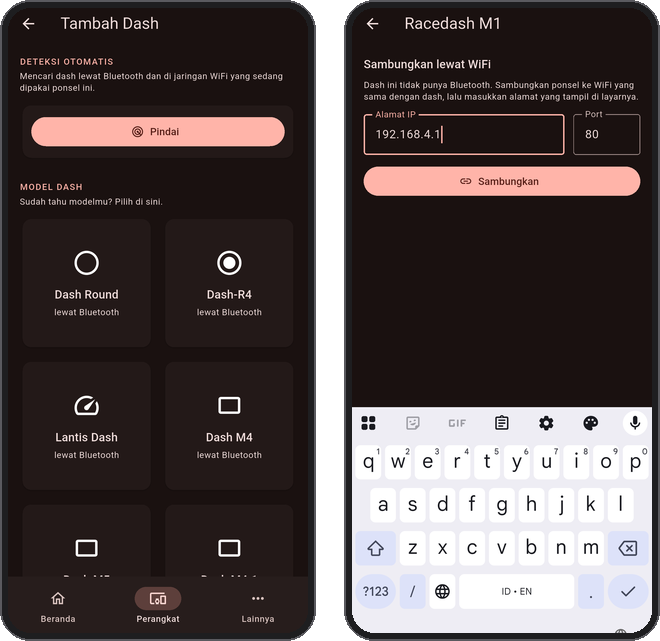

1. Nyalakan dash, lalu sambungkan WiFi HP ke **"MAZDUINO_Display"** dengan
   password **"12345678"**. Kalau Android bertanya karena WiFi ini tidak punya
   internet, pilih tetap tersambung.
2. Buka DashTune, masuk ke tab **Perangkat**, lalu tekan **Tambah Dash**.
3. Tekan **Pindai**. Dash akan ditemukan di jaringan WiFi yang sedang dipakai
   HP.
4. Kalau tidak ditemukan, pilih model Racedash Anda di bagian **Model Dash**,
   isi **Alamat IP** `192.168.4.1` (port `80`), lalu tekan **Sambungkan**.

Setelah tersambung, dash muncul di tab **Beranda** dalam bentuk kartu-kartu
menu: Kontrol Tampilan, Sumber Data, Protokol CAN, Splash, Update Firmware, dan
Info.

### 3. Kontrol Tampilan

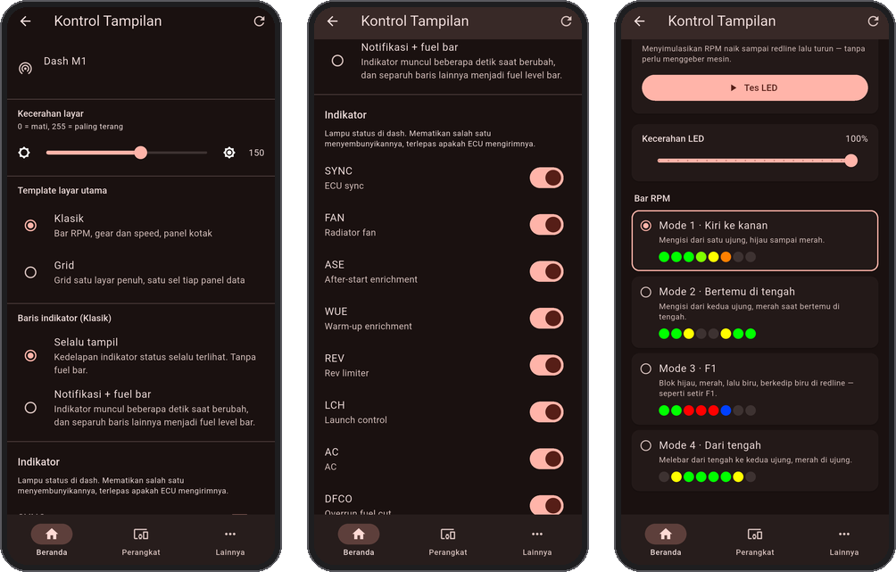

Semua yang tampil di layar diatur di sini, dan langsung dikirim ke dash.

- **Kecerahan layar** — 0 = mati, 255 = paling terang.
- **Template layar utama** — **Klasik** (bar RPM, gear, speed, panel kotak)
  atau **Grid** (satu layar penuh, satu sel tiap panel data).
- **Baris indikator** (Klasik) — **Selalu tampil**: delapan lampu status selalu
  terlihat. **Notifikasi + fuel bar**: lampu muncul beberapa detik saat
  berubah, dan separuh baris lainnya menjadi fuel level bar.
- **Indikator** — nyalakan atau matikan tiap lampu: SYNC, FAN, ASE, WUE, REV,
  LCH, AC, DFCO, FPMP, CEL, FAN2, KNOCK, TC, ANTL, SCUT. Mematikan lampu hanya
  menyembunyikannya di layar, terlepas apakah ECU mengirimnya.
- **Skala bar RPM** — RPM maksimum bar di layar, 1000–20000.
- **RPM shift light** — strip LED di atas layar: RPM mulai menyala,
  **Kecerahan LED**, pola **Bar RPM** (Mode 1–4), dan tombol **Tes LED** untuk
  mencobanya tanpa menggeber mesin.

Pengaturan RPM shift light hanya muncul pada dash yang memang memiliki strip
LED-nya.

### 4. Sumber Data

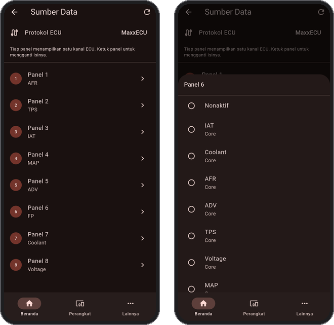

Racedash punya **8 panel data**. Ketuk panel untuk memilih data yang
ditampilkan, misalnya AFR, TPS, IAT, MAP, Coolant, Voltage, atau ADV. Pilih
**Nonaktif** untuk mengosongkan panel.

### 5. Protokol CAN

Menu ini menunjukkan protokol ECU yang dibaca dash dan bitrate CAN-nya. Firmware
Racedash dibuat untuk satu ECU sesuai pesanan, jadi di sini hanya protokol ECU
itu dan **Custom** yang bisa dipilih. **Custom** dipakai untuk ECU yang tidak
ada di daftar, dengan peta data CAN yang diatur sendiri.

Kalau ECU di mobil diganti merek, dash tidak perlu dikirim balik: buka
[Update Firmware](#7-update-firmware) dan pilih **Flash protokol lain**.
DashTune akan meminta konfirmasi sebelum mem-flash. Pilihan ini hanya ada di
dash mode CAN Bus; dash mode Serial untuk Speeduino tidak memakai menu ini.

Pastikan juga ECU sudah menyiarkan data CAN-nya — lihat
[Konfigurasi ECU untuk Racedash](setting-ecu-racedash.md).

### 6. Splash Screen

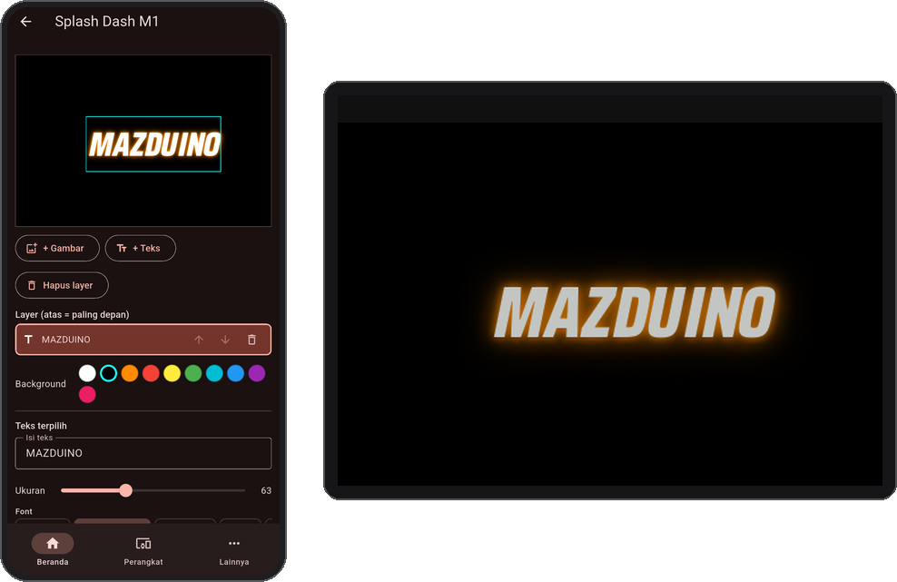

Splash adalah gambar pembuka yang tampil saat dash baru menyala. Splash dibuat
langsung di DashTune, tidak perlu lagi membuka Splash Screen Generator di web.

1. Buka kartu **Splash** di Beranda.
2. Tekan **+ Gambar** untuk memasang foto atau logo dari galeri HP, dan
   **+ Teks** untuk menulis teks. Bisa lebih dari satu layer, misalnya gambar
   background lalu logo di atasnya.
3. Ketuk layer untuk memilihnya, geser untuk memindahkan, dan cubit untuk
   memperbesar atau memperkecil. Untuk teks, atur isi, ukuran, dan font-nya.
   Warna background dipilih dari deretan warna di bawah preview.
4. Tekan **Kirim ke Dash**.
5. Matikan lalu nyalakan lagi dash (cabut daya) untuk melihat splash barunya.

Untuk kembali ke splash bawaan, tekan **Hapus splash (kembali default)**.

### 7. Update Firmware

Buka kartu **Update Firmware**. DashTune memeriksa versi terbaru untuk dash
Anda dan menampilkan versi yang terpasang sekarang.

- **Update dari Server** — mengunduh dan memasang versi terbaru. Karena WiFi
  dash tidak punya internet, DashTune mengunduh lewat **data seluler**, jadi
  nyalakan data seluler sebelum mulai.
- **Pilih File Firmware** — memasang file firmware yang sudah ada di HP,
  misalnya file yang dikirim tim support.
- **Flash protokol lain** — mengganti firmware ke ECU lain (lihat
  [Protokol CAN](#5-protokol-can)).

Kalau data seluler tidak ada, unduh firmware-nya dulu selagi HP punya internet:
keluar dari WiFi dash, buka tab **Perangkat**, tekan menu **⋮** pada dash, lalu
**Unduh firmware**. Setelah itu sambungkan lagi ke WiFi dash dan buka **Update
Firmware** untuk mem-flash file yang sudah tersimpan.

> **Peringatan**: Jangan lakukan update sambil berkendara. Pastikan listrik
> dash tidak terputus dan aplikasi tidak ditutup sampai proses selesai. Update
> yang terputus di tengah jalan bisa membuat dash gagal menyala.

### Tanya Dina

Tombol **Tanya Dina** di Beranda membuka asisten di dalam DashTune. Tanyakan
apa saja seputar pemasangan dan pengaturan dash, misalnya "kenapa RPM tidak
muncul?".

## Update Firmware

Cara yang disarankan adalah lewat DashTune, lihat
[Update Firmware di DashTune](#7-update-firmware). Dua cara lain tetap bisa
dipakai:

1. **Mazduino Flasher (laptop, lewat WiFi)** — tanpa perlu membuka case.
2. **USB** — membuka case Racedash, lalu menghubungkan port/pin USB TTL internal ke komputer secara langsung.

### Lewat Mazduino Flasher

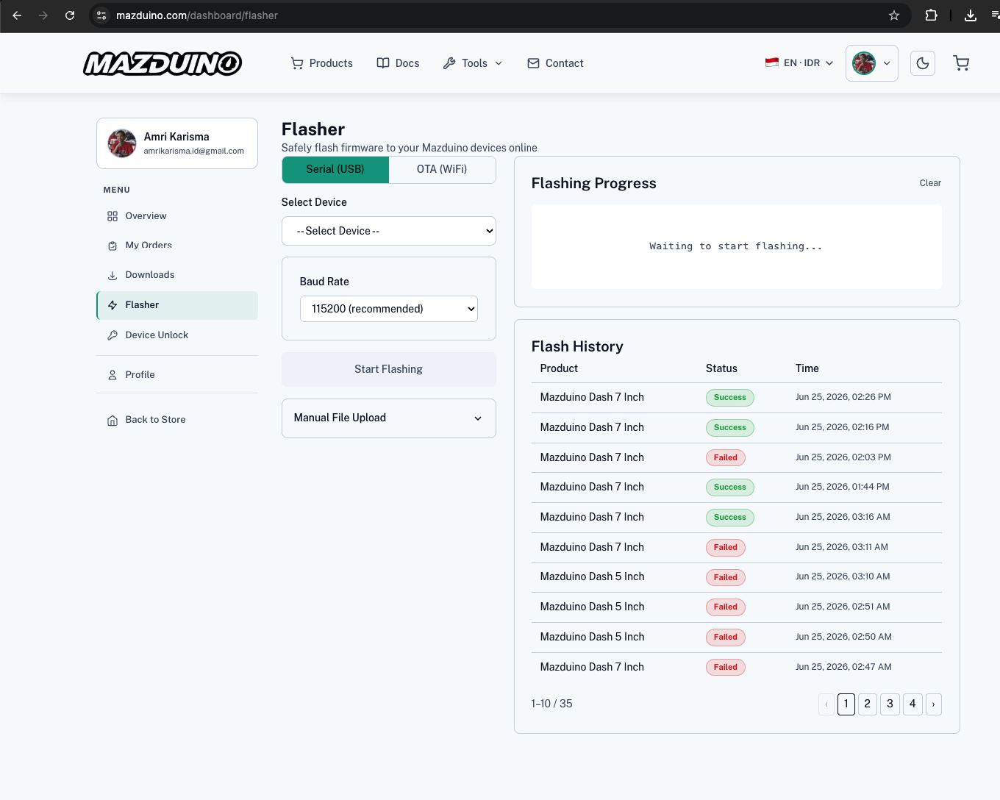

1. Login terlebih dahulu ke akun Mazduino di [mazduino.com](https://www.mazduino.com/), lalu buka **[mazduino.com/dashboard/flasher](https://www.mazduino.com/dashboard/flasher)**.
2. Pilih tab **OTA (WiFi)**.
3. Hubungkan laptop ke WiFi **"MAZDUINO_Display"** yang dipancarkan oleh Racedash, atau pastikan Racedash berada di jaringan WiFi yang sama.
4. Pilih model Racedash yang sesuai pada **Select Device** — **pastikan device dipilih dengan benar** — lalu klik **Start Flashing**.
5. Tunggu proses flashing selesai. Riwayat proses dapat dilihat pada **Flash History**.

## Cara lama: browser dan halaman 192.168.4.1

Sebelum ada DashTune, Racedash diatur lewat browser. Cara ini masih ada untuk
yang belum bisa memakai DashTune (misalnya hanya punya iPhone atau laptop),
tapi fitur barunya hanya ditambahkan di DashTune.

<strong>Display Control di mazduino.com</strong> (klik untuk membuka)

1. Sebelum berpindah WiFi, buka browser dan akses **[https://www.mazduino.com/display-control](https://www.mazduino.com/display-control)** terlebih dahulu selagi HP/laptop masih terhubung internet.
2. Setelah halaman terbuka, hubungkan WiFi HP/laptop ke **"MAZDUINO_Display"** dengan password **"12345678"** yang dipancarkan oleh Racedash. Koneksi internet akan terputus, namun halaman yang sudah terbuka tetap dapat digunakan.
3. Tunggu hingga Racedash terdeteksi otomatis pada **Network Scanner**. Jika tidak terdeteksi otomatis, masukkan IP Racedash secara manual pada kolom **Manual IP Address**: **192.168.4.1**, lalu klik **Test Connection**.

   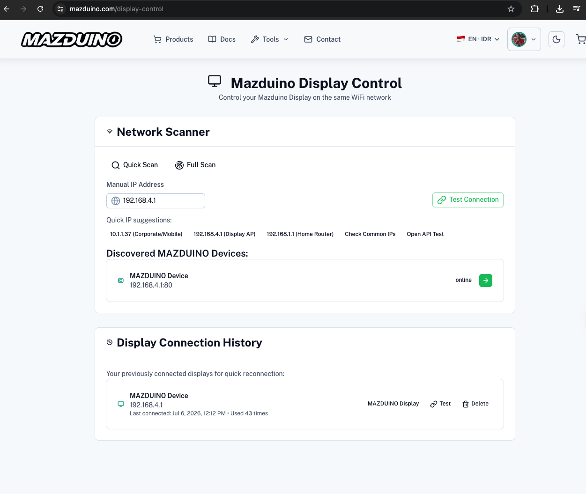

4. Setelah terhubung, halaman **Display Control** menampilkan informasi device serta data CAN Bus/ECU secara real-time.

   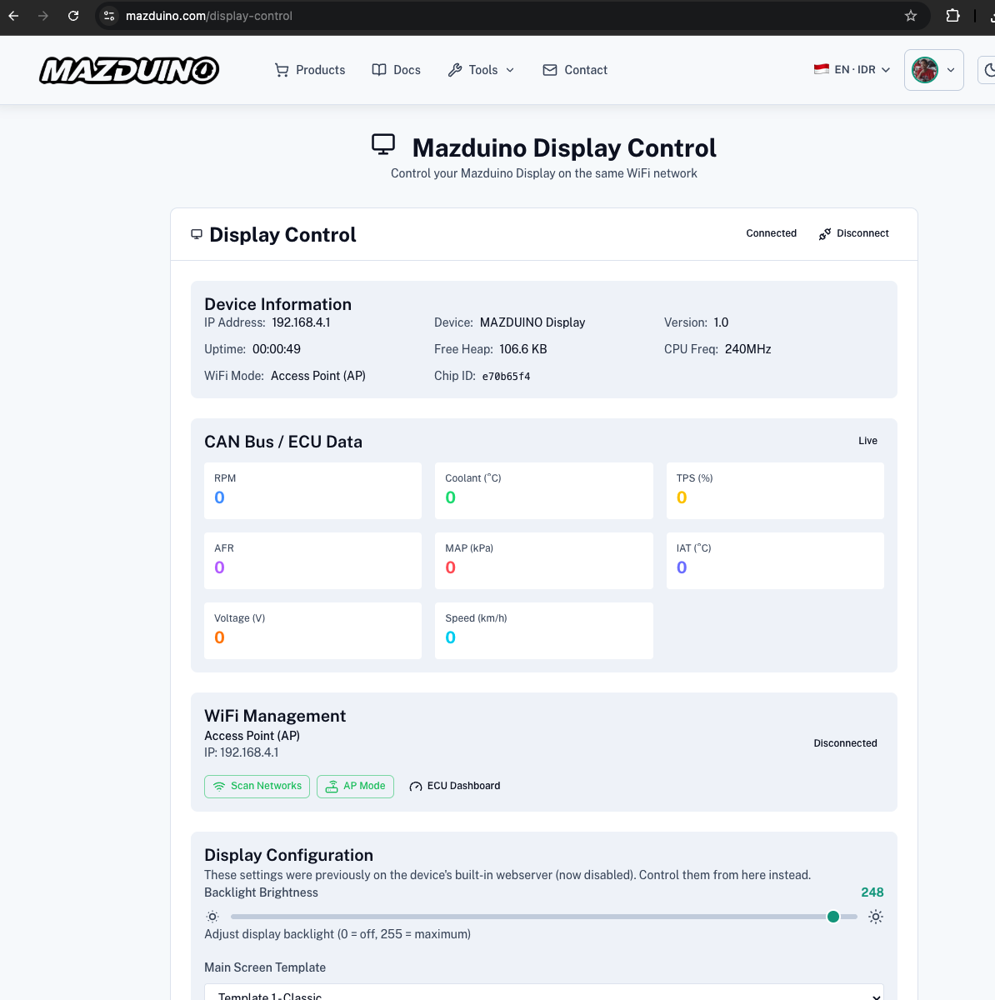

5. Atur data yang ditampilkan pada tiap posisi panel, template layar, brightness, dan mode komunikasi (CAN Bus/Serial) sesuai kebutuhan pada bagian **Display Configuration**.

   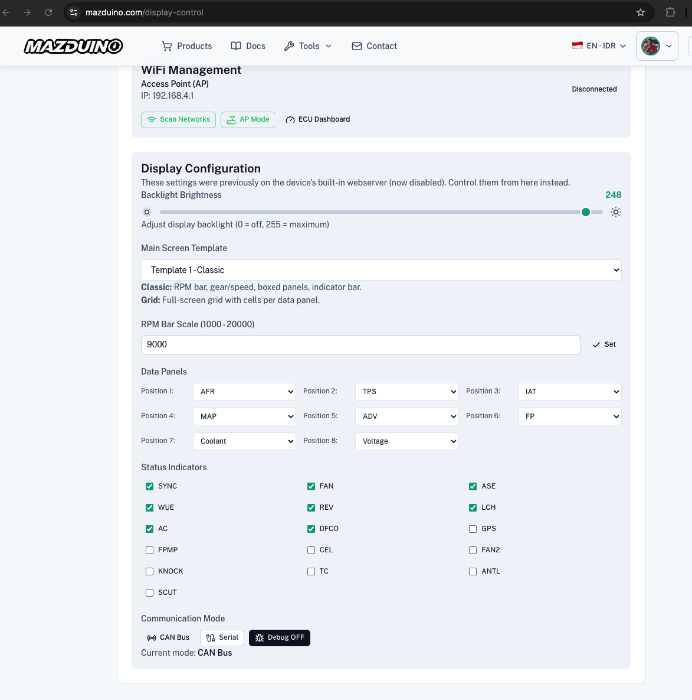

<strong>Splash Screen Generator di mazduino.com</strong> (klik untuk membuka)

1. Buka **[mazduino.com/splash-generator](https://www.mazduino.com/splash-generator)** melalui browser HP/laptop.
2. Buat splash screen sesuai keinginan mengikuti instruksi pada halaman tersebut.
3. Unggah hasilnya ke Racedash melalui koneksi WiFi **"MAZDUINO_Display"**.

<strong>Firmware lama — konfigurasi lewat 192.168.4.1</strong> (klik untuk membuka)

Bagian ini hanya berlaku untuk firmware versi lama, yang masih memakai halaman
konfigurasi lokal di `192.168.4.1`. Kalau Racedash Anda sudah menjalankan
firmware terbaru, pakai DashTune dan lewati bagian ini.

1. Hubungkan HP/laptop ke WiFi **"MAZDUINO_Display"** dengan password **"12345678"**.

   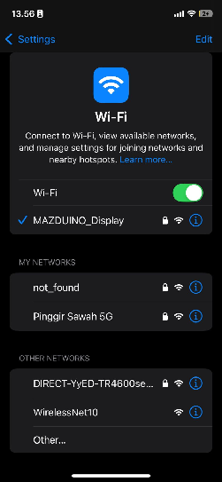

2. Setelah terhubung, buka browser dan akses [http://192.168.4.1](http://192.168.4.1).

   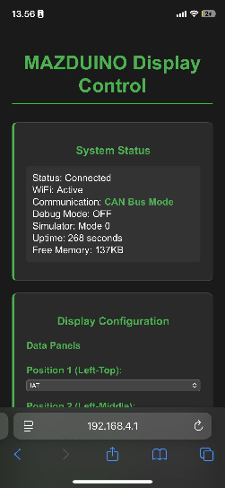

3. Atur data yang ditampilkan pada tiap posisi panel sesuai kebutuhan.

   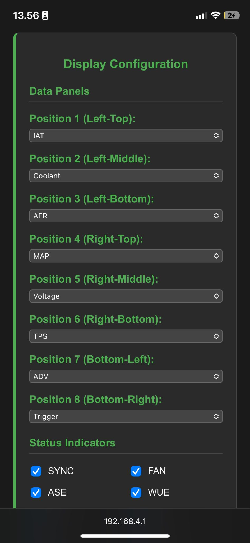

   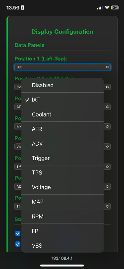

Untuk varian layar lebih besar (4.3", 5", dan 7"), lihat **[Mazduino Racedash Pro](mazduino-racedash-pro.md)**.

## Referensi

- Website Mazduino - [https://www.mazduino.com/](https://www.mazduino.com/)
- Wiki Mazduino - [https://wiki.mazduino.com/](https://wiki.mazduino.com/)
- Github Mazduino - [https://github.com/mazduino/mazduino](https://github.com/mazduino/mazduino)

Jika butuh skematik dan file pendukung lainnya, tersedia di website Mazduino.
