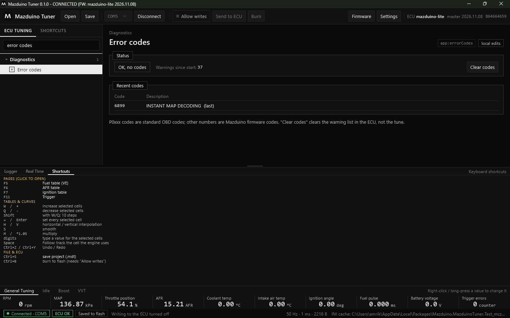
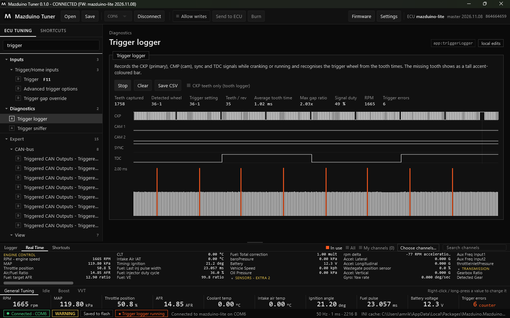
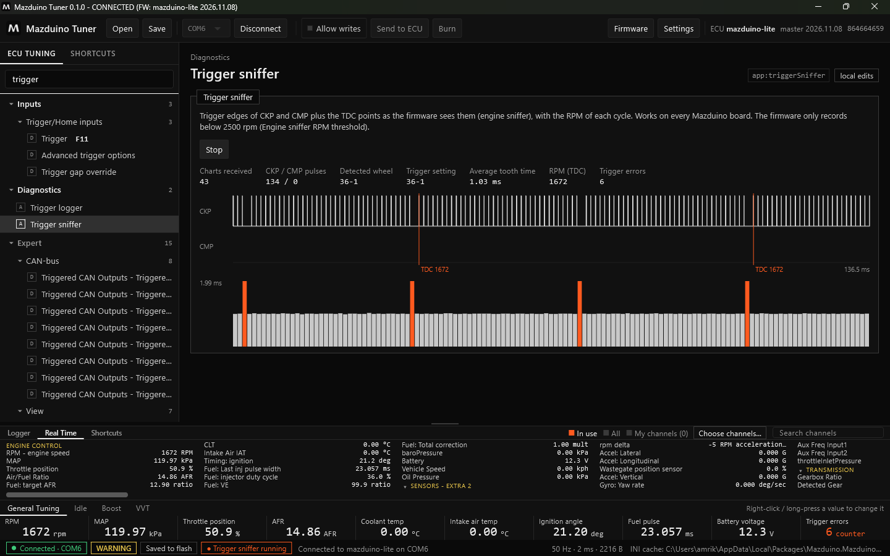

# Diagnostik di Mazduino Tuner

Alat diagnostik ada di grup **Diagnostics** pada menu. Ketik namanya di pencarian menu untuk
membukanya dengan cepat.

| Alat | Fungsi |
|---|---|
| [Error codes](#error-codes) | Kode error dan peringatan dari ECU |
| [Tune problems](#tune-problems) | Pemeriksaan pengaturan yang tidak wajar |
| [Temporary cylinder shutoff](#temporary-cylinder-shutoff) | Mematikan satu silinder untuk mencari silinder yang lemah |
| [Trigger logger](#trigger-logger) | Merekam sinyal CKP/CMP dan mengenali pola roda trigger |
| [Trigger sniffer](#trigger-sniffer) | Tepi sinyal trigger dan titik TDC seperti yang dilihat firmware |
| [Trigger oscilloscope](#trigger-oscilloscope) | Bentuk tegangan sinyal CKP/CMP (jika didukung ECU) |
| [CAN analyzer](#can-analyzer) | Melihat lalu lintas CAN lewat ECU |

Selain itu grup Diagnostics juga berisi halaman tes output dari firmware (injektor, koil, relay,
dan lain-lain).

!!! warning "Alat yang membebani ECU"
    Trigger logger, trigger sniffer, dan oscilloscope membuat ECU dan USB sibuk. Selama berjalan,
    status bar menampilkan penandanya. Jika Anda pindah halaman saat alat masih berjalan, aplikasi
    menanyakan apakah alat dihentikan.

## Error Codes

- **Status**: **OK, no codes** jika tidak ada error aktif, beserta jumlah peringatan sejak ECU
  menyala.
- **Recent codes**: kode terakhir dengan keterangannya.
- Kode **P0xxx** adalah kode OBD standar; angka lain adalah kode firmware Mazduino.
- **Clear codes** menghapus daftar peringatan di ECU, bukan tune.

## Tune Problems

Memeriksa tune dan menampilkan pengaturan yang tidak wajar atau saling bertentangan, beserta
tingkat kepentingannya.

## Temporary Cylinder Shutoff

Memutus bahan bakar dan pengapian satu silinder untuk mencari silinder yang lemah:

- Saat idle, **RPM turun banyak** = silinder sehat.
- **RPM hampir tidak turun** = silinder bermasalah (injektor, busi/koil, kompresi).
- Setiap silinder menyala kembali sendiri setelah 10 detik.

Syarat: **Allow writes** aktif, mesin menyala, dan injeksi sequential. Firmware lama mungkin belum
mendukung fitur ini.

## Trigger Logger

Merekam sinyal **CKP** (primary), **CMP** (cam), **sync**, dan **TDC** saat cranking atau mesin
menyala, lalu mengenali pola roda trigger dari waktu antar gigi. Gigi yang hilang (missing tooth)
tampil sebagai batang tinggi berwarna oranye.

1. Klik **Start**, lalu crank atau nyalakan mesin.
2. Lihat **Detected wheel** dan bandingkan dengan **Trigger setting**. Jika berbeda, aplikasi
   memberi peringatan untuk memeriksa pengaturan trigger atau sensor.
3. **Save CSV** menyimpan rekaman; **Clear** menghapusnya.

Centang **CKP teeth only (tooth logger)** untuk merekam gigi CKP saja.

ECU mengirim rekaman per buffer. Jeda waktu di antara dua buffer tidak terekam, jadi digambar pendek
dengan garis tipis vertikal sebagai penanda. Garis itu bukan berarti sinyal hilang.

## Trigger Sniffer

Menampilkan tepi sinyal CKP dan CMP serta titik TDC seperti yang dilihat firmware (engine sniffer),
dengan RPM setiap siklus. Bisa dipakai di semua board Mazduino.

1. Klik **Start**. Setiap siklus mesin yang diterima menambah **Charts received**.
2. Garis oranye **TDC** menandai titik mati atas silinder 1 beserta RPM saat itu.
3. Batang di bawah adalah waktu antar gigi; batang oranye adalah gigi yang hilang.
4. Bandingkan **Detected wheel** dengan **Trigger setting**, dan perhatikan **Trigger errors**.

Firmware hanya merekam di bawah batas RPM engine sniffer. Jika RPM di atas batas itu, halaman ini
memberi tahu Anda.

## Trigger Oscilloscope

Menampilkan bentuk sinyal analog (tegangan) input CKP/CMP dari ADC ECU, untuk memeriksa sensor
VR/hall, noise, dan level tegangan. Halaman ini hanya muncul jika hardware dan firmware ECU
mendukungnya.

## CAN Analyzer

Menampilkan lalu lintas CAN lewat controller ECU sendiri, tanpa adapter tambahan.

- **Start** menyalakan pencetakan CAN di RAM ECU saja. Pengaturan ini tidak disimpan ke flash dan
  dikembalikan saat **Stop**, saat halaman ditutup, atau sebelum Burn.
- Mode ini untuk bus yang sepi. Di bus yang ramai sebagian frame bisa hilang.
- Waktu frame adalah saat data tiba di PC, jadi perkiraan.
- Untuk menyadap jaringan mobil pabrikan, nyalakan dulu **Listen mode** di pengaturan CAN agar ECU
  tidak mengganggu bus.
- Jika **CAN read** di tune mati, frame masuk tidak akan terlihat.
