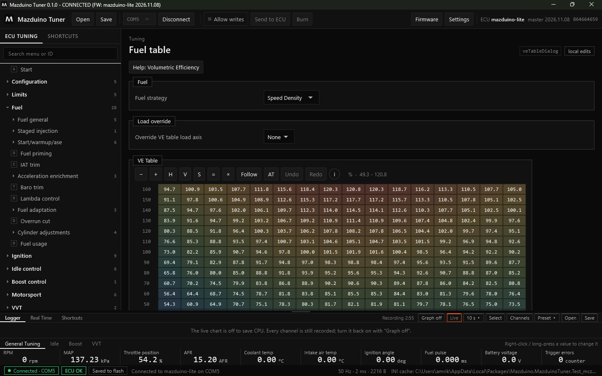
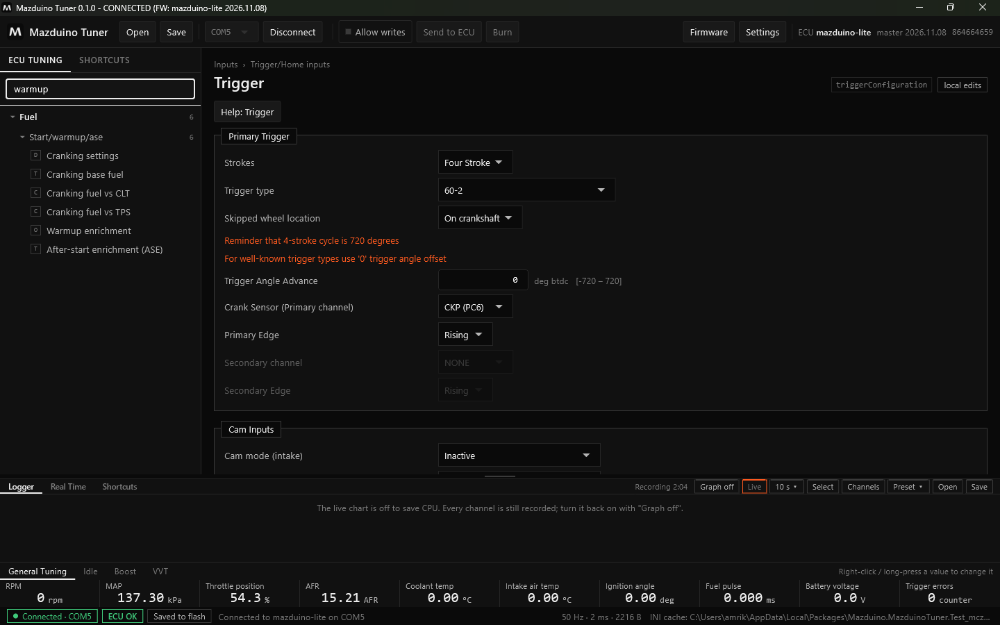
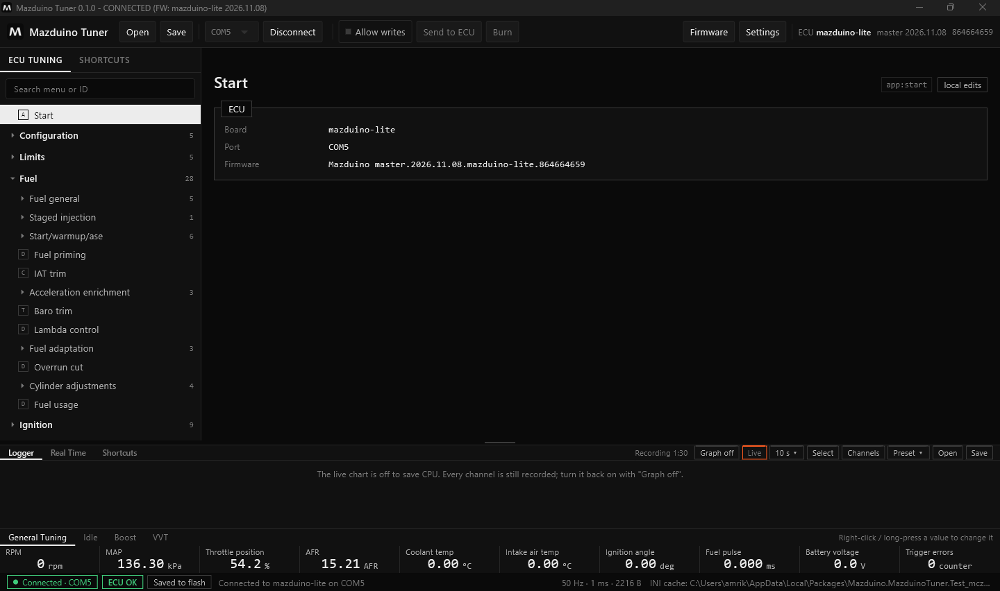

# Koneksi dan Tampilan Mazduino Tuner

Halaman ini menjelaskan cara menghubungkan ECU dan bagian-bagian tampilan Mazduino Tuner.

## Menghubungkan ECU

1. Colokkan ECU ke USB.
2. Pilih port di toolbar (misalnya `COM5`).
3. Klik **Connect**.

Saat terhubung, status bar di kiri bawah menampilkan **Connected · COM5** dan **ECU OK**. Klik
**Disconnect** untuk melepas. Saat disconnect atau aplikasi ditutup, port serial benar-benar
dilepas sehingga bisa dipakai aplikasi lain.

!!! tip "Auto-connect"
    Aktifkan **Auto-connect** di Settings agar aplikasi langsung connect ke port terakhir setiap
    kali ECU dicolok.

## Bagian-bagian Tampilan

| Bagian | Letak | Fungsi |
|---|---|---|
| **Judul jendela** | paling atas | Versi aplikasi, status koneksi, nama proyek, dan firmware |
| **Toolbar** | atas | Open/Save proyek, port, Connect, Allow writes, Send to ECU, Burn, Firmware, Settings |
| **Menu** | kiri | Semua halaman pengaturan ECU, dikelompokkan per sistem mesin, dengan pencarian |
| **Halaman** | tengah | Pengaturan, tabel, atau kurva dari menu yang dipilih |
| **Panel bawah** | bawah | Logger, Real Time, dan Shortcuts |
| **Nilai utama** | di bawah panel | RPM, MAP, TPS, AFR, suhu, dan lainnya, selalu terlihat |
| **Status bar** | paling bawah | Status koneksi, status burn, pesan terakhir, kecepatan data |

### Judul Jendela

Judul jendela menunjukkan:

- **Versi** Mazduino Tuner
- **Status**: `CONNECTED`, `CONNECTING`, `RECONNECTING`, `OFFLINE` (proyek dibuka tanpa ECU), atau
  `DISCONNECTED`
- **Nama proyek** `.mdt` yang terbuka. Tanda `*` berarti ada perubahan yang belum disimpan ke file.
- **FW**: board dan tanggal firmware dari tune yang sedang tampil

### Toolbar

| Tombol | Fungsi |
|---|---|
| **Open** | Membuka proyek tune `.mdt`. Bisa diedit tanpa ECU; saat ECU terhubung tune dibandingkan. |
| **Save** | Menyimpan tune ke proyek `.mdt`. Shift+klik untuk menyimpan sebagai file baru. |
| **Port** | Memilih port USB ECU |
| **Connect / Disconnect** | Menghubungkan atau melepas ECU |
| **Allow writes** | Mengizinkan aplikasi menulis ke ECU (hanya sesi ini) |
| **Send to ECU** | Mengirim perubahan yang tertunda ke RAM ECU |
| **Burn** | Menyimpan isi RAM ECU ke flash agar tetap ada setelah ECU mati |
| **Firmware** | Update firmware ECU. Lihat [Update Firmware](mazduino-tuner-update-firmware.md). |
| **Settings** | Pengaturan aplikasi |

Di kanan toolbar tertulis board dan versi firmware ECU yang terhubung.

### Menu dan Pencarian

Menu di kiri dikelompokkan per sistem mesin, misalnya Configuration, Limits, Fuel, Ignition, Idle
control, Boost control, VVT, CAN Bus, Inputs, Outputs, Tuning, Diagnostics, dan Expert. Angka di
kanan menunjukkan jumlah halaman di dalam grup. Halaman untuk fitur yang tidak aktif disembunyikan.
Pengaturan yang jarang dipakai ada di grup **Expert**.

Ketik di kotak **Search menu or ID** untuk mencari halaman. Hasilnya langsung tersaring:

Ikon kecil di depan nama halaman menunjukkan jenisnya:

| Ikon | Jenis |
|---|---|
| **D** | Halaman pengaturan (dialog) |
| **T** | Tabel 2D |
| **C** | Kurva |
| **A** | Halaman aplikasi (Start, diagnostik) |

Di kanan atas setiap halaman ada **ID halaman** (misalnya `veTableDialog`) yang juga bisa dicari,
dan label mode tulis: **local edits** (perubahan hanya di aplikasi) atau **writes allowed**.

### Panel Bawah

Panel bawah berisi tiga tab: **Logger**, **Real Time**, dan **Shortcuts**. Garis pembatas di atas
panel bisa ditarik untuk memperbesar atau memperkecil panel. Lihat
[Logger dan Real Time](mazduino-tuner-logger.md).

### Nilai Utama

Baris nilai di bawah panel selalu terlihat. Ada beberapa tab (General Tuning, Idle, Boost, VVT).
**Klik kanan** (atau tekan lama) sebuah nilai untuk menggantinya dengan channel lain.

### Status Bar

| Bagian | Arti |
|---|---|
| **Connected · COM5** | ECU terhubung di port tersebut |
| **ECU OK** | Tidak ada error kritis di ECU |
| **Saved to flash** | Semua perubahan sudah di-burn. Jika belum, tombol Burn ikut menyala. |
| Pesan | Pesan terakhir aplikasi, misalnya hasil edit atau burn |
| `50 Hz · 1 ms · 2216 B` | Kecepatan data live, waktu respons ECU, dan ukuran data per baca |
| **INI** | Sumber file definisi (cache, unduhan, atau file) |

## Halaman Start

Halaman **Start** menampilkan board, port, dan firmware ECU yang terhubung.

