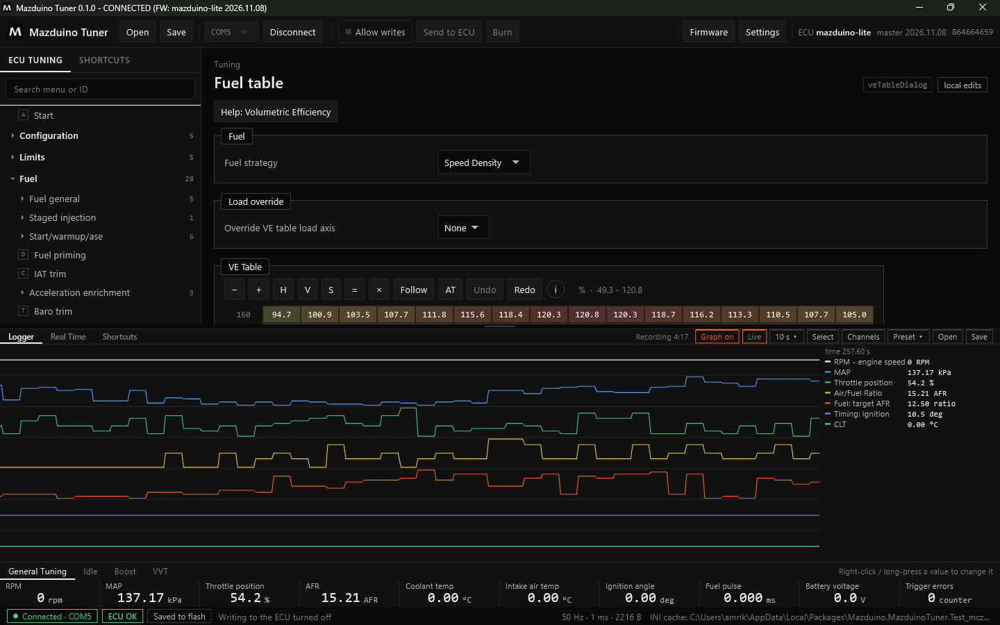
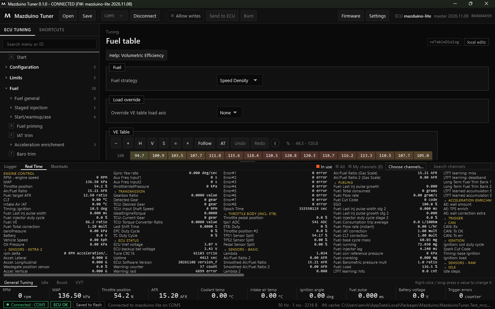
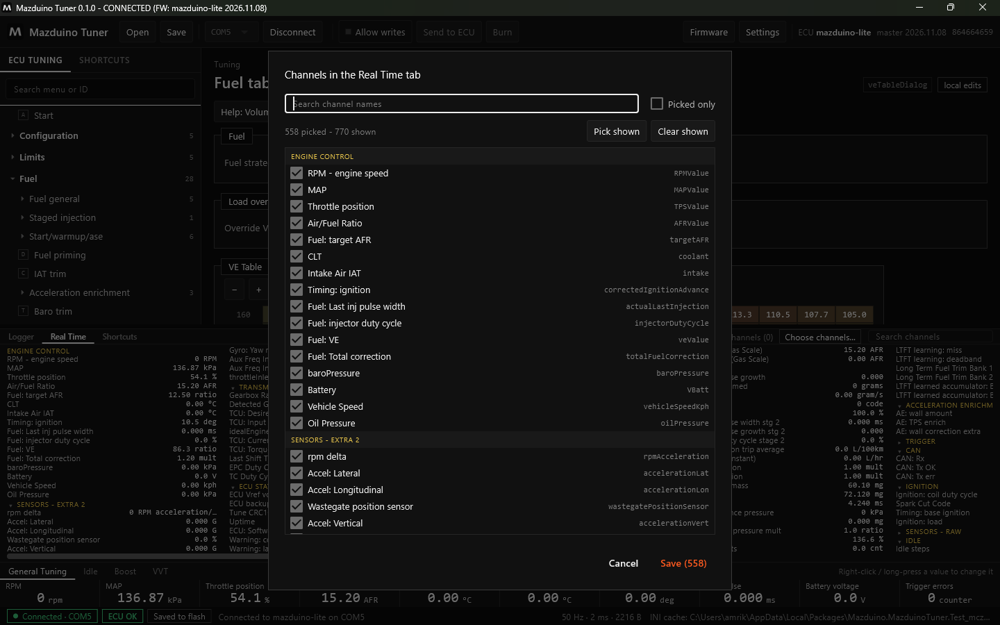
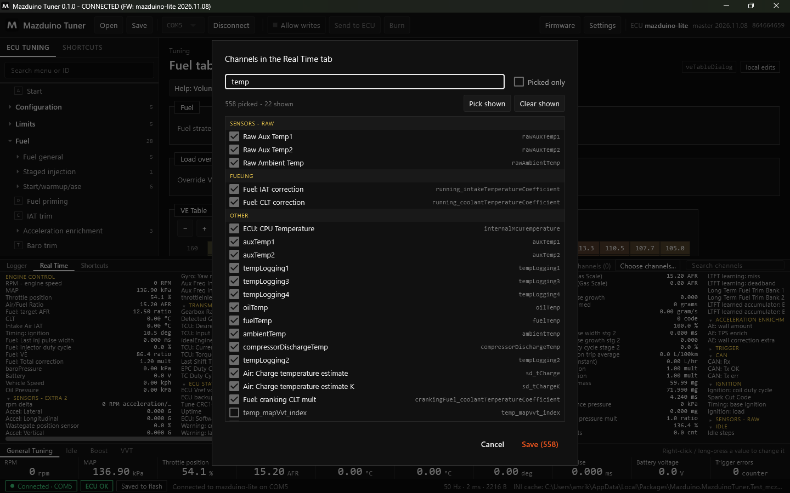
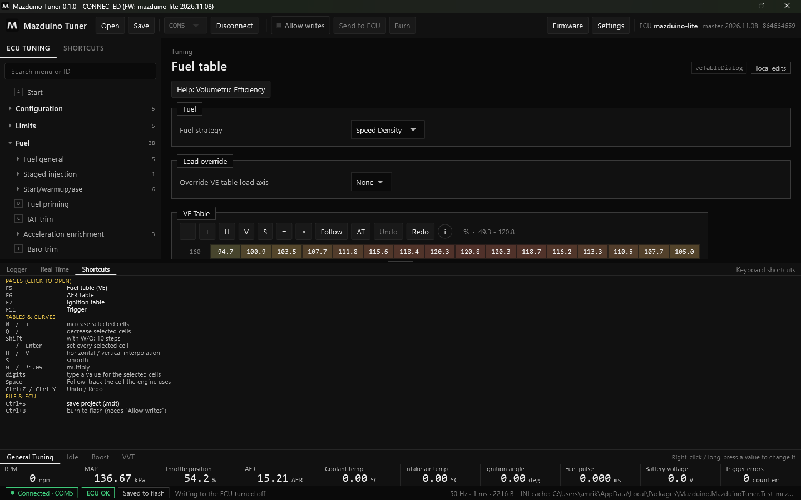

# Logger dan Real Time di Mazduino Tuner

Panel bawah Mazduino Tuner berisi tiga tab: **Logger**, **Real Time**, dan **Shortcuts**. Tarik
garis pembatas di atas panel untuk mengubah tingginya.

## Logger

Selama ECU terhubung, **semua channel selalu direkam** (sekitar 11 menit terakhir pada 50 Hz).
Anda tidak perlu menekan tombol rekam.

| Tombol | Fungsi |
|---|---|
| **Recording** | Lama rekaman yang tersimpan saat ini |
| **Graph on / Graph off** | Menyalakan atau mematikan grafik live. Mematikan grafik menghemat CPU; perekaman tetap berjalan. |
| **Live** / **Go live** | Grafik mengikuti data terbaru. Jika digeser ke belakang, klik **Go live** untuk kembali. |
| **10 s** | Lebar rentang waktu yang terlihat |
| **Select** | Klik pada grafik memilih rentang waktu (sama dengan Shift+klik), misalnya untuk menyimpan sebagian log |
| **Channels** | Memilih channel yang digambar |
| **Preset** | Menyimpan dan memakai kumpulan channel, misalnya "Idle" atau "Dyno" |
| **Open** | Membuka file log `.mlg` atau `.csv` |
| **Save** | Menyimpan log sebagai `.mlg` atau `.csv` |

Di kanan grafik tertulis nilai setiap channel pada posisi kursor.

**Simpan otomatis**: aktifkan **Save when disconnecting** di Settings. Log yang lebih dari 30 detik
disimpan saat disconnect, di folder `Logs` di samping proyek `.mdt`, atau di
`Documents\Mazduino Tuner\Logs\<nama kendaraan>`. Di samping setiap log juga tersimpan tune yang
dipakai ECU saat log direkam (`.mdt`).

## Real Time

Tab **Real Time** menampilkan nilai live dari channel ECU dalam kolom-kolom, dikelompokkan seperti
dashboard. Grup **Engine Control** (RPM, MAP, TPS, AFR, suhu, timing, injektor) selalu di depan.

- Klik judul grup untuk membuka atau menutupnya.
- Scroll mouse menggeser kolom ke samping.
- Arahkan kursor ke nama channel untuk melihat nama aslinya.

### Memilih Channel yang Ditampilkan

Di kanan atas tab ada tiga pilihan:

| Pilihan | Yang ditampilkan |
|---|---|
| **In use** | Hanya channel dari fitur yang dipakai ECU (default) |
| **All** | Semua channel |
| **My channels** | Hanya channel pilihan Anda |

Klik **Choose channels...** untuk memilih channel sendiri:

- Ketik di kotak pencarian untuk menyaring, misalnya `temp`:

    

- Centang atau hilangkan centang per channel.
- **Pick shown** / **Clear shown** mencentang atau menghapus semua channel yang sedang tampil.
- **Picked only** menampilkan hanya channel yang sudah dicentang.
- **Save** menyimpan pilihan dan beralih ke **My channels**.

Kotak **Search channels** di kanan atas tab Real Time menyaring kolom secara langsung.

## Shortcuts

Tab **Shortcuts** berisi daftar tombol keyboard. Klik baris halaman untuk langsung membukanya.

| Tombol | Fungsi |
|---|---|
| F5 / F6 / F7 / F11 (bawaan) | Fuel table (VE) / tabel target AFR / Ignition table / Trigger. Bisa diganti dan ditambah (F2 sampai F12) lewat klik kanan halaman di menu. |
| W atau + / Q atau − | Naikkan / turunkan sel terpilih (Shift: 10 langkah) |
| = atau Enter | Isi semua sel terpilih |
| H / V | Interpolasi horizontal / vertikal |
| S | Smooth |
| M atau `*1.05` | Kalikan |
| angka | Ketik nilai untuk sel terpilih |
| Space | Follow: ikuti sel yang dipakai mesin |
| Ctrl+Z / Ctrl+Y | Undo / Redo |
| Ctrl+S | Simpan proyek `.mdt` |
| Ctrl+B | Burn ke flash (perlu Allow writes) |

## Nilai Utama

Baris nilai di bawah panel (RPM, MAP, Throttle position, AFR, Coolant temp, dan lainnya) selalu
terlihat. Gunakan tab **General Tuning**, **Idle**, **Boost**, **VVT** untuk set nilai lain.
**Klik kanan** (atau tekan lama) sebuah nilai untuk menggantinya dengan channel lain.
