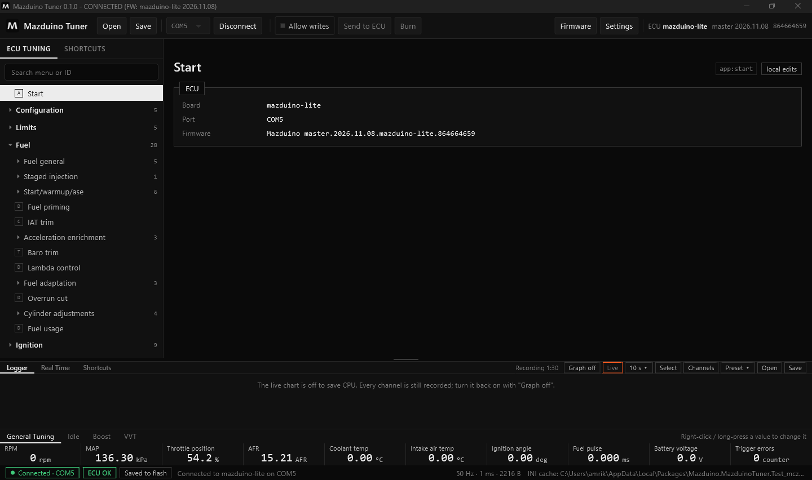
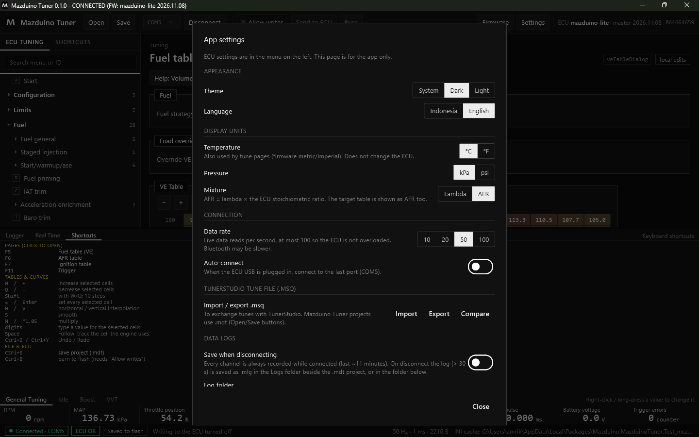

# Manual Mazduino Tuner

Mazduino Tuner adalah software tuning resmi untuk ECU Mazduino berbasis rusEFI. Software ini
membaca definisi (INI) langsung dari firmware di ECU, jadi semua menu dan halaman selalu cocok
dengan firmware yang terpasang. Firmware ECU juga bisa diupdate langsung dari aplikasi.

!!! warning "Versi alpha"
    Mazduino Tuner masih dalam tahap pengujian (alpha). Simpan selalu salinan tune Anda
    (`.mdt` atau `.msq`) sebelum menulis ke ECU, dan jangan mengandalkannya untuk mesin yang
    tidak boleh bermasalah.

## Isi Manual

| Halaman | Isi |
|---|---|
| [Instalasi](#instalasi) | Unduh, pasang, dan jalankan pertama kali |
| [Koneksi dan Tampilan](mazduino-tuner-interface.md) | Menghubungkan ECU, toolbar, menu, panel bawah, status |
| [Mengubah Tune](mazduino-tuner-tuning.md) | Halaman pengaturan, tabel dan kurva, Allow writes, Send, Burn |
| [Proyek dan File Tune](mazduino-tuner-proyek.md) | Proyek `.mdt`, edit offline, tune laptop vs ECU, file `.msq` |
| [Update Firmware](mazduino-tuner-update-firmware.md) | Update firmware ECU lewat USB dan memeriksa tune setelahnya |
| [Logger dan Real Time](mazduino-tuner-logger.md) | Data log, grafik, daftar channel, shortcut |
| [Diagnostik](mazduino-tuner-diagnostik.md) | Error code, trigger logger, sniffer, CAN analyzer, tes silinder |

## Kebutuhan Sistem

- **Sistem operasi**: Windows 10 atau 11 (64-bit)
- **Koneksi**: port USB untuk ECU Mazduino
- **Hak administrator**: tidak perlu untuk instalasi. Windows hanya meminta izin sekali saat
  driver USB bootloader dipasang (untuk update firmware).

Mazduino Tuner dibuat untuk ECU Mazduino dengan firmware Mazduino (rusEFI). Board rusEFI lain dan
Speeduino juga bisa dibuka.

## Instalasi

### Langkah 1: Unduh installer

Buka halaman **[Releases Mazduino Tuner][releases]** dan unduh file
`MazduinoTuner-Setup-<versi>.exe` dari rilis terbaru.

[releases]: https://github.com/mazduino/mazduino-tuner/releases

### Langkah 2: Jalankan installer

1. Klik dua kali file installer.
2. Versi alpha belum ditandatangani (code signing), jadi Windows SmartScreen bisa menampilkan
   **"Windows protected your PC"**. Klik **More info**, lalu **Run anyway**. Pastikan file
   memang diunduh dari halaman Releases di atas.
3. Ikuti langkah installer. Aplikasi dipasang untuk user yang sedang login, tanpa hak administrator.
4. Di akhir instalasi Windows bisa menanyakan izin untuk memasang **driver USB bootloader STM32**.
   Driver ini dipakai saat update firmware. Setujui; kalau dilewati, aplikasi akan memintanya lagi
   saat pertama kali update firmware.

### Langkah 3: Jalankan pertama kali

1. Buka **Mazduino Tuner** dari Start Menu atau shortcut desktop.
2. Hubungkan ECU dengan kabel USB.
3. Pilih port ECU (misalnya `COM5`) di toolbar, lalu klik **Connect**.

Aplikasi membaca signature firmware, mengambil file INI yang cocok, lalu membuka menu sesuai board
dan firmware. Lihat [Koneksi dan Tampilan](mazduino-tuner-interface.md).

!!! note "File INI tidak perlu dipilih manual"
    Untuk firmware Mazduino, INI diunduh otomatis sesuai signature dan disimpan di cache, jadi
    berikutnya tidak perlu internet lagi. INI juga ikut tersimpan di setiap proyek `.mdt`.
    Hanya untuk firmware yang tidak dikenal aplikasi akan meminta Anda memilih file INI sekali.

## Pengaturan Aplikasi

Klik **Settings** di kanan atas.

| Pengaturan | Keterangan |
|---|---|
| **Theme** | System, Dark, atau Light |
| **Language** | Bahasa Indonesia atau English |
| **Temperature / Pressure / Mixture** | Satuan tampilan (°C/°F, kPa/psi, Lambda/AFR). Hanya tampilan; isi ECU tidak berubah. |
| **Data rate** | Berapa kali per detik data live dibaca (10, 20, 50, 100). Default 50, maksimal 100 agar ECU tidak terbebani. |
| **Auto-connect** | Langsung connect ke port terakhir saat ECU dicolok |
| **Import / Export / Compare .msq** | Bertukar tune dengan TunerStudio. Lihat [Proyek dan File Tune](mazduino-tuner-proyek.md#file-tunerstudio-msq). |
| **Save when disconnecting** | Simpan data log otomatis saat disconnect |
| **Log folder / Data folders** | Membuka folder log dan folder data aplikasi |

## Lokasi File

| Isi | Lokasi |
|---|---|
| Pengaturan, cache INI, log koneksi dan update firmware, backup tune sebelum update | `%APPDATA%\MazduinoTuner` |
| Data log | `Documents\Mazduino Tuner\Logs`, atau folder `Logs` di samping proyek `.mdt` |

Uninstall tidak menghapus folder-folder ini.

## Melaporkan Masalah

Buat laporan di [halaman Issues][issues] dengan menyertakan:

- versi Mazduino Tuner (terlihat di judul jendela) dan firmware ECU (di kanan atas toolbar)
- langkah yang dilakukan dan apa yang terjadi
- `%APPDATA%\MazduinoTuner\connection.log` untuk masalah koneksi, atau
  `%APPDATA%\MazduinoTuner\firmware-update.log` untuk masalah update firmware

[issues]: https://github.com/mazduino/mazduino-tuner/issues
