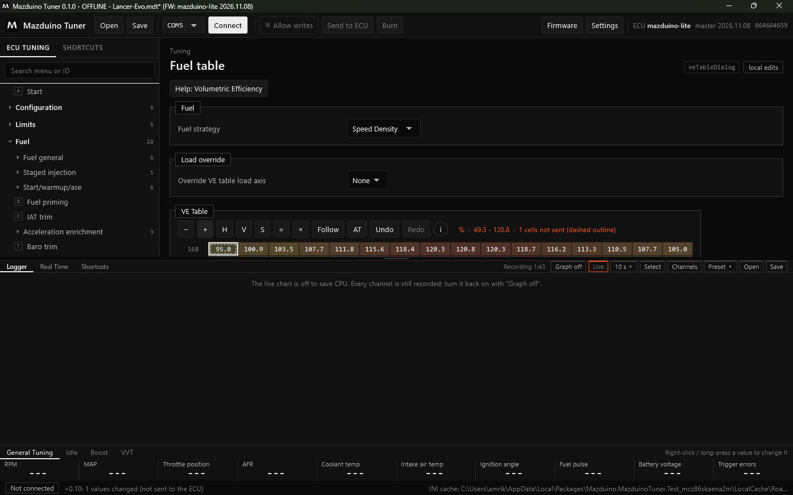
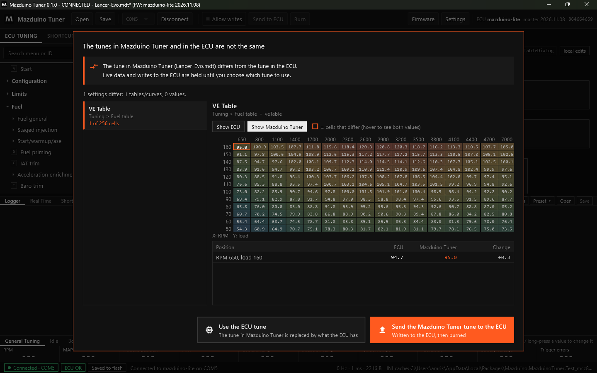
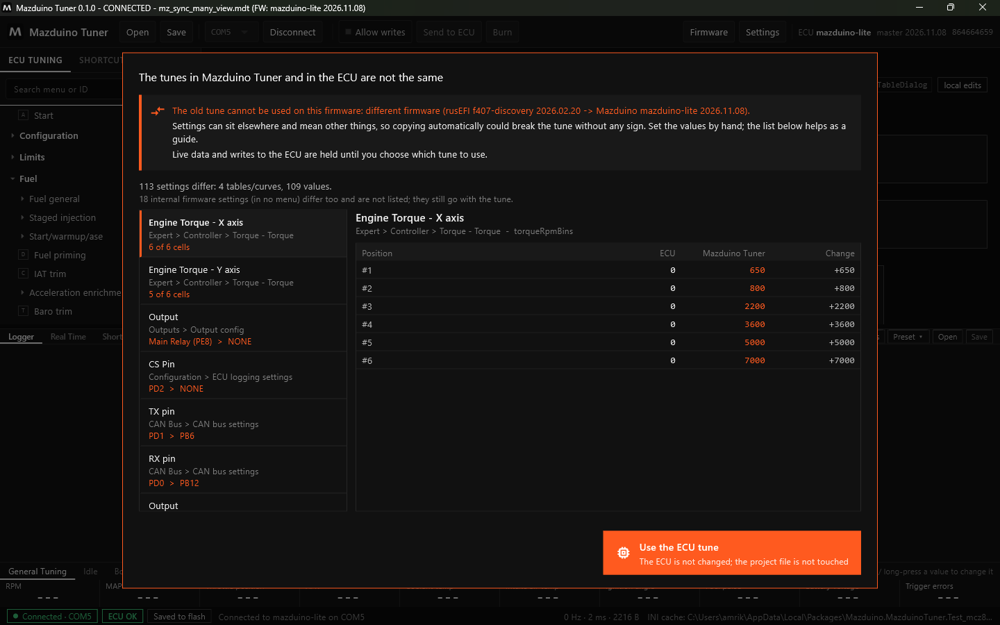
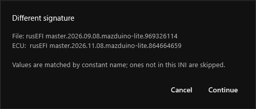
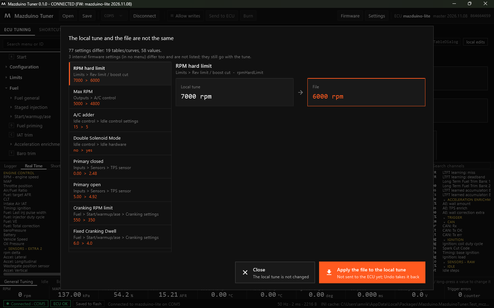
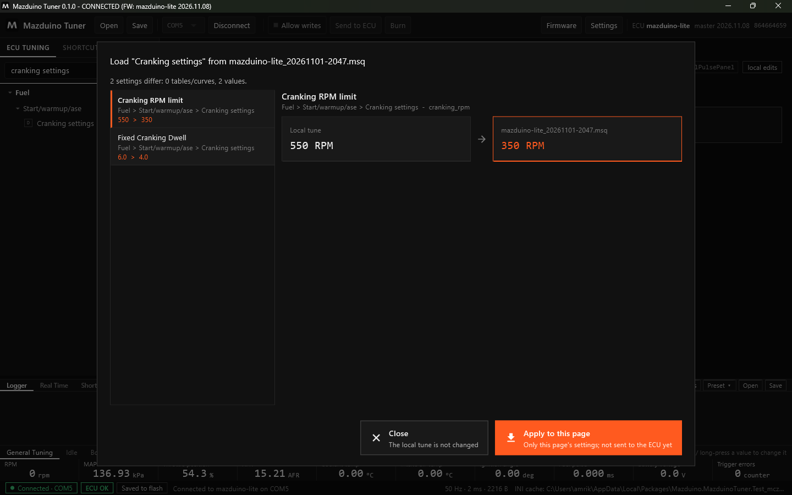

# Proyek dan File Tune di Mazduino Tuner

Mazduino Tuner menyimpan tune dalam **proyek `.mdt`**. Untuk bertukar tune dengan TunerStudio,
aplikasi juga bisa membuka, menyimpan, dan membandingkan file **`.msq`**.

## Proyek `.mdt`

File `.mdt` menyimpan:

- semua nilai tune persis seperti di ECU (tanpa pembulatan)
- signature firmware tempat tune itu dibuat
- definisi firmware (INI), sehingga proyek bisa dibuka di komputer mana pun tanpa internet

### Menyimpan Proyek

1. Klik **Save** di toolbar (atau Ctrl+S).
2. Pertama kali, pilih folder dan nama file, misalnya `Lancer-Evo.mdt`.
3. Berikutnya **Save** langsung menimpa file yang sama. **Shift+klik Save** untuk menyimpan sebagai
   file baru.

Nama proyek tampil di judul jendela. Tanda `*` berarti ada perubahan yang belum disimpan.

### Membuka dan Mengedit Proyek Tanpa ECU

Klik **Open**, pilih file `.mdt`. Tanpa ECU, proyek terbuka **OFFLINE** dan semua halaman bisa
dilihat dan diedit seperti biasa:

Jangan lupa **Save** setelah mengedit.

## Tune di Mazduino Tuner Berbeda dengan ECU

Saat ECU dihubungkan dan proyek sedang terbuka, aplikasi membandingkan tune proyek dengan tune di
ECU. Jika berbeda, muncul dialog berikut. **Data live dan penulisan ke ECU ditahan** sampai Anda
memilih.

Isi dialog:

- **Daftar kiri**: setiap pengaturan yang berbeda dengan nama dan letaknya di menu, misalnya
  *VE Table — Tuning > Fuel table — 1 of 256 cells*.
- **Detail kanan**:
    - **Tabel**: grid dengan sel yang berbeda diberi kotak oranye. Pilih **Show ECU** atau
      **Show Mazduino Tuner** untuk melihat nilai dari masing-masing sisi. Di bawahnya ada daftar
      sel yang berbeda: posisi (RPM, beban), nilai ECU, nilai Mazduino Tuner, dan selisihnya.
    - **Kurva**: semua titik dengan baris yang berbeda ditandai.
    - **Nilai tunggal**: nilai ECU dan nilai Mazduino Tuner berdampingan.
- **Pilihan**:
    - **Use the ECU tune** — tune di Mazduino Tuner diganti dengan isi ECU. Tidak ada yang ditulis
      ke ECU.
    - **Send the Mazduino Tuner tune to the ECU** — tune proyek ditulis ke ECU lalu di-burn.

Pengaturan internal firmware yang tidak ada di menu (misalnya tanggal build firmware) tidak
ditampilkan di daftar, hanya disebut jumlahnya. Jika hanya itu yang berbeda, dialog tidak muncul.

### Proyek dari Firmware Lain

Setiap update firmware rusEFI bisa **memindahkan posisi pengaturan** di memori ECU. Jika tune lama
disalin mentah ke firmware baru, nilainya bisa masuk ke pengaturan yang salah tanpa terlihat.
Karena itu Mazduino Tuner memindahkan tune **berdasarkan nama pengaturan**, dan hanya jika aman:

| Proyek dibuat dengan | ECU memakai | Yang terjadi |
|---|---|---|
| Firmware sama | Firmware sama | Dibandingkan langsung |
| Mazduino, board sama, tanggal lain (misalnya mazduino-lite 2026-08-17) | Mazduino, board sama (misalnya mazduino-lite 2026-11-08) | Dibandingkan dan dikirim **berdasarkan nama**; aman walau posisinya bergeser |
| Board lain, epicEFI, rusEFI official, atau firmware lain | Firmware Mazduino | **Peringatan**: tune lama tidak bisa dipakai, samakan secara manual |

Untuk firmware yang berbeda, daftar perbedaan tetap ditampilkan sebagai **panduan** untuk
menyamakan nilai secara manual, tetapi hanya ada pilihan **Use the ECU tune**. File proyeknya
tidak diubah.

!!! note "Banyak Mazduino Lite memakai firmware rusEFI f407-discovery"
    ECU Mazduino Lite yang sebelumnya memakai firmware rusEFI `f407-discovery` termasuk "firmware
    lain" saat dipindah ke firmware Mazduino `mazduino-lite`. Simpan tune lama sebagai `.msq`,
    lalu samakan pengaturan secara manual dengan bantuan **Compare**.

## File TunerStudio (`.msq`)

Buka **Settings**, bagian **TunerStudio tune file (.msq)**:

| Tombol | Fungsi |
|---|---|
| **Import** | Memuat file `.msq` ke tune lokal. Belum dikirim ke ECU; bisa dibatalkan dengan Undo. |
| **Export** | Menyimpan tune lokal sebagai `.msq` (termasuk perubahan yang belum dikirim) |
| **Compare** | Membandingkan tune lokal dengan file `.msq` |

Nilai dicocokkan berdasarkan nama pengaturan. Jika signature file berbeda tetapi masih firmware
Mazduino dengan board yang sama, aplikasi meminta konfirmasi dulu:

Hasil **Compare** memakai tampilan yang sama dengan dialog di atas:

- **Close** — tune lokal tidak diubah.
- **Apply the file to the local tune** — nilai dari file diterapkan ke tune lokal. Belum dikirim ke
  ECU; kirim dengan **Send to ECU** dan simpan dengan **Burn**.

Untuk file dari firmware lain, **Import** ditolak dengan peringatan, sedangkan **Compare** tetap
bisa dipakai sebagai panduan (tanpa tombol Apply).

## Memuat Satu Halaman dari File

Untuk mengambil pengaturan **satu halaman saja** dari tune lain (misalnya cranking dari tune mobil
lain), klik kanan halaman itu di menu, lalu pilih **Load this page from another file...** dan pilih
file `.mdt` atau `.msq`.

- Hanya pengaturan di halaman itu yang dibandingkan, dengan tampilan yang sama seperti di atas.
- **Apply to this page** menerapkan nilai dari file ke tune lokal. Belum dikirim ke ECU: kirim
  dengan **Send to ECU** dan simpan dengan **Burn**, atau batalkan dengan **Ctrl+Z**.
- Aturan firmware yang sama berlaku: file dari firmware lain hanya ditampilkan sebagai panduan.
