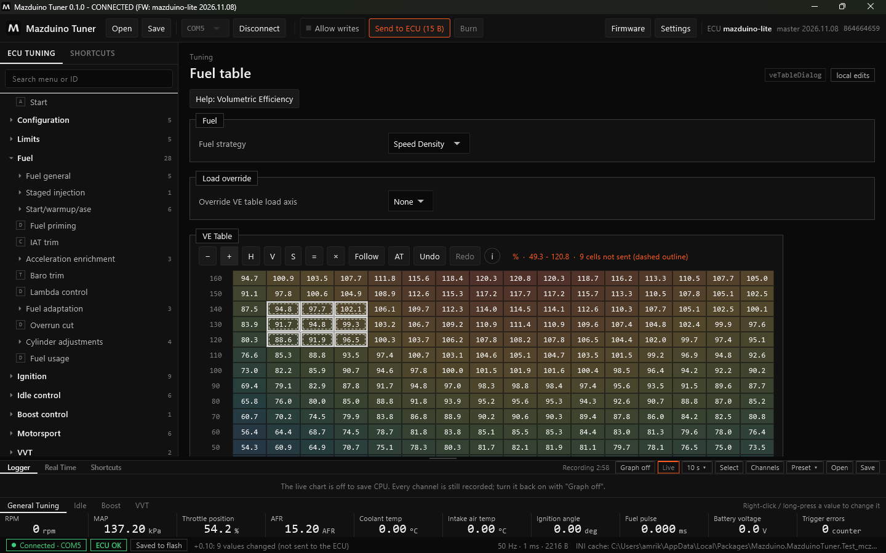
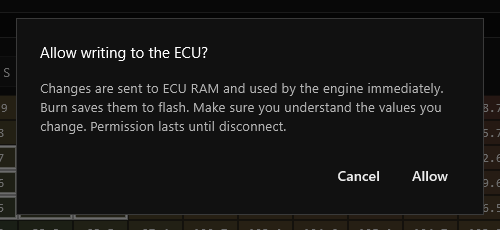
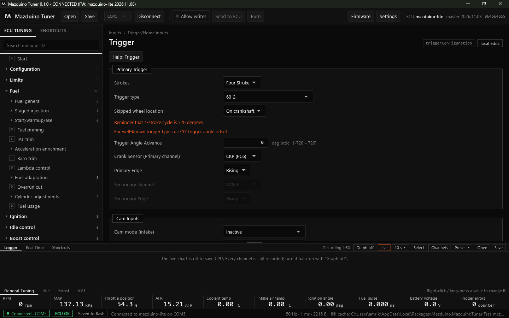
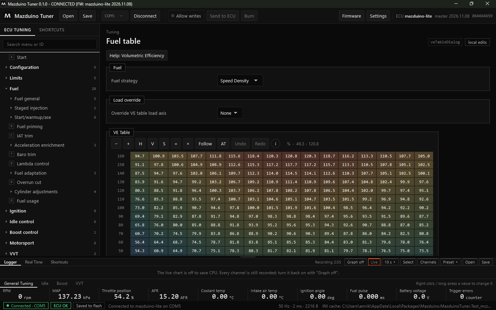
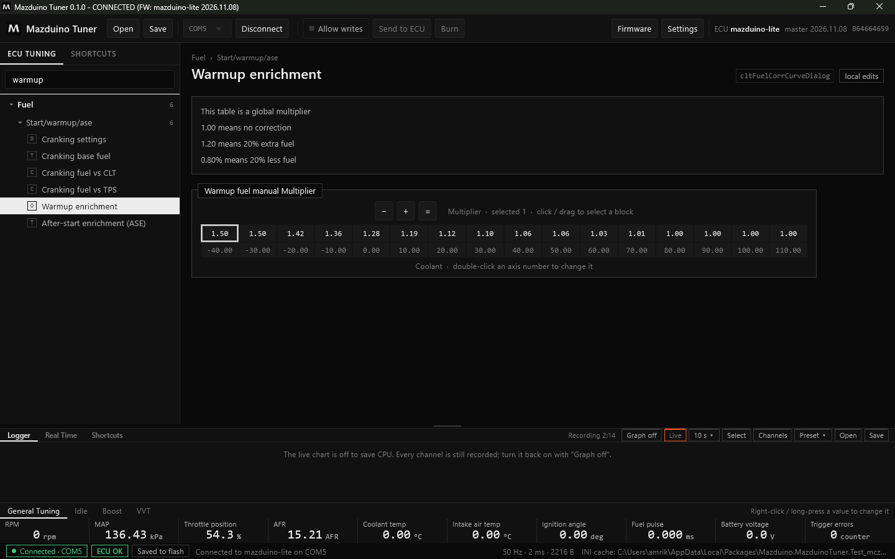

# Mengubah Tune di Mazduino Tuner

Halaman ini menjelaskan cara mengubah pengaturan, tabel, dan kurva, lalu mengirim dan menyimpan
perubahan ke ECU.

## Alur Perubahan: Lokal, RAM ECU, Flash

Setiap perubahan melewati tiga tahap:

1. **Lokal** — perubahan baru ada di aplikasi. Sel yang berubah diberi **garis putus-putus**, dan
   tertulis jumlah sel yang belum dikirim.
2. **RAM ECU** — perubahan dikirim ke ECU dan langsung dipakai mesin, tetapi hilang jika ECU mati.
3. **Flash** — perubahan disimpan permanen dengan **Burn**.

Secara default aplikasi **tidak boleh menulis** ke ECU. Selama itu, semua edit hanya lokal dan
aman untuk dicoba.

Pada contoh di atas sembilan sel dinaikkan. Sel-selnya bergaris putus-putus, tertulis
**9 cells not sent**, dan tombol **Send to ECU (15 B)** menyala. Klik **Undo** (Ctrl+Z) untuk
membatalkan.

### Allow writes

Klik **Allow writes** di toolbar untuk mengizinkan aplikasi menulis ke ECU. Aplikasi meminta
konfirmasi:

Setelah diizinkan, tombol berwarna oranye dan label halaman berubah menjadi **writes allowed**:

Selama Allow writes aktif:

- Setiap edit langsung dikirim ke **RAM ECU** dan langsung dipakai mesin.
- **Send to ECU** mengirim perubahan yang tertunda (misalnya yang dibuat sebelum Allow writes
  dinyalakan).
- **Burn** (Ctrl+B) menyimpan ke flash. Status bar menampilkan **Saved to flash** jika semua sudah
  tersimpan.

Izin ini hanya berlaku sampai disconnect. Klik **Allow writes** lagi untuk mematikannya.

!!! warning "Perhatikan kondisi mesin"
    Dengan Allow writes aktif, perubahan langsung dipakai mesin. Pastikan Anda memahami nilai yang
    diubah, terutama saat mesin menyala.

## Halaman Pengaturan

Halaman pengaturan (ikon **D** di menu) berisi kolom isian, pilihan, dan catatan dari firmware.
Contoh halaman **Trigger** (tombol F11):

- Kolom angka menampilkan satuan dan batas nilai, misalnya `deg btdc [-720 – 720]`.
- Teks oranye adalah catatan penting dari firmware.
- Kolom abu-abu sedang tidak berlaku untuk pengaturan saat ini (misalnya Secondary channel saat
  tidak ada sensor kedua).
- Tombol **Help** membuka penjelasan halaman.

## Tabel

Contoh halaman **Fuel table** (F5) dengan **VE Table**:

Sumbu X di atas (biasanya RPM) dan sumbu Y di kiri (beban: MAP, TPS, dan lain-lain, sesuai mode).
Warna sel menunjukkan besar kecilnya nilai.

**Memilih sel**: klik sel, atau klik lalu tarik untuk memilih blok.

| Tombol | Keyboard | Fungsi |
|---|---|---|
| **−** / **+** | Q / W (atau − / +) | Turunkan / naikkan sel terpilih satu langkah. Dengan Shift: 10 langkah. |
| **H** / **V** | H / V | Interpolasi horizontal / vertikal di antara sel tepi |
| **S** | S | Smooth (haluskan) blok terpilih |
| **=** | = / Enter | Isi semua sel terpilih dengan satu nilai |
| **×** | M | Kalikan sel terpilih (misalnya `*1.05` = +5%) |
| angka | ketik angka | Ketik nilai untuk sel terpilih |
| **Follow** | Space | Pilihan mengikuti sel yang sedang dipakai mesin (RPM × beban) |
| **AT** | | Panel VE autotune |
| **Undo / Redo** | Ctrl+Z / Ctrl+Y | Batalkan / ulangi perubahan |
| **i** | | Tampilkan ringkasan tombol dan shortcut tabel |

Saat ECU terhubung, sel yang sedang dipakai mesin ditandai di tabel.

### VE Autotune

Tombol **AT** di tabel VE membuka panel autotune. Panel ini mengusulkan koreksi VE dari lambda
terukur dibanding target, sel per sel. **Ctrl+T** menerapkan koreksi pada sel di posisi mesin.
Jika Allow writes mati, koreksi hanya mengubah tune lokal dan bisa dikirim ke ECU nanti. Saat
autotune berjalan, status bar menampilkan penandanya.

## Kurva

Kurva (ikon **C** di menu) berupa satu baris nilai dengan sumbunya di bawah. Contoh **Warmup
enrichment**:

- Klik atau tarik untuk memilih titik, lalu pakai **−**, **+**, atau **=** seperti pada tabel.
- **Klik dua kali** angka sumbu untuk mengubah titik sumbu.

## Shortcut Halaman

| Tombol | Halaman |
|---|---|
| F5 | Fuel table (VE) |
| F6 | Tabel target AFR / Lambda |
| F7 | Ignition table |
| F11 | Trigger |

Daftar lengkap ada di tab **Shortcuts** di panel bawah. Lihat
[Logger dan Real Time](mazduino-tuner-logger.md#shortcuts).
