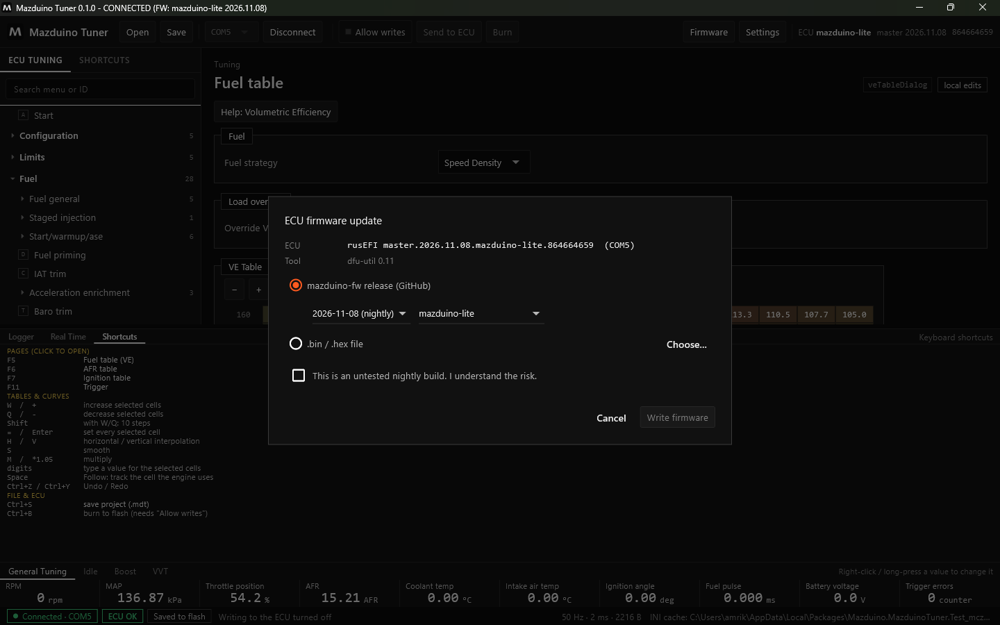

# Update Firmware dengan Mazduino Tuner

Firmware ECU Mazduino bisa diupdate langsung dari Mazduino Tuner lewat kabel USB, tanpa jumper
BOOT0 dan tanpa software lain.

## Sebelum Mulai

- **Mesin harus mati.** Update ditolak jika RPM terbaca.
- Jangan cabut USB atau mematikan ECU selama proses (sekitar 1 menit).
- Tune saat ini otomatis disimpan sebagai `.msq` sebelum update, di
  `%APPDATA%\MazduinoTuner\Firmware backups`. Tetap disarankan menyimpan proyek `.mdt` sendiri.

## Langkah Update

1. Hubungkan ECU dan klik **Connect**.
2. Klik **Firmware** di toolbar.

    

3. Pilih sumber firmware:
    - **mazduino-fw release (GitHub)** — pilih tanggal rilis dan board. Board terisi otomatis dari
      ECU yang terhubung.
    - **.bin / .hex file** — klik **Choose...** untuk memilih file sendiri. Karena tidak ada yang
      memastikan file itu untuk board Anda, centang konfirmasi **I am sure this firmware is for
      this ECU**.
4. Untuk rilis **nightly**, centang **This is an untested nightly build. I understand the risk**.
5. Klik **Write firmware**, baca ringkasannya, lalu konfirmasi.

Aplikasi lalu:

1. menyimpan tune lama sebagai `.msq`
2. mengirim ECU ke mode bootloader (DFU)
3. memasang **driver USB bootloader** jika belum ada (Windows meminta izin sekali)
4. menghapus dan menulis flash, dengan progres di dialog
5. menunggu ECU kembali dan menghubungkannya lagi

Selesai jika tertulis **Done. The ECU runs ...** dengan signature firmware baru.

## Memeriksa Tune Setelah Update

Firmware baru bisa **mengembalikan tune ke nilai bawaan** atau **menggeser posisi pengaturan**.
Karena itu, setelah update Mazduino Tuner langsung membandingkan isi ECU dengan tune sebelum update,
berdasarkan nama pengaturan.

- Jika semua pengaturan yang tampil di menu sama, tidak ada pertanyaan.
- Jika berbeda, muncul dialog **The tune after the firmware update** dengan daftar perbedaan
  (tampilannya sama seperti [dialog perbandingan tune](mazduino-tuner-proyek.md#tune-di-mazduino-tuner-berbeda-dengan-ecu)).

Untuk **firmware Mazduino dengan board yang sama** (hanya tanggalnya berbeda) dialog juga
menampilkan ringkasan posisi pengaturan:

| Ringkasan | Arti |
|---|---|
| **pindah posisi** | Dibawa otomatis berdasarkan nama, tidak perlu diubah |
| **pengaturan baru** | Memakai nilai bawaan firmware baru, periksa nilainya |
| **berubah bentuk** | Ukuran atau tipe berubah (misalnya ukuran tabel), sesuaikan secara manual |
| **dihapus** | Tidak ada lagi di firmware baru, diabaikan |

Pilihan:

- **Keep what the ECU has now** — memakai isi ECU apa adanya.
- **Restore the tune from before the update** — tune lama dipindah berdasarkan nama ke firmware
  baru, lalu di-burn.

Untuk **firmware lain** (board lain, rusEFI official, epicEFI), dialog hanya memberi peringatan
bahwa tune lama tidak bisa dipakai dan harus disamakan secara manual. Backup `.msq` tetap tersedia
sebagai panduan lewat **Compare**.

!!! example "Contoh nyata"
    Update Mazduino Lite dari firmware 2026-06-22 ke 2026-11-08: firmware baru mengembalikan tune
    ke nilai bawaan (VE, cranking, trigger offset berubah). Hampir 2000 pengaturan pindah posisi.
    Dengan **Restore the tune from before the update** semua nilai kembali ke pengaturan yang
    benar.

## Jika Update Gagal

| Masalah | Solusi |
|---|---|
| **ECU tidak muncul dalam mode DFU** | Masuk DFU manual: tahan BOOT0, cabut-colok USB, lepas BOOT0, lalu ulangi update |
| Izin Windows untuk driver ditolak | Ulangi update dan setujui izin Windows |
| ECU tidak terhubung lagi setelah update | Cek port di toolbar, lalu klik **Connect** |
| Mesin menyala | Matikan mesin dulu |

Detail setiap update tercatat di `%APPDATA%\MazduinoTuner\firmware-update.log`. Sertakan file ini
saat melaporkan masalah.
