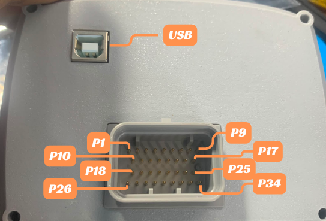

# Mazduino X600

## Overview

The Mazduino X600 is an ECU with an **integrated 4.3 inch display**: **dash and ECU in one unit**, so no separate dash display is needed to monitor engine data in real time. It runs **rusEFI**-based firmware and is configured and tuned with **TunerStudio**.

It connects to a computer over **USB Type B**, and to the engine harness through a **34-pin connector**. With 6 ignition outputs, 12 low side outputs, a combination of Hall (Digital) and VR inputs, and analog inputs for voltage and temperature sensors, the X600 supports engines with up to **6 cylinders**.

This documentation is based on the Mazduino X600 product specification and the hardware pinout reference in the X600 manual.

## Key Features

- **Integrated 4.3 inch display**: dash and ECU in one unit, showing RPM, sensor data and engine status in real time (display-only; all tuning is done in TunerStudio)
- **rusEFI based** firmware
- Connects to a computer via **USB Type B** for tuning with **TunerStudio**
- **34-pin connector** for wiring to the engine harness
- **6x ignition outputs** (IGN1–IGN6; IGN5/IGN6 share their lines with High Side 1/2)
- **2x High Side outputs** (HS1, HS2) for 12V switched loads (via the jumper option on IGN5/IGN6)
- **12x low side outputs** (LS1–LS12) for injectors, idle PWM, boost, VVT, relays and other actuators
- **4x Analog Volt inputs** (AV1–AV4) for MAP, TPS, O2/wideband, PPS or pressure sensors (0–5V)
- **4x Analog Temp inputs** (AT1, AT2, AT3, AT6) for CLT, IAT and other temperature sensors
- **2x Digital/Hall inputs** (Digital 1, Digital 2) for CKP/CMP, VSS or switches
- **2x VR inputs** (VR1, VR2) for variable reluctor CKP/CMP sensors (sharing lines with Digital/Analog Temp via a **jumper option**)
- **TACH output** for the RPM signal to a tachometer
- Built-in **5V sensor supply** as the reference for 5V sensors

## Wiring and Installation

The X600 uses the **34-pin connector** for all connections to the engine harness, and a separate **USB Type B** port for the tuning connection to a computer.



*Pin positions on the 34-pin connector and the USB Type B port.*

### 34-pin Connector Layout

```
P1   P2   P3   P4   P5   P6   P7   P8   P9
P10  P11  P12  P13  P14  P15  P16  P17
P18  P19  P20  P21  P22  P23  P24  P25
P26  P27  P28  P29  P30  P31  P32  P33  P34
```

### 34-pin Connector Pin Assignment

| Pin | Function | Description |
|-----|--------|------------|
| P1 | 12V | 12V ECU power supply |
| P2 | IGN6 / HS2 | Ignition 6 or High Side 2 (12V switching), jumper option |
| P3 | IGN5 / HS1 | Ignition 5 or High Side 1 (12V switching), jumper option |
| P4 | IGN2 | Ignition 2 |
| P5 | TACH | Tacho signal output (RPM) |
| P6 | AT6 / VR1- | Analog Temp 6 or VR1- (VR1 negative input), jumper option |
| P7 | AT3 / VR2- | Analog Temp 3 or VR2- (VR2 negative input), jumper option |
| P8 | AT2 | Analog Temp 2 |
| P9 | AT1 | Analog Temp 1 |
| P10 | GND | Power ground (ECU power ground) |
| P11 | IGN4 | Ignition 4 |
| P12 | IGN3 | Ignition 3 |
| P13 | IGN1 | Ignition 1 |
| P14 | AV1 | Analog Volt 1 (0–5V input) |
| P15 | AV2 | Analog Volt 2 (0–5V input) |
| P16 | AV3 | Analog Volt 3 (0–5V input) |
| P17 | AV4 | Analog Volt 4 (0–5V input) |
| P18 | LS2 | Low Side 2 |
| P19 | LS1 | Low Side 1 |
| P20 | DIGITAL1 / VR1+ | Digital 1 (Hall) or VR1+ (VR1 positive input), jumper option |
| P21 | DIGITAL2 / VR2+ | Digital 2 (Hall) or VR2+ (VR2 positive input), jumper option |
| P22 | GND | Sensor ground |
| P23 | GND | Sensor ground |
| P24 | 5V SENSOR | 5V sensor supply |
| P25 | LS12 | Low Side 12 |
| P26 | LS4 | Low Side 4 |
| P27 | LS3 | Low Side 3 |
| P28 | LS6 | Low Side 6 |
| P29 | LS5 | Low Side 5 |
| P30 | LS8 | Low Side 8 |
| P31 | LS7 | Low Side 7 |
| P32 | LS9 | Low Side 9 |
| P33 | LS10 | Low Side 10 |
| P34 | LS11 | Low Side 11 |

### Shared Lines (Jumper Option)

Some pins have two functions, selected with a **jumper**. The jumper configuration can be **specified when you first order** (chosen to suit your engine) or **changed yourself** by setting the jumpers on the board. Always switch off ECU power before changing the jumper configuration.

- **P2 (IGN6 / HS2)** and **P3 (IGN5 / HS1)**: can be configured as **ignition** outputs (IGN5/IGN6) or as **High Side** outputs (HS1/HS2) for 12V switched loads, for example alternator control or a 12V solenoid.
- **P6 (AT6 / VR1-)** and **P20 (DIGITAL1 / VR1+)**: the line pair for **VR1**. Select VR (VR1+ and VR1-) for a variable reluctor CKP/CMP sensor, or Analog Temp 6 + Digital 1 (Hall) for Hall/temperature sensors.
- **P7 (AT3 / VR2-)** and **P21 (DIGITAL2 / VR2+)**: the line pair for **VR2**, configured the same way as VR1.

> **Note:** The functions of the pins above are set by the jumper positions. Make sure the jumper configuration matches your wiring and the type of sensor/actuator used. If in doubt, specify the configuration when ordering.

## I/O Count Summary

| Group | Count | Description |
|----------|--------|------------|
| Ignition Output | 6 | IGN1–IGN6 (IGN5/IGN6 share lines with HS1/HS2) |
| High Side | 2 | HS1, HS2 for 12V switching (via the IGN5/IGN6 lines) |
| Low Side | 12 | LS1–LS12 for injectors and actuators |
| Analog Volt Input | 4 | AV1–AV4 (0–5V) |
| Analog Temp Input | 4 | AT1, AT2, AT3, AT6 |
| Digital/Hall Input | 2 | Digital 1, Digital 2 (share lines with VR+) |
| VR Input | 2 | VR1 (+/-), VR2 (+/-) |
| Tacho Output | 1 | TACH |
| 5V Sensor Supply | 1 | 5V sensor reference |

## Firmware Function Mapping

Below is a typical function mapping for the firmware setup. The assignments can be adjusted to suit the engine and the tuning strategy.

| Typical Function | Default Line |
|------------|---------------|
| Ignition 1–6 | IGN1 to IGN6 |
| Injector | Low Side (LS1 onward) |
| Main Relay / Fuel Pump / Fan / AC / Idle | Low Side (LS lines not used for injectors) |
| MAP / TPS / O2 / PPS / Pressure sensor | Analog Volt 1–4 |
| CLT / IAT / Additional temp | Analog Temp (AT1, AT2, AT3, AT6) |
| CKP / CMP Hall | Digital 1 and Digital 2 |
| CKP / CMP VR | VR1 and VR2 (via shared lines) |
| Tacho | TACH |

## Example I/O Usage Scenarios

The Low Side, Analog Volt and Analog Temp lines are generic, so how they are allocated depends on the engine configuration. Some example scenarios:

- **6-cylinder full sequential engine**: use IGN1–IGN6 for COP/individual ignition, and 6 Low Side lines for sequential injectors. The remaining Low Side lines (LS7–LS12) are free for idle PWM, boost solenoid, VVT, fuel pump, fan or other actuators.
- **4-cylinder engine**: use 4 ignition channels and 4 Low Side lines for injectors, and the rest for actuators and relays. The IGN5/IGN6 lines can be switched to High Side (HS1/HS2) for 12V switching.
- **VR trigger**: for variable reluctor CKP/CMP sensors, use the VR1 (P6 + P20) and VR2 (P7 + P21) lines.
- **Hall trigger**: for Hall CKP/CMP sensors, use Digital 1 (P20) and Digital 2 (P21).
- **Analog Volt**: inputs for 0–5V analog sensors such as MAP, TPS, O2/wideband, PPS or pressure sensors.
- **Analog Temp**: inputs for temperature sensors such as CLT (Coolant Temp) and IAT (Intake Air Temp).

## Integrated 4.3 inch Display

The X600 has a **4.3 inch** display built into the ECU that shows engine data in real time (RPM, sensor data and status), so no separate dash display is needed. The display is **display-only**: all configuration and tuning is done in **TunerStudio**, not through on-screen menus.

## Tuning Software

The X600 is configured and tuned with **TunerStudio** over a **USB Type B** connection to a computer.

1. Connect the X600 to the computer with a **USB Type B** cable.
2. Open **TunerStudio**, select the matching port, then connect to the ECU.
3. Use the configuration file (firmware/definition) made for the **Mazduino X600** so that every pin works as the board was designed.
4. Check the outputs with test mode in TunerStudio before starting the engine.

## Quick Installation Guide

1. Make sure the **power ground** (P10) and **sensor ground** (P22, P23) are properly connected.
2. Connect P1 to a stable 12V ECU supply.
3. Choose **Hall (Digital)** or **VR** trigger mode to match the CKP/CMP sensor type, then wire it to the matching shared lines.
4. Decide whether the IGN5/IGN6 lines are used as ignition or High Side, as needed.
5. Connect 5V sensors to the 5V Sensor Supply line (P24) and the temperature/voltage sensors to the matching Analog lines.
6. Connect the X600 to the computer via USB Type B and verify the outputs with test mode in TunerStudio before starting the engine.

## Important Notes

- The 4.3 inch display is **display-only**; all tuning is done in TunerStudio.
- The ignition outputs are meant for **smart coils**. Dumb coils require an external driver/IGBT.
- **HS1 and HS2** (the IGN5/IGN6 lines) can be used as **12V switching** outputs, for example for alternator control.
- The VR lines (VR1/VR2) share pins with Digital and Analog Temp: make sure only one function is wired per pin pair.
- The firmware for this board is based on **rusEFI**. Use the X600-specific definition/firmware.

## References

- Mazduino website - [https://www.mazduino.com/](https://www.mazduino.com/)
- Mazduino Wiki - [https://wiki.mazduino.com/](https://wiki.mazduino.com/)
- Download TunerStudio - [https://www.tunerstudio.com/index.php/downloads](https://www.tunerstudio.com/index.php/downloads)
- rusEFI firmware reference - [https://wiki.rusefi.com](https://wiki.rusefi.com)
